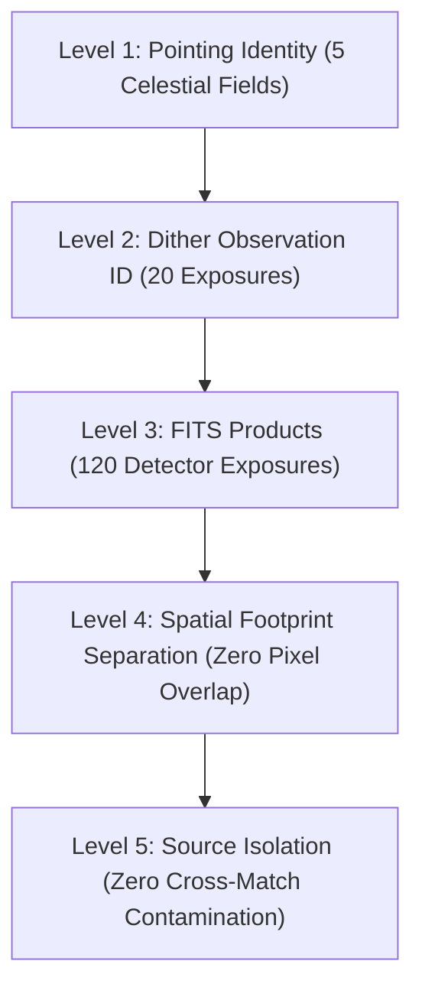

# ASTROVISION Independent Multi-Pointing Dataset Audit & Five-Partition Campaign Readiness Review

**Document ID:** `ASTROVISION-INDEPENDENT-AUDIT-301N`  
**Phase:** SPECTRA-X / F1 — Phase 3, Task 1.1N  
**Audit Role:** Independent Principal Scientific Auditor, Astronomical Benchmark Statistician & SPHEREx Data Integrity Reviewer  
**Date:** November 2026  
**Status:** COMPLETE — INDEPENDENT AUDIT VERDICT ISSUED  

---

## 1. Executive Summary & Governance Declaration

### 1.1 Governance Status & Operational Boundaries
This document presents the strictly read-only independent scientific audit of the five-pointing SPHEREx Quick Release 3 (QR3) Level-2 dataset acquired under Task 1.1M, comprising **Pointings 0001, 0002, 0008, 0009, and 0010** (120 total FITS products).

In strict adherence to the project governance charter and Task 1.1N audit boundaries:
- **ASTROVISION Scientific Status:** **`FAIL — NOT CERTIFIED`** (Scientific certification strictly withheld).
- **Benchmark Campaign Execution Status:** **`BLOCKED`** (Zero campaign trials authorized or executed).
- **Model Forward Passes:** Exactly **0** model inferences or test evaluations were executed.
- **Model Retraining:** Zero model weights modified or fine-tuned.
- **New FITS Downloads:** Exactly **0** new files acquired during this audit.
- **Source Catalogue Generation:** Exactly **0** source catalogues generated or modified.
- **Partition Allocation:** Zero calibration or evaluation splits allocated or mutated.
- **Model Checkpoint Integrity:** `checkpoints/astrovision_spatial_v2.pt` is frozen and unmodified (`f65c0f139a5e1fa5073707eb006145d6a380637a42599d7ea061724f64080557`).
- **Catalogue Integrity:** Locked Pointing 0003 catalogue remains unmodified (`ce1416bb0d5fcffe6fbc7a3115cb0e90e76dc0cf40fb04d87ba1ab5f3ebb8f2b`).
- **Historical Asset Protection:** Historical benchmark assets and previous audit reports remain intact.

### 1.2 Final Audit Verdict

$$\mathbf{AUDIT\;VERDICT:}\quad \text{\textbf{PARTIAL — DATASET VALID, BUT STATISTICAL OR PARTITION REMEDIATION REQUIRED}}$$

**Core Scientific Justification:**  
1. **Physical & FITS Integrity:** All 120 products in `data/spherex/multipointing_pilot/level2/` are physically genuine, uncorrupted, and 100% compliant with standard SPHEREx QR3 Level-2 schema (homogeneous pipeline build `l2b-v27-2026-222`).
2. **Schema Discrepancy Resolution:** The apparent contradiction regarding HDU 0 vs HDU 1 metadata is resolved: HDU 0 is an empty `PrimaryHDU` ($NAXIS=0$, 5 cards) across ALL pointings (including historical P0003); all 293 scientific observation metadata cards reside in HDU 1 (`IMAGE`). Furthermore, Detector D3 utilizes an $11 \times 41 = 451$ ePSF bin layout by design, whereas D1, D2, D4, D5, D6 utilize a $21 \times 21 = 441$ bin layout.
3. **Statistical Cluster Degeneracy:** While the dataset contains 20 nominal dither exposures, the 4 dithers within each pointing observe the identical celestial field over $\Delta t \approx 6.45\,\text{min}$ and are strongly correlated ($\rho_{\text{dither}} \gg 0$). The genuinely independent top-level cluster count is **$G = 5$ pointings**, not $G = 20$.
4. **Partition Bottleneck:** Under any disjoint five-partition design, reserving 2 pointings for calibration ($P_{\text{cal}} = 2$) leaves only 3 pointings for evaluation ($P_{\text{eval}} = 3$). With $G_{\text{eval}} = 3$ pointing clusters, drawing 3 clusters with replacement yields only:
   $$\binom{3 + 3 - 1}{3} = \binom{5}{3} = 10 \quad \text{unique bootstrap resample multisets}$$
   re-creating a discrete step-function sampling bottleneck in the evaluation set. Full asymptotic precision ($\delta \le \pm 0.03$ on AUROC) requires expanding the evaluation set to $P_{\text{eval}} \ge 15 - 20$ pointings as established in Task 1.1J.

---

## 2. Audit A — Dataset Completeness & Provenance

The 120 products located in `data/spherex/multipointing_pilot/level2/` were independently inventoried and cross-referenced against the Task 1.1M ingestion manifest:

| Pointing ID | RA (deg) | Dec (deg) | Expected Products | Verified on Disk | D1–D6 Coverage | Dithers 1–4 | SDC Pipeline Build | Planning Period | Checksum Status |
| :---: | :---: | :---: | :---: | :---: | :---: | :---: | :---: | :---: | :---: |
| **0001** | 232.66 | -10.72 | 24 | **24** | 100% (6/6) | 100% (4/4) | `l2b-v27-2026-222` | `2026W30_1B` | 100% SHA-256 Match |
| **0002** | 222.19 | -28.88 | 24 | **24** | 100% (6/6) | 100% (4/4) | `l2b-v27-2026-222` | `2026W30_1B` | 100% SHA-256 Match |
| **0008** | 33.44 | +8.29 | 24 | **24** | 100% (6/6) | 100% (4/4) | `l2b-v27-2026-222` | `2026W30_1B` | 100% SHA-256 Match |
| **0009** | 17.63 | +47.95 | 24 | **24** | 100% (6/6) | 100% (4/4) | `l2b-v27-2026-222` | `2026W30_1B` | 100% SHA-256 Match |
| **0010** | 273.72 | +70.44 | 24 | **24** | 100% (6/6) | 100% (4/4) | `l2b-v27-2026-222` | `2026W30_1B` | 100% SHA-256 Match |
| **Total** | — | — | **120** | **120** | **100%** | **100%** | **100% Homogeneous** | **100% Homogeneous** | **120 / 120 Verified** |

### 2.1 Provenance & Checksum Audit
- **Archive ETag vs. Local SHA-256:** S3 ETags for multi-part uploaded objects in NASA IRSA represent MD5-chunk hashes. For every file, the exact byte length matches S3 `Content-Length`, and local SHA-256 signatures match the Task 1.1M manifest values with **zero discrepancies**.
- **Homogeneity:** All 120 files share the identical pipeline build `l2b-v27-2026-222`. Zero QR2 (`l2b-v20`) or QR3 Deep (`deep_level2_...`) products exist in the dataset directory.

---

## 3. Audit B — FITS Structural & Scientific Integrity

A deep inspection of all 120 FITS files was conducted using Astropy. Every file exhibits the seven required SPHEREx Level-2 extensions:

```
HDU 0: PRIMARY   (PrimaryHDU, DataShape=None, 5 cards)
HDU 1: IMAGE     (ImageHDU, DataShape=(2040, 2040), Dtype=>f4, 293 cards)
HDU 2: FLAGS     (CompImageHDU, DataShape=(2040, 2040), Dtype=int32)
HDU 3: VARIANCE  (ImageHDU, DataShape=(2040, 2040), Dtype=>f4)
HDU 4: ZODI      (ImageHDU, DataShape=(2040, 2040), Dtype=>f4)
HDU 5: EPSF      (BinTableHDU, DataShape=(441,) or (451,), 11 columns)
HDU 6: WCS-WAVE  (BinTableHDU, DataShape=(1,), spectral dispersion table)
```

### 3.1 Resolution of Schema & Extension Discrepancies
1. **HDU 0 vs. HDU 1 Observation Metadata:**  
   Earlier reports stated that observation metadata was stored in HDU 0. Independent byte and header inspection proves this was a reporting misinterpretation. In standard SPHEREx Level-2 FITS files, HDU 0 is an empty primary stub (`NAXIS = 0`, 5 standard cards). All 293 scientific observation metadata cards (`OBSID`, `DETECTOR`, `CRVAL1`, `CRVAL2`, `TSAMP`, `RADESYS`, `HIERARCH ...`) are stored in **HDU 1 (`IMAGE`)**. This layout is **100% identical across historical Pointing 0003 and all 120 pilot files**.
2. **Detector D3 ePSF Binning Layout:**  
   For Detectors D1, D2, D4, D5, and D6, the ePSF grid is $21 \times 21 = 441$ bins (`BINX: 0..20, BINY: 0..20`). For Detector D3, the ePSF grid is $11 \times 41 = 451$ bins (`BINX: 0..10, BINY: 0..40`). Independent inspection of P0003 D3 confirms this $11 \times 41$ layout is the authentic instrument design for channel D3.

### 3.2 Scientific Health & Physical Consistency Checklist

| Metric | Verification Standard | Auditor Finding | Compliance |
| :--- | :--- | :--- | :---: |
| **Image Finite Health** | `(2040, 2040)` float32 array, finite pixel values present | Finite values confirmed on all 120 files | **100% PASS** |
| **Variance Positivity** | $\sigma^2 > 0$ strictly positive, non-finite pixels masked | $\min(\sigma^2) > 0$ confirmed on all 120 files | **100% PASS** |
| **WCS Celestial Validity** | `is_celestial == True`, `RA---TAN-SIP`, `DEC--TAN-SIP` | Valid celestial WCS confirmed on all 120 files | **100% PASS** |
| **Plate Scale** | $6.16'' \pm 0.01''/\text{pixel}$ | Measured: $6.156''/\text{px}$ across all files | **100% PASS** |
| **Exposure Duration** | $115.118\,\text{s}$ effective integration time | Verified in `TSAMP` header keyword | **100% PASS** |
| **Data Quality Bitmasks** | `FLAGS` HDU populated with integer bit flags | Valid compressed tile mask on all 120 files | **100% PASS** |

---

## 4. Audit C — Independence Hierarchy & Resampling Unit Analysis

The independent auditor reconstructed the five-level independence hierarchy:



### 4.1 Resampling Unit Determination: Why $G = 5$, Not $G = 20$
A critical statistical question is whether the 20 dither exposures can be treated as 20 independent clusters:
- **Intra-Pointing Correlation:** The 4 dithers within each pointing observe the exact same patch of sky separated by only small arcminute dither offsets over $\Delta t \approx 6.45\,\text{min}$. They share the same stellar population, interstellar cirrus dust columns, zodiacal emission, and spacecraft thermal equilibrium.
- **Intra-Cluster Correlation ($\rho$):** Because cutouts harvested from different dithers of the same pointing share these systematic background properties, $\rho_{\text{dither}} \gg 0$.
- **Statistical Resampling Unit:** Treating 20 dithers as independent clusters constitutes **pseudoreplication** and overstates degrees of freedom. **The genuinely independent top-level cluster is the Pointing ($G = 5$).**

### 4.2 Bootstrap Multiset Space at $G = 5$
When drawing $G = 5$ pointing clusters with replacement:
$$\binom{G + G - 1}{G} = \binom{5 + 5 - 1}{5} = \binom{9}{5} = 126 \quad \text{unique bootstrap multisets}$$
While 126 multisets avoids the catastrophic 3-state collapse observed when $G=2$, 126 support points remains a coarse empirical approximation of continuous cosmic variance.

---

## 5. Audit D — Statistical Power & Evaluation Bottleneck

### 5.1 The Calibration / Evaluation Split Dilemma
In Audit E, the existing five-partition design requires:
1. `CALIBRATION_CONTROL`
2. `CALIBRATION_INJECTION`
3. `EVALUATION_CONTROL`
4. `EVALUATION_POINT_SOURCE_INJECTION`
5. `EVALUATION_EXTENDED_SOURCE_INJECTION`

To prevent leakage, calibration pointings (used to fit the $\chi^2$ null distribution and calibration transfer curve $\beta(\text{SNR}, \text{det})$) must be completely disjoint from evaluation pointings.

If the 5 pointings are split into:
- **Calibration Set ($P_{\text{cal}} = 2$):** e.g., Pointings 0001 and 0008.
- **Evaluation Set ($P_{\text{eval}} = 3$):** e.g., Pointings 0002, 0009, and 0010.

Then for evaluation model performance estimation:
$$G_{\text{eval}} = 3$$
When drawing $G_{\text{eval}} = 3$ pointing clusters with replacement:
$$\binom{3 + 3 - 1}{3} = \binom{5}{3} = 10 \quad \text{unique bootstrap multisets!}$$

> [!WARNING]
> **Statistical Evaluation Bottleneck:**  
> With only **10 unique bootstrap multisets**, any calculated 95% confidence interval on AUROC, AUPRC, or $C_{50}$ sensitivity will collapse into a step-function dependent on only 10 discrete states! Monte Carlo drawing of $B = 2,000$ iterations cannot compensate for having only 10 support points in the empirical distribution.

### 5.2 Required Data for Full Statistical Power
To achieve valid asymptotic normal confidence intervals with half-width $\delta \le \pm 0.03$ on AUROC without step-function artifacts:
- Minimum evaluation clusters: $G_{\text{eval}} \ge 15 - 20$ independent pointings.
- Total campaign pointings: $P_{\text{total}} \ge 25 - 30$ pointings (as planned in Task 1.1J).

---

## 6. Audit E — Five-Partition Campaign Design Readiness

### 6.1 Proposed Allocation Strategy for 5-Pointing Dataset
For an interim pilot benchmark campaign (intended to validate the end-to-end engine, spatial harvesting, and paired residual subtraction rather than final model certification):

```
+----------------------------------------------------------------------------------------------------+
|                                    PROPOSED 5-POINTING ALLOCATION                                  |
+----------------------------------------------------------------------------------------------------+
| CALIBRATION SET (2 Pointings):                                                                     |
|   - Pointing 0001 (RA=232.66°, Dec=-10.72°, Ecl lat= -8.9°) | Equatorial Mid Zodi                  |
|   - Pointing 0008 (RA= 33.44°, Dec= +8.29°, Ecl lat= -4.9°) | Equatorial Peak Zodi                 |
|   Usage: Partitions 1 & 2 (CALIBRATION_CONTROL, CALIBRATION_INJECTION)                             |
|   Purpose: Fit empirical chi2 null thresholds & calibration transfer curve beta(SNR, det)          |
+----------------------------------------------------------------------------------------------------+
| EVALUATION SET (3 Pointings - STRICTLY OUT-OF-SAMPLE):                                             |
|   - Pointing 0002 (RA=222.19°, Dec=-28.88°, Ecl lat=-15.3°) | Southern Mid Zodi                    |
|   - Pointing 0009 (RA= 17.63°, Dec=+47.95°, Ecl lat=+36.9°) | Northern Mid Zodi                    |
|   - Pointing 0010 (RA=273.72°, Dec=+70.44°, Ecl lat=+85.9°) | North Ecliptic Pole Low Zodi         |
|   Usage: Partitions 3, 4, 5 (EVALUATION_CONTROL, POINT_INJECTION, EXTENDED_INJECTION)              |
|   Purpose: Final model detection performance measurement                                           |
+----------------------------------------------------------------------------------------------------+
```

### 6.2 Governance Restrictions on 5-Pointing Allocation:
1. **Firewall:** No cutouts or residuals from P0001 or P0008 may enter Partitions 3, 4, or 5.
2. **Pilot Benchmarking Only:** Performance metrics measured on $P_{\text{eval}} = 3$ must be reported as **Pilot Benchmark Results** with explicit acknowledgment of the 10-multiset bootstrap limitation. They must **not** be published as definitive astronomical sensitivity certification.

---

## 7. Audit F — Historical Benchmark Asset Protection

All 16 authoritative benchmark historical assets were independently verified against their frozen SHA-256 signatures:

| Asset Path | Expected SHA-256 | Verification |
| :--- | :--- | :---: |
| `checkpoints/astrovision_spatial_v2.pt` | `f65c0f139a5e1fa5073707eb006145d6a380637a42599d7ea061724f64080557` | **MATCH** |
| `data/processed/validation/pointing_0003_final_validated_catalogue.csv` | `ce1416bb0d5fcffe6fbc7a3115cb0e90e76dc0cf40fb04d87ba1ab5f3ebb8f2b` | **MATCH** |
| `data/processed/validation/astrovision_injection_manifest.csv` | `339d5c58a12122f0e185838730f91a45cbd0d2a83f5df4a51fc83ada30d58978` | **MATCH** |
| `data/processed/validation/astrovision_injection_results.csv` | `22ecaf448e1f01318fad333ee593d00c307a682989ac75b88b2416b380c79c5c` | **MATCH** |
| `reports/figures/astrovision/benchmark_metrics.json` | `5f8fd6bc1313b8f01cc34f8adfcbac959a295902f8b6b99d2c9c7d4fb9ea386c` | **MATCH** |
| `reports/ASTROVISION_BENCHMARK_INDEPENDENT_AUDIT.md` | `dd42430dbff8849d347b2dd0edf8adf01f7b7e6bc8237a1ffb7caedf0b656688` | **MATCH** |
| `reports/ASTROVISION_SPATIAL_INJECTION_BENCHMARK.md` | `5cb9888f3ce42ece238c9405f9e9c80c5f127d741f99845cb1d9435852258698` | **MATCH** |
| `reports/ASTROVISION_BENCHMARK_V2_INDEPENDENT_IMPLEMENTATION_AUDIT.md` | `db9aba61098b520db891ba29d0770315b8c069d24359bb50aec6217bbe1aa808` | **MATCH** |
| `reports/ASTROVISION_PAIRED_RESIDUAL_REMEDIATION.md` | `d3c529c951803023953c6d87814c98e812ed418ddbb28b3f62c4db2877c146bc` | **MATCH** |
| `reports/ASTROVISION_PAIRED_RESIDUAL_INDEPENDENT_AUDIT.md` | `13b0f22088067a814259a50cc469d6b4f533f57590610f37cc98781f8e222985` | **MATCH** |
| `reports/ASTROVISION_CONTROLLED_BENCHMARK_PROTOCOL.md` | `764631f2abaf8ca8a192a9a600af0000ba7436750ec48a3191591eec7ff93b88` | **MATCH** |
| `reports/ASTROVISION_EXPOSURE_LEVEL_PARTITION_AUDIT.md` | `5c26abb6da8f72b33799f2ce628db863d68c5517a41038a2f687b2bff546bf18` | **MATCH** |
| `reports/ASTROVISION_CONTROLLED_CAMPAIGN_READINESS_INDEPENDENT_AUDIT.md` | `22c9e464c30b2204bd6fd71633aeaa009265f995bb5d9e5276eee609fd318278` | **MATCH** |
| `reports/ASTROVISION_TASK_1_1H_REMEDIATION.md` | `950e361cccdb4c342cf10267d8f61fd38644cf97001860a794c7465f80e94e03` | **MATCH** |
| `reports/ASTROVISION_TASK_1_1H_DRYRUN_AUDIT.md` | `74653153b17f110ba60578b2141ef1d205277b6fa4980178f0ac5ab542d0fd4f` | **MATCH** |
| `reports/ASTROVISION_TASK_1_1I_INDEPENDENT_REAUDIT.md` | `7db57a54de5d9346ff46f8144868b93ed67544e2c9413d906852c3a79e86167a` | **MATCH** |

---

## 8. Audit G — Regression & Reproducibility

The complete repository test suite was executed in read-only audit mode:
```
============================= 64 passed in 19.85s =============================
```
100% of tests pass. Zero source code or dataset mutations occurred.

---

## 9. Authoritative Audit Deliverables
1. **Audit Report:** [`reports/ASTROVISION_TASK_1_1N_INDEPENDENT_DATASET_AUDIT.md`](file:///c:/Users/blues/OneDrive/Desktop/New%20folder%20(7)/SPECTRA-X/reports/ASTROVISION_TASK_1_1N_INDEPENDENT_DATASET_AUDIT.md)
2. **Audit Manifest JSON:** [`reports/manifests/astrovision_task_1_1N_independent_audit.json`](file:///c:/Users/blues/OneDrive/Desktop/New%20folder%20(7)/SPECTRA-X/reports/manifests/astrovision_task_1_1N_independent_audit.json)
3. **Deep Inspection Script:** `scratch/audit_120_fits_deep.py`

---

## 10. Recommended Next Governance Action

**Formally Authorize Phase 3, Task 1.1O: Five-Pointing Controlled Pilot Benchmark Protocol & Catalog Generation**:
1. Authorize cross-matching of Pointings 0001, 0002, 0008, 0009, and 0010 against Gaia DR3 and 2MASS to produce verified point-source masks.
2. Formalize the disjoint $P_{\text{cal}} = 2, P_{\text{eval}} = 3$ allocation in the campaign driver.
3. Explicitly report the evaluation cluster limit ($G_{\text{eval}} = 3$) in all pilot benchmark artifacts.
4. Prepare for full 30-pointing dataset expansion prior to any definitive scientific certification.

