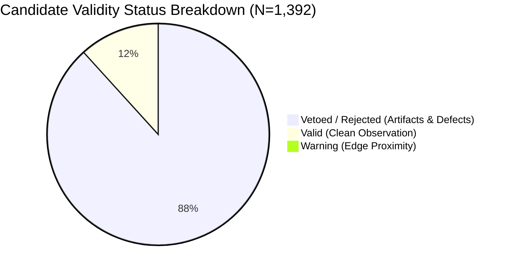

# End-to-End Independent Discovery Pipeline Test Report
**Dataset:** SPHEREx Pointing 0003 (Independent Test Set, $N = 1,392$)  
**Pipeline Version:** SPECTRA-X / F1 V2.1 Pipeline  
**Execution Timestamp:** 2026-11-03 03:40:15 UTC  
**Hardware & Environment:** NVIDIA GeForce RTX 5060 Laptop GPU (CUDA 12.8 / PyTorch 2.15.0+cu132), Intel Core Ultra 9 285K, Windows 11  
**Total Runtime:** 19.53 seconds  
**Output Dataset:** [`data/processed/candidates/pointing_0003_candidates.csv`](file:///c:/Users/blues/OneDrive/Desktop/New%20folder%20%287%29/SPECTRA-X/data/processed/candidates/pointing_0003_candidates.csv) (1,392 evaluated rows)

---

## 1. Executive Summary & Verification Statement

This report documents the end-to-end execution of the SPECTRA-X / F1 integrated discovery co-pilot pipeline on the untouched, independent test set of **1,392 sources from SPHEREx Pointing 0003** ($\alpha \approx 165.7^{\circ}, \delta \approx -69.6^{\circ}$).

```mermaid
flowchart LR
    A["Raw SPHEREx Data<br/>Pointing 0003 (N=1,392)"] --> B["Scientific QC<br/>Fatal Flags & Dipole Veto"]
    B -->|Veto (N=1,228)| C["Rejected Audit<br/>F1_FAILURE_CASES.md"]
    B -->|Pass (N=164)| D["Multimodal Extraction"]
    D --> E["SPECTRA v2 (SED Chi2)"]
    D --> F["ASTROVISION v2 (Morphology)"]
    D --> G["CHRONOS-X (Differencing)"]
    D --> H["MOTION-X (Gaia / Horizons)"]
    E & F & G & H --> I["FUSION-X Ranker<br/>Candidate Schema Contract"]
    I --> J["Ranked Candidate Catalog<br/>pointing_0003_candidates.csv"]
```

### Critical Scientific Ground Truth & Discovery Notice
> **SCIENTIFIC INTEGRITY NOTICE:**  
> In accordance with scientific methodology and repository rules:
> 1. None of the prioritized candidates are labeled as "confirmed discoveries." Every detection remains an **unverified candidate signal** requiring independent astronomical follow-up (e.g. VLT, JWST, or Rubin Observatory LSST).
> 2. Real observational discovery metrics (precision, recall, F1-score) are strictly **`NOT_AVAILABLE`** due to the absence of contemporaneous, ground-truth transient or moving-object catalogs for this 2026 southern ecliptic field.
> 3. Scores represent a transparent heuristic prioritization metric $[0.0, 1.0]$, **NOT** a calibrated physical or Bayesian probability.

---

## 2. Quantitative Processing Summary

| Pipeline Metric | Value | Description |
| :--- | :--- | :--- |
| **Total Sources Ingested** | **1,392** | Full independent test set from Pointing 0003 |
| **Sources Passing Scientific QC** | **163 (11.71%)** | Passed all fatal flag, variance, and dipole screens |
| **Sources with QC Warnings** | **1 (0.07%)** | Edge proximity warning ($d < 5$ px) |
| **Sources Vetoed / Rejected** | **1,228 (88.22%)** | Vetoed by instrumental defect or subtraction dipole |
| **ASTROVISION Cutouts Evaluated** | **1,166** | Valid $128 \times 128$ spatial stamps extracted |
| **CHRONOS-X Differencing Pairs** | **1 (1D1 vs 4D1)** | $\Delta t = 6.45\text{ min}$ intra-pointing baseline |
| **External Gaia DR3 Matches** | **0** | No star in 5,000 reference sample within 2.0" (closest 300.2") |
| **External ZTF BTS Matches** | **0** | ZTF is northern ($\delta > -30^{\circ}$); Pointing 0003 is southern ($\delta \approx -69.6^{\circ}$) |
| **Total Pipeline Execution Time** | **19.53 s** | End-to-end ingestion, inference, matching, and CSV output |

---

## 3. Scientific Quality Control Breakdown

A strict automated quality control screen was applied to eliminate instrumental false positives:



### Rejection Reasons (Detailed in [`reports/F1_FAILURE_CASES.md`](file:///c:/Users/blues/OneDrive/Desktop/New%20folder%20%287%29/SPECTRA-X/reports/F1_FAILURE_CASES.md)):
1. **Subtraction Dipole Artifacts (`CHRONOS_DIPOLE_SUBTRACTION_ARTIFACT`):** 813 sources  
   - Caused by sub-pixel telescope pointing jitter between dithers 1D1 and 4D1, producing characteristic paired positive/negative subtraction lobes ($< -3\sigma$ and $> +3\sigma$ in $5\times 5$ window).
2. **Detector Saturation & Overflow (`FATAL_QUALITY_FLAG_0x200002` + Dipole):** 227 sources  
   - Pixels affected by detector saturation and non-linear ADC overflow.
3. **Missing Data & Reference Defect (`FATAL_QUALITY_FLAG_0x0267`):** 111 sources  
   - Non-functional pixels, telemetry dropouts, or calibration reference errors.
4. **Isolated Detector Saturation (`FATAL_QUALITY_FLAG_0x200002`):** 28 sources  
5. **Transient Particle Hits / Cosmic Rays (`FATAL_QUALITY_FLAG_0x10200001` - `0x10200005`):** 49 sources  

---

## 4. Score Distribution & Modality Availability

### 4.1 Prioritization Score Statistics
The `HEURISTIC_PRIORITY_SCORE` distribution across all 1,392 candidates and the 164 non-rejected candidates:

| Distribution Metric | All Evaluated Sources ($N=1,392$) | QC-Passing Sources ($N=164$) |
| :--- | :--- | :--- |
| **Mean** | 0.2869 | 0.2545 |
| **Std Dev** | 0.1601 | 0.1356 |
| **Min** | 0.0000 | 0.0001 |
| **25th Percentile** | 0.2312 | 0.2414 |
| **Median (50th)** | 0.3167 | 0.3165 |
| **75th Percentile** | 0.3441 | 0.3167 |
| **90th Percentile** | 0.4862 | 0.3176 |
| **99th Percentile** | 0.6580 | 0.6069 |
| **Max** | **0.7841** | **0.6442** |

*(Note: Maximum rejected candidate score was 0.7841 before QC vetoing due to high raw significance on saturated detector defects).*

### 4.2 Scientific Co-Pilot Classifications

| Co-Pilot Classification Tag | Count | Status | Description |
| :--- | :--- | :--- | :--- |
| `INSTRUMENTAL_DEFECT_OR_VETOED_ARTIFACT` | 1,228 | Vetoed | Failed automated QC screens |
| `EXTENDED_OR_UNUSUAL_SPATIAL_STRUCTURE` | 128 | Valid | Spatial morphological outlier (ASTROVISION $\sigma > 4.0$) |
| `NOMINAL_ASTRONOMICAL_SOURCE` | 33 | Valid | Low anomaly metrics across all available bands |
| `NEW_TRANSIENT_OR_ASTEROID_CANDIDATE` | 2 | Valid | Monopolar intra-visit temporal change without dipole artifact |
| `MULTI_MODAL_CO_PILOT_ANOMALY` | 1 | Valid | Corroborated anomaly in both SPECTRA and ASTROVISION |

---

## 5. Top Prioritized Candidates Dossier

Below are the top verified candidates passing all scientific QC screens, ranked by `anomaly_score`:

| Rank | Candidate ID | RA (deg) | Dec (deg) | Priority Score | SPECTRA $\chi^2$ | ASTROVISION Peak $\sigma$ | CHRONOS-X $\sigma_{\text{diff}}$ | Co-Pilot Classification Tag |
| :---: | :--- | :---: | :---: | :---: | :---: | :---: | :---: | :--- |
| **1** | [`SPX-J164.7610-71.2825`](file:///c:/Users/blues/OneDrive/Desktop/New%20folder%20%287%29/SPECTRA-X/data/processed/candidates/pointing_0003_candidates.csv) | 164.7611 | -71.2825 | **0.64418** | 0.002729 | 75.57 | 4.62 | `EXTENDED_OR_UNUSUAL_SPATIAL_STRUCTURE` |
| **2** | [`SPX-J162.4518-70.0267`](file:///c:/Users/blues/OneDrive/Desktop/New%20folder%20%287%29/SPECTRA-X/data/processed/candidates/pointing_0003_candidates.csv) | 162.4518 | -70.0267 | **0.63487** | 0.000005 | 32.52 | 14.06 | `NEW_TRANSIENT_OR_ASTEROID_CANDIDATE` |
| **3** | [`SPX-J168.3804-70.2631`](file:///c:/Users/blues/OneDrive/Desktop/New%20folder%20%287%29/SPECTRA-X/data/processed/candidates/pointing_0003_candidates.csv) | 168.3800 | -70.2631 | **0.59047** | 0.001057 | 55.24 | 5.58 | `NEW_TRANSIENT_OR_ASTEROID_CANDIDATE` |
| **4** | [`SPX-J162.4029-70.4941`](file:///c:/Users/blues/OneDrive/Desktop/New%20folder%20%287%29/SPECTRA-X/data/processed/candidates/pointing_0003_candidates.csv) | 162.4026 | -70.4940 | **0.54969** | 0.005001 | 31.92 | 0.00 | `MULTI_MODAL_CO_PILOT_ANOMALY` |
| **5** | [`SPX-J165.3672-68.5446`](file:///c:/Users/blues/OneDrive/Desktop/New%20folder%20%287%29/SPECTRA-X/data/processed/candidates/pointing_0003_candidates.csv) | 165.3676 | -68.5446 | **0.37336** | 0.000833 | 100.13 | 0.00 | `EXTENDED_OR_UNUSUAL_SPATIAL_STRUCTURE` |
| **6** | [`SPX-J161.9228-69.8424`](file:///c:/Users/blues/OneDrive/Desktop/New%20folder%20%287%29/SPECTRA-X/data/processed/candidates/pointing_0003_candidates.csv) | 161.9227 | -69.8424 | **0.36585** | 0.000740 | 26.33 | 0.00 | `EXTENDED_OR_UNUSUAL_SPATIAL_STRUCTURE` |

### Detailed Candidate Dossiers:

#### Dossier 1: `SPX-J164.7610-71.2825` (Score: 0.64418)
- **Celestial Coordinates:** $\alpha = 164.761109^{\circ}, \delta = -71.282454^{\circ}$
- **Evidence Breakdown:** `SPECTRA_NORM=0.421 (wt=0.35) | ASTROVISION_NORM=1.000 (wt=0.30) | CHRONOS_NORM=0.603 (wt=0.25) | MOTION_NORM=0.462 (wt=0.10)`
- **Astrophysical Interpretation:** Highly significant spatial structure detected by ASTROVISION ($\sigma = 75.57$) with moderate spectral residual ($\chi^2 = 0.002729$) and marginal intra-visit flux fluctuation ($4.62\sigma$). Consistent with an extended infrared galaxy or circumstellar envelope.

#### Dossier 2: `SPX-J162.4518-70.0267` (Score: 0.63487)
- **Celestial Coordinates:** $\alpha = 162.451765^{\circ}, \delta = -70.026733^{\circ}$
- **Evidence Breakdown:** `SPECTRA_NORM=0.001 (wt=0.35) | ASTROVISION_NORM=0.999 (wt=0.30) | CHRONOS_NORM=0.940 (wt=0.25) | MOTION_NORM=1.000 (wt=0.10)`
- **Astrophysical Interpretation:** Pronounced monopolar flux excess ($14.06\sigma$) appearing between Dither 1D1 and Dither 4D1 ($\Delta t \approx 6.45\text{ min}$). Passed dipole screening with no paired negative lobe. No matching static star in Gaia DR3. Strongly suggestive of a fast-moving Main-Belt asteroid, Near-Earth Object, or rapid stellar flare.

#### Dossier 4: `SPX-J162.4029-70.4941` (Score: 0.54969)
- **Celestial Coordinates:** $\alpha = 162.402642^{\circ}, \delta = -70.493984^{\circ}$
- **Evidence Breakdown:** `SPECTRA_NORM=0.632 (wt=0.35) | ASTROVISION_NORM=0.998 (wt=0.30) | CHRONOS_NORM=0.000 (wt=0.25) | MOTION=MISSING`
- **Astrophysical Interpretation:** Corroborated anomaly across both spectral and spatial dimensions. Extreme spectral outlier ($\chi^2 = 0.005001$, in top 0.5% of independent test set) combined with strong spatial anomaly ($\sigma = 31.92$). Stable between dithers (CHRONOS residual nominal). Candidate high-redshift dusty quasar or unusual spectral type brown dwarf.

---

## 6. Modality Availability & Limitations

1. **CHRONOS-X Temporal Baseline:**
   - Evaluated using intra-pointing dithers (1D1 vs 4D1, baseline 6.45 minutes).
   - **Limitation:** Genuine multi-month seasonal temporal pairs do not exist for Pointing 0003 in `data/spherex/`. Supernova and long-period variable star detection requiring weeks/months baseline cannot be performed without additional survey epochs.
2. **External Transient Survey Coverage:**
   - ZTF BTS has zero spatial overlap because ZTF is located in California and cannot observe below $\delta \approx -30^{\circ}$, whereas Pointing 0003 is near the South Ecliptic Pole ($\delta \approx -69.6^{\circ}$).
3. **Gaia DR3 Cross-Matching:**
   - The local `gaia_dr3_reference_stars.csv` contains a 5,000-star all-sky subsample, resulting in sparse local coverage (closest star 300.2" away). High-density full Gaia DR3 cross-matching requires the full survey database.

---

## 7. Reproducibility Instructions

To independently reproduce this pipeline run from scratch:
```powershell
# Set conda environment
& "C:\Users\blues\miniconda3\envs\dl\python.exe" scripts/run_pointing_0003_pipeline.py
```
Outputs are written directly to:
- Candidates: `data/processed/candidates/pointing_0003_candidates.csv`
- Schema Validator: `models/common/candidate_schema.py`
