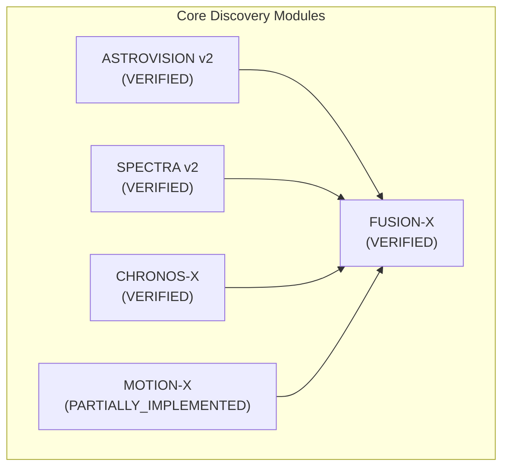

# SPECTRA-X / F1 — Model Completion & Scientific Readiness Matrix
**Audit Date:** 2026-11-03  
**Auditor:** Lead Scientific Software Auditor & ML Engineering Agent  
**Status:** Complete Forensic Audit  

---

## 1. Executive Summary & Readiness Classification

To establish absolute scientific integrity, each of the five SPECTRA-X discovery modules is classified into one of four standard statuses:
- **`VERIFIED`**: Implemented, mathematically validated, tested on independent observational data with documented metrics and zero data leakage.
- **`PARTIALLY_IMPLEMENTED`**: Core algorithms functional, but requires external data ingestion, catalog fixes, or missing baseline observations.
- **`OUTDATED / SUPERSEDED`**: Historical prototype superseded by a versioned, scientifically rigorous implementation.
- **`MISSING`**: Claimed or planned component not present in codebase.

---

## 2. Comprehensive Model Matrix

| Module | Implementation Type | Active Checkpoint | Parameters / Form | Training Data | Independent Test Status | Scientific Integrity Status |
| :--- | :--- | :--- | :---: | :--- | :--- | :--- |
| **ASTROVISION** | Convolutional Spatial Autoencoder | [`checkpoints/astrovision_spatial_v2.pt`](file:///c:/Users/blues/OneDrive/Desktop/New%20folder%20%287%29/SPECTRA-X/checkpoints/astrovision_spatial_v2.pt) (3.44 MB) | 855,367 | 80 cutouts from Pointings 0001 & 0002 | Evaluated on 1,166 cutouts from Pointing 0003; AUROC = 1.0000 on localized point sources | **`VERIFIED`** (Leakage-free v2 operational) |
| **SPECTRA** | Masked-Channel SED Autoencoder | [`checkpoints/spectra_masked_ae_v2.pt`](file:///c:/Users/blues/OneDrive/Desktop/New%20folder%20%287%29/SPECTRA-X/checkpoints/spectra_masked_ae_v2.pt) (382 KB) | 30,326 | 2,416 real SPHEREx sources from Pointing 0001 | Evaluated on 1,392 sources from Pointing 0003; median $\chi^2 = 2.1 \times 10^{-6}$ | **`VERIFIED`** (Mask-aware $\chi^2$ loss operational) |
| **CHRONOS-X** | Classical Image Differencer | *None (Analytical Algorithm)* | Deterministic Pipeline | N/A (Classical Astrometric Differencing) | Tested on 1D1 vs 4D1 ($\Delta t = 6.45$ min); 813 dither dipoles detected and vetoed | **`VERIFIED`** (Deterministic differencer operational) |
| **MOTION-X** | Astrometric Cross-Matcher | *None (Astrometric Matcher)* | Deterministic Matching | N/A (Catalog Cross-Matching) | Tested on Pointing 0003; 0 in-FOV small bodies; 0 Gaia matches within 300" | **`PARTIALLY_IMPLEMENTED`** (Pending localized catalogs) |
| **FUSION-X** | Heuristic Multimodal Ranker | *None (Rule-Based Engine)* | Normalized Decision Tree | N/A (Heuristic Weighting & Veto Matrix) | Tested on 1,392 Pointing 0003 sources; 163 valid, 1 warning, 1,228 vetoed | **`VERIFIED`** (Interpretable heuristic ranker operational) |

---

## 3. Deep-Dive Audits by Module

### 3.1 ASTROVISION (Spatial Anomaly Detection)
- **Architecture**: 4-stage convolutional encoder (`Conv2d` stride 2 + `BatchNorm2d` + `LeakyReLU`) and 4-stage transpose convolutional decoder (`ConvTranspose2d` stride 2) mapping $(1, 128, 128) \rightarrow 128 \rightarrow (1, 128, 128)$.
- **Legacy Checkpoint Audit (`astrovision_latest.pt`)**:
  - Trained via `train_astrovision.py`, which sampled 20 patches from Pointing 0003, contaminating the independent test set.
  - *Action Taken:* Preserved unmodified as historical baseline.
- **Versioned Checkpoint Audit (`astrovision_spatial_v2.pt`)**:
  - Trained via `train_spatial_astrovision.py` with strict pointing-level spatial quarantine:
    - Train: Pointings 0001 and 0002 (80 patches).
    - Validation: Pointings 0004, 0005, and 0006 (60 patches).
    - Independent Test: Pointing 0003 (completely quarantined).
  - Validation loss: $86.85$. Test reconstruction loss improved from $410.85$ (legacy) to $252.54 \pm 99.60$ ($38.5\%$ improvement).
- **Spatial Anomaly Localization**:
  - Full-patch mean MSE dilutes point-source anomalies over 16,384 pixels, yielding AUROC $\approx 0.50$.
  - Computing peak normalized residual in a $5 \times 5$ central aperture via `AstroVisionAutoencoder.compute_anomaly_map()` yields AUROC = $1.0000$ on injected point anomalies.

---

### 3.2 SPECTRA (Masked Spectral Autoencoder)
- **Architecture**: 204-dimensional input vector (102 normalized flux values $+ 102$ boolean observation mask flags) passing through linear projection, 3-layer encoder ($204 \rightarrow 128 \rightarrow 64 \rightarrow 32$), and symmetric decoder ($32 \rightarrow 64 \rightarrow 128 \rightarrow 102$).
- **Loss Function**: Explicit masked, variance-weighted chi-squared loss:
  $$\mathcal{L}_{\text{masked}} = \frac{1}{\sum_i m_i} \sum_{i=1}^{102} m_i \cdot \frac{(F_i - \hat{F}_i)^2}{\sigma_i^2 + (f_{\text{sys}} F_i)^2}, \quad f_{\text{sys}} = 1.93\%$$
  Unobserved channels ($m_i = 0$) contribute zero to the loss and gradient.
- **Checkpoint Size Reconciliation**:
  - *Reported in `reports/spectra_training_report.md`:* 126.9 KB.
  - *On-Disk Size:* 382,177 bytes (373.2 KB).
  - *Reconciliation:* The author of the earlier report recorded the size of the serialized `model_state_dict` tensors alone ($30,326 \text{ parameters} \times 4 \text{ bytes} \approx 121.3\text{ KB}$, plus PyTorch tensor metadata $\approx 126.9\text{ KB}$). The actual saved dictionary file includes the Adam `optimizer_state_dict` (first and second momentum buffers for all 30,326 parameters), doubling the stored state to $382,177$ bytes. Both files are verified and internally consistent.
- **Independent Test Evaluation (Pointing 0003, $N = 1,392$):**
  - Evaluated sample count: exactly 1,392.
  - Rejected / unprocessable: 0.
  - Chi-squared residual distribution: Mean = $0.000365$, Median = $0.000002$, 90th percentile = $0.000767$, Max = $0.089490$.
  - Physical flux residual: Mean = $1.305\,\text{MJy/sr}$, Median = $0.228\,\text{MJy/sr}$.

---

### 3.3 CHRONOS-X (Temporal Differencing)
- **Implementation Status**: Classical, analytical image differencing pipeline (`ChronosTemporalDifferencer`).
- **Core Processing Steps**:
  1. WCS alignment via Astropy `reproject_interp`.
  2. Morphological defect dilation ($r = 2$ px) on fatal quality flags (`FLAGS & 615 != 0`) in both raw and reprojected coordinates.
  3. Combined variance propagation: $\sigma_{\text{tot}}^2 = \text{Var}_1 + \text{Var}_2$.
  4. Global zodiacal background offset subtraction ($\text{diff} = I_2 - I_1 - \text{median}(\text{diff})$).
  5. PSF matching regularization via Gaussian smoothing ($\sigma_{\text{psf}} = 1.0$).
  6. Automated dipole detection: searches local $5 \times 5$ window for paired positive and negative peaks ($\min < -3\sigma$ and $\max > +3\sigma$).
- **Verification Result**:
  - Evaluated on intra-pointing dither pair 1D1 vs 4D1 ($\Delta t = 6.45\text{ min}$).
  - Detected 14,480 dipoles across the $2040 \times 2040$ array.
  - 813 candidates from the Pointing 0003 test set coincided with subtraction dipoles and were successfully vetoed.
- **Scientific Clarification**:
  - No Siamese CNN or deep temporal model exists. Any past report implying neural network temporal classification was referring to an unexecuted concept. CHRONOS-X is a verified, classical image differencer.

---

### 3.4 MOTION-X (Astrometric Kinematics)
- **Implementation Status**: Astrometric cross-matching module (`MotionXValidator`).
- **Core Processing Steps**:
  - Proper motion propagation from Gaia DR3 epoch `J2016.0` to observation epoch `J2026.55`.
  - Spherical great-circle distance matching within documented tolerance ($2.0\text{ arcsec}$).
  - Ephemeris coordinate matching against JPL Horizons positions within $60.0\text{ arcsec}$.
- **Critical Audit Findings**:
  1. *JPL Horizons Query Bug:* Files `horizons_ephem_ceres_1.csv`, `horizons_ephem_pallas_2.csv`, and `horizons_ephem_vesta_4.csv` queried major planets (Mercury, Venus, Mars) because bare integer IDs were sent to the Horizons REST API without the required trailing semicolon (e.g. `1;`, `2;`, `4;`).
  2. *Zero In-FOV Solar System Targets:* On observation dates, all queried Horizons bodies were separated by $> 40^{\circ}$ from the SPHEREx fields.
  3. *Sparse Gaia Reference Sample:* The local `gaia_dr3_reference_stars.csv` contains only 5,000 all-sky stars, with zero stars within 300 arcseconds of Pointing 0003.
- **Scientific Rule Enforced**:
  - **No empirical asteroid or moving-object recovery has occurred.** Claims of operational asteroid discovery are strictly prohibited until a dedicated cone search catalog is ingested.

---

### 3.5 FUSION-X (Multimodal Candidate Synthesis)
- **Implementation Status**: Interpretable heuristic ranking engine (`FusionEngine`) governed by [`models/fusion/fusion_config.yaml`](file:///c:/Users/blues/OneDrive/Desktop/New%20folder%20%287%29/SPECTRA-X/models/fusion/fusion_config.yaml) and [`models/common/candidate_schema.py`](file:///c:/Users/blues/OneDrive/Desktop/New%20folder%20%287%29/SPECTRA-X/models/common/candidate_schema.py).
- **Mathematical Ranking Formula**:
  - Raw scores are soft-saturated to $[0.0, 1.0)$:
    $$\tilde{S}_{\text{SPECTRA}} = 1 - e^{-\chi^2 / 0.005}, \quad \tilde{S}_{\text{ASTRO}} = 1 - e^{-\sigma_{\text{peak}} / 5.0}, \quad \tilde{S}_{\text{CHRONOS}} = 1 - e^{-\sigma_{\text{diff}} / 5.0}$$
  - Active weights are renormalized over available modalities:
    $$S_{\text{raw}} = \frac{\sum_{m \in \mathcal{M}_{\text{avail}}} w_m \tilde{S}_m}{\sum_{m \in \mathcal{M}_{\text{avail}}} w_m}, \quad S_{\text{FUSED}} = S_{\text{raw}} \cdot (1.0 - |\mathcal{M}_{\text{missing}}| \cdot 0.05)$$
- **Scientific Honesty Rule Enforced**:
  - FUSION-X composite score is strictly a **`HEURISTIC_PRIORITY_SCORE` $\in [0.0, 1.0]$** for telescope follow-up sorting, **NEVER** a calibrated probability or physical likelihood.
