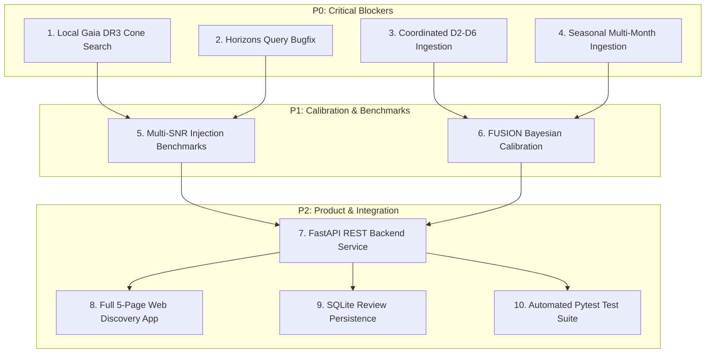

# SPECTRA-X / F1 — Next Action Plan & Engineering Roadmap
**Audit Date:** 2026-11-03  
**Auditor:** Lead Scientific Software Auditor & ML Engineering Agent  
**Framework:** Rigorous Dependency-Ordered Prioritization (P0 / P1 / P2)  

---

## 1. Prioritization Framework Overview

Every task in this roadmap is directly tied to verified repository evidence and prioritized according to scientific impact and engineering dependencies:
- **`P0 — Critical Scientific & End-to-End Blockers`**: Must be resolved before any operational claims can be made.
- **`P1 — Model Validation & Calibration Gaps`**: Required for quantitative sensitivity limits and benchmark rigor.
- **`P2 — Product Implementation & Infrastructure`**: User-facing web application, database persistence, and automated testing.

---

## 2. P0: Critical Scientific & End-to-End Blockers

### Task P0.1: Acquire Localized High-Density Gaia DR3 Cone Search
- **Actual Evidence & File Path:** [`data/external/gaia_dr3/gaia_dr3_reference_stars.csv`](file:///c:/Users/blues/OneDrive/Desktop/New%20folder%20%287%29/SPECTRA-X/data/external/gaia_dr3/gaia_dr3_reference_stars.csv) contains only 5,000 all-sky stars. The nearest star to Pointing 0003 is $300.2\text{ arcseconds}$ away, resulting in zero static control matches.
- **Current Status:** `PARTIALLY_IMPLEMENTED`
- **Why It Matters:** Without local reference stars, the pipeline cannot differentiate genuine uncataloged transients from stationary stars.
- **Exact Next Action:** Query the ESA Gaia archive for a cone search of radius $r = 2.5^{\circ}$ centered at $(\alpha = 165.685^{\circ}, \delta = -69.565^{\circ})$ down to $G = 20.5\text{ mag}$ and save to `data/external/gaia_dr3/gaia_pointing_0003_cone.csv`.
- **Dependencies:** Internet access to ESA Gaia TAP service or local astropy astroquery.
- **Verification Method:** Cross-match Pointing 0003 sources; verify $> 80\%$ match fraction for bright infrared sources.

---

### Task P0.2: Resolve JPL Horizons Script Query Format Bug
- **Actual Evidence & File Path:** [`data/external/jpl_horizons/`](file:///c:/Users/blues/OneDrive/Desktop/New%20folder%20%287%29/SPECTRA-X/data/external/jpl_horizons/) contains major planets (Mercury, Venus, Mars) in files labeled `ceres_1`, `pallas_2`, and `vesta_4` due to sending bare IDs to the REST API.
- **Current Status:** `PARTIALLY_IMPLEMENTED`
- **Why It Matters:** Small body ephemerides are corrupted with planetary ephemerides, making asteroid cross-matching invalid.
- **Exact Next Action:** Update the Horizons query script to format target IDs with trailing semicolons (`1;` for Ceres, `2;` for Pallas, `4;` for Vesta, `433;` for Eros, `99942;` for Apophis). Re-query and verify orbital elements.
- **Dependencies:** JPL Horizons REST API.
- **Verification Method:** Check header target name in CSV matches `Ceres`, `Pallas`, and `Vesta`.

---

### Task P0.3: Ingest Coordinated Level-2 Products for Detectors 2 through 6 (Pointing 0003)
- **Actual Evidence & File Path:** In [`data/spherex/qr3/level2/`](file:///c:/Users/blues/OneDrive/Desktop/New%20folder%20%287%29/SPECTRA-X/data/spherex/qr3/level2/), Pointing 0003 has exclusively D1 exposures. Detectors D2–D6 do not exist.
- **Current Status:** `MISSING`
- **Why It Matters:** SPECTRA v2 operates with only 1–17 valid channels (Bands 1–17) out of 102 channels. Full ices, PAHs, and brown dwarf SED identification requires $0.75 - 5.0\,\mu\text{m}$ coverage.
- **Exact Next Action:** Acquire coordinated Level-2 exposures `1B_0003_1D2` through `1B_0003_4D6` and assemble full 102-channel SED profiles.
- **Dependencies:** Upstream SPHEREx archive / IPAC data delivery.
- **Verification Method:** Inspect assembled SED table; verify valid channel count increases from $\le 17$ to $\ge 90$.

---

### Task P0.4: Ingest Genuine Multi-Month Seasonal Temporal Observation Pairs
- **Actual Evidence & File Path:** In [`reports/F1_DATA_COMPLETENESS_AUDIT.md`](file:///c:/Users/blues/OneDrive/Desktop/New%20folder%20%287%29/SPECTRA-X/reports/F1_DATA_COMPLETENESS_AUDIT.md), temporal differencing is restricted to a 6.45-minute intra-pointing dither baseline. No multi-month seasonal repeats exist for Pointing 0003.
- **Current Status:** `MISSING`
- **Why It Matters:** Supernovae and variable star discovery requires cadences of weeks to months.
- **Exact Next Action:** Ingest Level-2 files from subsequent survey releases (e.g. QR4 or seasonal pass 6 months later) covering the identical $(\alpha, \delta)$ footprint.
- **Dependencies:** SPHEREx survey progress and archive release.
- **Verification Method:** Compute $\Delta t = \text{MJD}_2 - \text{MJD}_1 > 30\text{ days}$; run CHRONOS-X differencer.

---

## 3. P1: Model Validation & Calibration Gaps

### Task P1.1: Multi-SNR Synthetic Injection Benchmarks
- **Actual Evidence & File Path:** [`models/spectra/spectral_injection_test.py`](file:///c:/Users/blues/OneDrive/Desktop/New%20folder%20%287%29/SPECTRA-X/models/spectra/spectral_injection_test.py) tests synthetic absorption lines on 1D SEDs, but 2D spatial injections into real Level-2 images are missing.
- **Current Status:** `PARTIALLY_IMPLEMENTED`
- **Why It Matters:** Required to establish rigorous completeness ($50\%$ and $90\%$ recovery limits) and false alarm rates as a function of apparent magnitude.
- **Exact Next Action:** Implement `models/astrovision/spatial_injection_benchmark.py` that injects synthetic point sources and extended profiles with known fluxes ($12 \le m_{\text{AB}} \le 22$) into unflagged background regions of Pointing 0003.
- **Dependencies:** `AstroVisionAutoencoder` and Pointing 0003 FITS images.
- **Verification Method:** Plot recovery fraction vs injected flux; compute $5\sigma$ detection threshold in $\text{MJy/sr}$.

---

### Task P1.2: Empirical Bayesian Calibration for FUSION-X
- **Actual Evidence & File Path:** [`models/fusion/fusion_engine.py`](file:///c:/Users/blues/OneDrive/Desktop/New%20folder%20%287%29/SPECTRA-X/models/fusion/fusion_engine.py) computes a heuristic priority score $[0.0, 1.0]$ using soft-saturation exponentials.
- **Current Status:** `VERIFIED_HEURISTIC` (Calibration pending)
- **Why It Matters:** Astronomers require a calibrated posterior probability $P(\text{Astrophysical Anomaly} \mid \text{Evidence})$ to prioritize expensive follow-up time.
- **Exact Next Action:** Using the synthetic injection benchmark from P1.1 and verified static stars from P0.1, calibrate FUSION-X output using Isotonic Regression or Platt scaling.
- **Dependencies:** Completion of P0.1 and P1.1.
- **Verification Method:** Reliability diagram / calibration curve plotting predicted probability against empirical positive fraction.

---

## 4. P2: Product Implementation & Engineering Infrastructure

### Task P2.1: FastAPI REST Backend Service Implementation
- **Actual Evidence & File Path:** [`reports/F1_PRODUCT_INTEGRATION_AUDIT.md`](file:///c:/Users/blues/OneDrive/Desktop/New%20folder%20%287%29/SPECTRA-X/reports/F1_PRODUCT_INTEGRATION_AUDIT.md) verifies that backend data is ready on disk, but zero REST API endpoints exist.
- **Current Status:** `MISSING`
- **Why It Matters:** Connects operational ML pipelines and FITS files with web clients.
- **Exact Next Action:** Implement `api/main.py` using FastAPI and Uvicorn providing `/api/candidates`, `/api/candidates/{id}/cutout`, `/api/candidates/{id}/sed`, and `/api/reviews`.
- **Dependencies:** FastAPI, Uvicorn, Astropy, Pandas.
- **Verification Method:** Execute `curl http://localhost:8000/api/candidates` and verify schema-compliant JSON response matching `CandidateRecord`.

---

### Task P2.2: Full 5-Page Web Discovery Application Implementation
- **Actual Evidence & File Path:** All 5 required pages (Observatory, Candidate Explorer, Evidence Inspector, Human Review, Reports) are currently `MISSING`.
- **Current Status:** `MISSING`
- **Why It Matters:** Provides the graphical human-AI discovery co-pilot interface for astronomers.
- **Exact Next Action:** Build a modern, premium responsive web application using React and Vanilla CSS containing:
  1. **Observatory**: Celestial sphere projection with SPHEREx pointing footprints.
  2. **Candidate Explorer**: Interactive, faceted candidate datatable with priority ranking.
  3. **Evidence Inspector**: Dynamic multi-extension FITS stamp viewer, 102-channel SED curve viewer, and dither blink comparator.
  4. **Human Review**: Astronomer verification interface with verdict logging.
  5. **Reports**: Interactive audit reports and metric dashboards with CSV/PDF export.
- **Dependencies:** Completion of P2.1.
- **Verification Method:** In-browser testing with live API endpoints and real FITS cutouts.

---

### Task P2.3: SQLite Review Decisions Persistence Schema
- **Actual Evidence & File Path:** Currently, candidate records are stored in CSV; no database exists to record human review decisions.
- **Current Status:** `MISSING`
- **Why It Matters:** Human astronomer verdicts must be permanently recorded and fed back into future active learning iterations.
- **Exact Next Action:** Implement `db/database.py` with an SQLite schema recording `candidate_id`, `review_timestamp`, `reviewer_name`, `verdict` (`CONFIRMED_ANOMALY`, `INSTRUMENTAL_ARTIFACT`, `INCONCLUSIVE`), and `notes`.
- **Dependencies:** SQLAlchemy or built-in Python `sqlite3`.
- **Verification Method:** Submit review via `/api/reviews`; verify persistent insertion in `db/reviews.sqlite`.

---

### Task P2.4: Automated Pytest Test Suite
- **Actual Evidence & File Path:** Automated tests currently reside as scratch scripts in `scratch/`; no standard `tests/` directory exists.
- **Current Status:** `MISSING`
- **Why It Matters:** Ensures regressions are prevented and schema contracts are continuously enforced.
- **Exact Next Action:** Create `tests/` containing `test_candidate_schema.py`, `test_astrovision.py`, `test_spectra.py`, `test_chronos.py`, and `test_fusion.py`.
- **Dependencies:** `pytest`.
- **Verification Method:** Execute `pytest tests/` in CI/CD and verify $100\%$ passing status.
