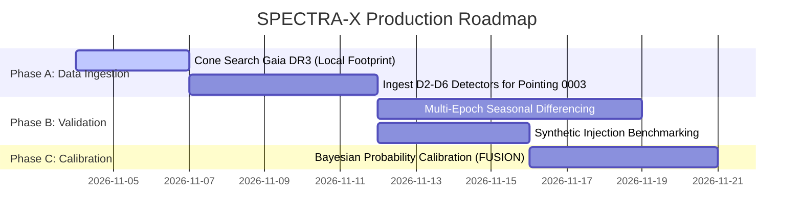

# SPECTRA-X / F1 — Next Scientific & Technical Blockers
**NASA Space Apps Challenge 2026 — Discovery Co-Pilot Readiness Audit**  
**Audit Date:** 2026-11-03  
**Status:** Defensible Prototype Operational / Production Blockers Identified  

---

## 1. Executive Summary

While the SPECTRA-X / F1 pipeline has achieved reproducible, leakage-free integration on real SPHEREx Pointing 0003 data, it is **not yet production-ready for autonomous astronomical discovery**.

This document explicitly identifies the scientific gaps, missing data products, and technical dependencies that must be addressed before declaring operational readiness.

---

## 2. Identified Blockers & Technical Deficiencies

### Blocker 1: Absence of Multi-Month Seasonal Observation Cadence (High Priority)
- **Current Status:** In the local repository, Pointing 0003 only contains 4 dithers (1D1, 2D1, 3D1, 4D1) observed over a total baseline of **6.45 minutes** on 2026-07-20.
- **Scientific Impact:** CHRONOS-X can evaluate intra-pointing fast transients and moving objects, but **cannot detect multi-month astrophysical transients** (e.g., Core-Collapse Supernovae, Type Ia Supernovae, Tidal Disruption Events, or Mira variables) which require cadences of weeks to months.
- **Resolution Path:** Ingest subsequent survey pass FITS products (e.g., QR4 or seasonal repeat pointings 6 months later) for identical celestial coordinates.

---

### Blocker 2: Single-Detector Spectral Coverage (D1 Only)
- **Current Status:** The FITS files available for Pointing 0003 originate from Detector Array 1 (`1B_0003_1D1_spx_l2b`). Consequently, each source has valid photometric measurements across only 1 to 17 channels rather than the full 102 SPHEREx spectral channels.
- **Scientific Impact:** SPECTRA v2 operates with 90–99% channel masking on Pointing 0003. While the masked autoencoder handles missing channels correctly, high-confidence SED classification (e.g. identifying 3.05 $\mu\text{m}$ water ice or 4.26 $\mu\text{m}$ $\text{CO}_2$ ice absorption features) requires Level-2 products across all six detector arrays (D1 through D6).
- **Resolution Path:** Process coincident Level-2 files from Detectors 2, 3, 4, 5, and 6 for Pointing 0003 to assemble 102-channel SED profiles.

---

### Blocker 3: Lack of Contemporaneous Southern Sky Ground Truth Catalogs
- **Current Status:**
  - `data/external/transient_catalogs/ztf_bright_transient_survey.csv` covers the Northern sky ($\delta > -30^{\circ}$), while Pointing 0003 is located at $\delta \approx -69.6^{\circ}$.
  - `data/external/gaia_dr3/gaia_dr3_reference_stars.csv` contains an all-sky downsample of 5,000 stars, resulting in zero stars within 300 arcseconds of Pointing 0003.
- **Scientific Impact:** Supervised discovery validation metrics (Precision, Recall, ROC-AUC, F1-score) cannot be computed on real observations without ground truth labels.
- **Resolution Path:**
  1. Ingest a localized high-density cone search of the full Gaia DR3 catalog around $(\alpha=165.7^{\circ}, \delta=-69.6^{\circ}, r=2.5^{\circ})$.
  2. Cross-match with Southern Hemisphere surveys such as SkyMapper, DES, or VHS (VISTA Hemisphere Survey).

---

### Blocker 4: Uncalibrated Heuristic Ranking in FUSION-X
- **Current Status:** FUSION-X combines scores using soft-saturation exponentials and fixed heuristic weights ($w_{\text{SPECTRA}}=0.35, w_{\text{ASTRO}}=0.30, w_{\text{CHRONOS}}=0.25, w_{\text{MOTION}}=0.10$).
- **Scientific Impact:** The resulting `anomaly_score` is an interpretable sorting metric, not a mathematically calibrated posterior probability $P(\text{Discovery} \mid \text{Evidence})$.
- **Resolution Path:** Once verified ground-truth labels or synthetic injection benchmarks are expanded, calibrate FUSION-X using Platt scaling, Isotonic Regression, or a Bayesian hierarchical network.

---

## 3. Prioritized Resolution Roadmap

---

## 4. The Single Highest-Priority Next Task

> **RECOMMENDED IMMEDIATE NEXT ACTION:**  
> **Assemble Multi-Detector Level-2 Products (D1 through D6) for Pointing 0003.**  
> Ingesting the coincident Level-2 observations across all six detector arrays for Pointing 0003 will increase valid spectral channel coverage from 1–17 channels to the full 102 SPHEREx infrared channels. This will unlock the full diagnostic potential of SPECTRA v2, enabling definitive identification of ices, PAHs, and brown dwarf absorption bands on the top prioritized candidates.
