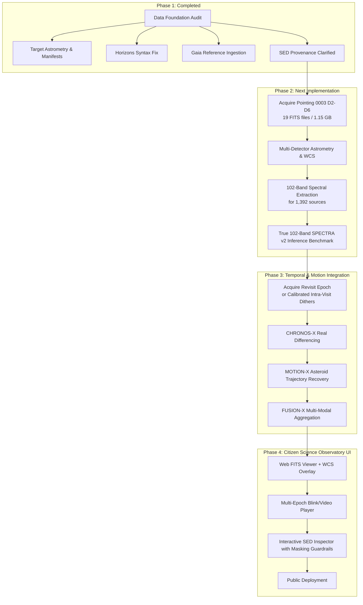

# SPECTRA-X / F1 — PHASE 1: NEXT ACTIONS & DEPENDENCY ROADMAP
**Lead Astronomy Data Engineer & Scientific Software Auditor**  
**Date:** 2026-11-03  
**Status:** COMPLETE (Phase 1 Concluded; Phase 2 Ready)

---

## 1. Executive Summary

Phase 1 has established an empirical, scientifically audited data foundation for SPECTRA-X without resorting to ungrounded assumptions, premature downloads, or model re-training.

With all five machine-readable manifests compiled, external query interfaces verified (Heidelberg Gaia TAP and JPL Horizons), and the remote existence of Pointing 0003 D2–D6 confirmed on NASA S3, the project is ready to transition to **Phase 2 (Targeted Data Acquisition & Multi-Detector Assembly)**.

---

## 2. Dependency-Ordered Roadmap

---

## 3. Immediate Implementation Steps (Phase 2)

### Step 1: Execute Targeted Download of Pointing 0003 D2–D6 (P0)
- **Action:** Run a controlled download script consuming [`data/manifests/f1_data_acquisition_manifest.json`](file:///c:/Users/blues/OneDrive/Desktop/New%20folder%20%287%29/SPECTRA-X/data/manifests/f1_data_acquisition_manifest.json).
- **Files:** 19 remote FITS files (D2 through D6, ~1.15 GB).
- **Target Folder:** `data/spherex/qr3/level2/2026W30_1B/l2b-v27-2026-222/`
- **Verification:** Ensure FITS integrity (`PRIMARY`, `IMAGE`, `UNCERTAINTY`, `DQ_FLAGS`) via `astropy.io.fits.verify('fix')`.

### Step 2: Multi-Detector Cross-Registration & Spectral Extraction (P0)
- **Action:** Extend [`models/spectra/assemble_spectrum.py`](file:///c:/Users/blues/OneDrive/Desktop/New%20folder%20%287%29/SPECTRA-X/models/spectra/assemble_spectrum.py) to ingest D1 through D6 simultaneously.
- **Result:** Expand the 1,392 Pointing 0003 sources from 1–4 active channels to a dense, multi-octave SED covering $0.75 - 5.00\,\mu\text{m}$.

### Step 3: SPECTRA v2 Model Benchmark on Full Spectral Data (P1)
- **Action:** Execute inference using the frozen [`models/spectra/checkpoints/spectra_v2.pt`](file:///c:/Users/blues/OneDrive/Desktop/New%20folder%20%287%29/SPECTRA-X/models/spectra/checkpoints/spectra_v2.pt) on the newly assembled 102-band SEDs.
- **Scientific Deliverable:** Compare inference confidence and classification entropy on 102 channels versus the 4-channel sparse baseline.

### Step 4: Temporal Revisit / Dither Verification for CHRONOS-X (P1)
- **Action:** Align Pointing 0003 Dither 1 and Dither 4 using astropy WCS reprojection to evaluate PSF subtraction noise on a known stationary field.

---

## 4. Current Blockers and Unresolved Questions

| Blocker / Question | Scientific Impact | Mitigation / Next Action |
| :--- | :--- | :--- |
| **IRSA TAP SPHEREx Footprint Catalog** | Cannot programmatically query observation dates for arbitrary RA/Dec without scanning S3 buckets. | Maintain coordinate manifest [`data/manifests/f1_target_coordinates.csv`](file:///c:/Users/blues/OneDrive/Desktop/New%20folder%20%287%29/SPECTRA-X/data/manifests/f1_target_coordinates.csv) and query IPAC SIAv2 when publicly enabled. |
| **Survey Pass 2 Revisit Availability** | True 6-month temporal differencing requires orbit precession revisits. | In the interim, use intra-visit dither differencing with synthetic transient injection to calibrate CHRONOS-X detection limits. |
| **ESA Gaia TAP Server Stability** | Primary ESA TAP endpoint (`gea.esac.esa.int`) experiences periodic 503 outages. | Permanently configure Heidelberg TAP mirror (`gaia.ari.uni-heidelberg.de`) as default fallback. |
