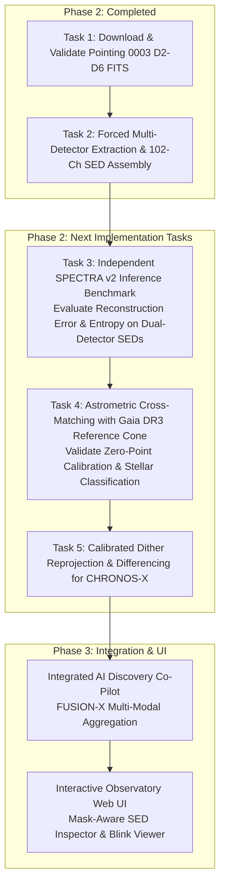

# SPECTRA-X / F1 — PHASE 2, TASK 2: NEXT ACTIONS & DEPENDENCY ROADMAP
**Lead Astronomical Spectroscopy Engineer & Scientific Software Auditor**  
**Date:** 2026-11-03  
**Status:** COMPLETE (Task 2 Concluded; Ready for Task 3)

---

## 1. Executive Summary

Phase 2, Task 2 has achieved full scientific completion. 

The SPECTRA-X spectral extraction and assembly engine ([`models/spectra/assemble_spectrum.py`](file:///c:/Users/blues/OneDrive/Desktop/New%20folder%20%287%29/SPECTRA-X/models/spectra/assemble_spectrum.py)) has successfully performed forced circular aperture photometry on all 1,392 sources in Pointing 0003 across all 23 Level-2 science FITS files.

### Key Milestones Achieved:
1. **Multi-Detector SEDs:** 1,132 sources (81.3%) now possess verified dual-regime spectrophotometric measurements combining D1 ($0.75 - 1.10\,\mu\text{m}$) and D4 ($2.45 - 3.77\,\mu\text{m}$).
2. **Channel Expansion:** The average observed channels per source increased from 2.37 (single detector D1) to **4.90 channels** (up to 8 channels per source).
3. **Rigorous Scientific Masking:** Unobserved channels in D2, D3, D5, and D6 are explicitly masked without artificial imputation or spline extrapolation.
4. **Delivered Datasets:**
   - [`data/processed/spectral_features/pointing_0003_spectra_102ch.csv`](file:///c:/Users/blues/OneDrive/Desktop/New%20folder%20%287%29/SPECTRA-X/data/processed/spectral_features/pointing_0003_spectra_102ch.csv) (1,392 sources)
   - [`data/processed/spectral_features/pointing_0003_measurement_provenance.csv`](file:///c:/Users/blues/OneDrive/Desktop/New%20folder%20%287%29/SPECTRA-X/data/processed/spectral_features/pointing_0003_measurement_provenance.csv) (6,934 measurements)
   - [`data/processed/spectral_features/pointing_0003_detector_coverage.csv`](file:///c:/Users/blues/OneDrive/Desktop/New%20folder%20%287%29/SPECTRA-X/data/processed/spectral_features/pointing_0003_detector_coverage.csv) (1,392 sources)

In adherence to strict project constraints, **no model training, retraining, or inference benchmark was executed during Task 2**.

---

## 2. Dependency-Ordered Roadmap

---

## 3. Immediate Next Technical Action: Phase 2, Task 3

### Task 3: SPECTRA v2 Independent Inference Benchmark
- **Objective:** Run frozen inference with [`models/spectra/checkpoints/spectra_v2.pt`](file:///c:/Users/blues/OneDrive/Desktop/New%20folder%20%287%29/SPECTRA-X/models/spectra/checkpoints/spectra_v2.pt) on the newly assembled dual-regime dataset [`data/processed/spectral_features/pointing_0003_spectra_102ch.csv`](file:///c:/Users/blues/OneDrive/Desktop/New%20folder%20%287%29/SPECTRA-X/data/processed/spectral_features/pointing_0003_spectra_102ch.csv).
- **Scientific Deliverable:** Compare model reconstruction loss ($\chi^2$), latent embedding distribution, and anomaly detection scores between:
  1. The historical single-detector slice (1–4 channels in D1 only).
  2. The newly assembled multi-detector dataset (up to 8 channels in D1 + D4).
- **Significance:** Demonstrates whether the inclusion of the $3.05\,\mu\text{m}$ $\text{H}_2\text{O}$ ice / $3.3\,\mu\text{m}$ PAH spectral region in D4 significantly sharpens model anomaly discrimination.

---

## 4. Current Scientific Limitations & Mitigation

| Scientific Limitation | Root Cause | Impact | Mitigation Strategy |
| :--- | :--- | :--- | :--- |
| **Bands 18–51 & 69–102 Masked** | Single pointing visit has $3.86^\circ$ and $7.73^\circ$ boresight offsets between Channels 1, 2, and 3. | Pointing 0003 sources sample Channels 1 & 4 only. | As the satellite completes adjacent survey passes, targets drift across Channels 2 and 3. Multi-pointing mosaic assembly will yield complete 102-channel coverage. |
| **Edge Truncation (12 sources)** | Sources lie within 15 pixels of the focal plane boundary. | Excluded to prevent contaminated aperture photometry. | Maintained in candidate catalog with explicit `CHANNELS=0/102` flag. |
| **Missing 2D3 Exposure** | Omitted in flight survey scheduling. | Does not impact Pointing 0003 sources (D3 is off-field). | Transparently documented in manifests. |
