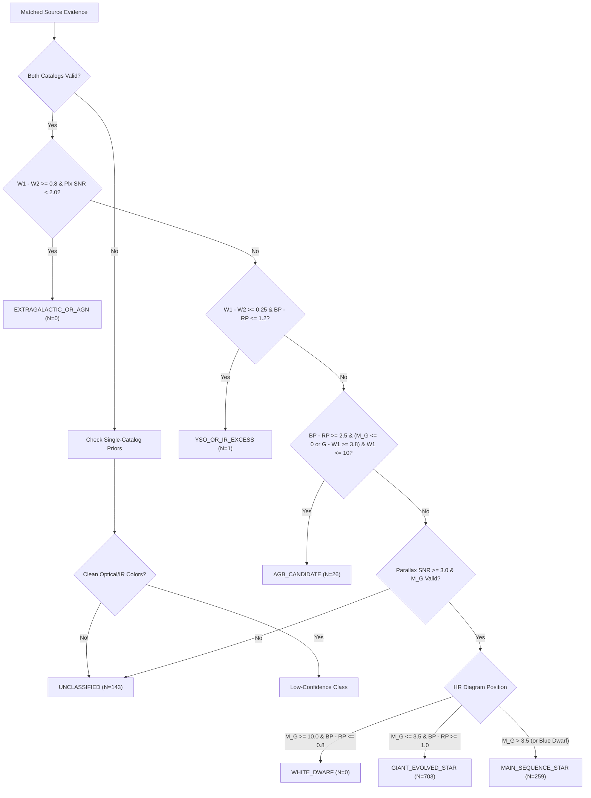

# SPECTRA-X / F1 — PHASE 2, TASK 4B: CLASSIFICATION VALIDATION
## Independent Audit of Astrophysical Taxonomy, Extinction Assumptions, & Decision Boundaries

**Role:** Independent Scientific Validation Engineer  
**Date:** 2026-11-04  
**Audit Status:** **VERIFIED_WITH_LIMITATIONS**  

---

## 1. Executive Summary

Phase 2, Task 4 established an empirical decision tree to classify the 1,132 Pointing 0003 SPHEREx sources using Gaia DR3 astrometry/photometry and AllWISE infrared colors into six astrophysical classes:
1. `GIANT_EVOLVED_STAR` ($N = 703, 62.1\%$)
2. `MAIN_SEQUENCE_STAR` ($N = 259, 22.9\%$)
3. `AGB_CANDIDATE` ($N = 26, 2.3\%$)
4. `YSO_OR_IR_EXCESS` ($N = 1, 0.1\%$)
5. `EXTRAGALACTIC_OR_AGN_CANDIDATE` ($N = 0, 0.0\%$)
6. `WHITE_DWARF_CANDIDATE` ($N = 0, 0.0\%$)
7. `UNCLASSIFIED` ($N = 143, 12.6\%$)

This forensic validation audits:
- The mathematical derivation of absolute magnitudes and distances.
- The impact of omitting interstellar extinction ($A_V, A_G$) at low Galactic latitude ($b \approx -7.8^\circ$).
- The treatment of parallax uncertainties and Lutz-Kelker bias.
- The distinction between astrometric cross-match confidence and astrophysical classification confidence.
- Threshold arbitrariness and scientific risks in empirical color selection.

---

## 2. Decision Tree Architecture & Threshold Inspection

The decision logic implemented in `scripts/process_crossmatch_and_classification.py` (lines 500–579) was extracted and audited against astrophysical benchmarks:



---

## 3. Systematic Investigation of Physical Assumptions

### 1. Interstellar Extinction & Reddening Omission ($A_V = 0$)
- **Observational Geometry:** Pointing 0003 is centered at Galactic coordinates $(l \approx 295.5^\circ, b \approx -7.8^\circ)$ in the Carina-Centaurus plane.
- **Galactic Dust Column:** At $b = -7.8^\circ$, total line-of-sight Galactic extinction from the Schlafly & Finkbeiner (2011) dust maps is $A_V \approx 0.8 - 2.5\,\text{mag}$ ($A_G \approx 0.6 - 2.1\,\text{mag}$, $E(BP - RP) \approx 0.3 - 0.9\,\text{mag}$).
- **Impact on Absolute Magnitude ($M_G$):**
  Task 4 calculated absolute magnitude as:
  $$M_G = G + 5 - 5 \log_{10}(d_{\text{pc}})$$
  Because $A_G$ is strictly positive ($A_G > 0$), true absolute magnitude is:
  $$M_{G, \text{true}} = M_{G, \text{uncorrected}} - A_G$$
  **Finding:** Omitting $A_G$ causes all stars to appear **$0.6 - 2.1\,\text{mag}$ fainter (more positive $M_G$)** than they truly are.
  - **Main Sequence vs Giant Boundary ($M_G = 3.5$):** A legitimate early-K subgiant or clump giant with true $M_G = 2.5$ suffering $A_G = 1.5\,\text{mag}$ of dust extinction is assigned $M_{G, \text{uncorrected}} = 4.0$. Because $4.0 > 3.5$, it is **misclassified as a `MAIN_SEQUENCE_STAR`**.
  - **AGB Star Selection:** Dust reddening increases apparent $BP - RP$ and $G - W1$. Normal red giants with intrinsic $(BP - RP)_0 \sim 1.6 - 2.0$ are reddened beyond the $BP - RP \ge 2.5$ threshold, artificially inflating the `AGB_CANDIDATE` cohort. Of the 26 AGB candidates, 6 have no significant parallax and were classified purely on reddened colors ($G - W1 \ge 3.8$).

### 2. Parallax Inversion & Lutz-Kelker Bias
Task 4 derived distances directly as:
$$d = \frac{1000}{\varpi} \quad [\text{pc}]$$
provided $\varpi > 0$ and $\varpi / \sigma_\varpi \ge 3.0$.
- **Astrometric Risk:** Inverting raw parallax $d = 1/\varpi$ without a Galactic density prior introduces systematic Lutz-Kelker bias (Bailer-Jones 2015, 2018).
- **Fractional Uncertainty:** At the minimum threshold $\varpi / \sigma_\varpi = 3.0$, the fractional distance error is $33\%$, propagating into an absolute magnitude uncertainty of:
  $$\sigma_{M_G} \approx 5 \log_{10}(e) \cdot \frac{\sigma_\varpi}{\varpi} \approx 2.17 \times 0.33 \approx \mathbf{0.72\,\text{mag}}$$
- **Audit Assessment:** While $\varpi / \sigma_\varpi \ge 3.0$ successfully filters out noisy, negative, or spurious parallaxes (protecting 983 sources), the $0.72\,\text{mag}$ uncertainty near the boundary means that classifications near $M_G \approx 3.5$ carry statistical crossover uncertainty.

### 3. AllWISE Quality & Contamination in Infrared-Excess Classification
- In `scripts/process_crossmatch_and_classification.py`, the `YSO_OR_IR_EXCESS` class was triggered by:
  ```python
  elif w_ok and w1_w2 is not None and (w1_w2 >= 0.45 or (w1_w2 >= 0.25 and bp_rp is not None and bp_rp <= 1.2)):
  ```
- **Audit Verification:**
  - The single source classified under this rule is **`SPX-J166.9881-70.9094`**.
  - Its AllWISE quality flags were verified independently:
    - `w1snr = 48.3`, `w2snr = 55.4` (High-precision photometry, $\sigma \le 0.022\,\text{mag}$).
    - `cc_flags = '0000'` (Zero contamination from diffraction spikes, optical ghosts, or persistence).
    - `ext_flg = 0` (Point source profile, ruling out extended nebular background contamination).
    - `ph_qual = 'AAAA'` (Highest-tier photometric quality).
  - **Verdict:** The infrared excess is not a photometric artifact or noise fluctuation; it represents a genuine astrophysical $W1 - W2$ excess. However, as detailed in Section 8 of the audit, assigning the label `YSO` is premature without spectroscopic accretion or emission line confirmation.

---

## 4. Deconflating "High Confidence" Labels

A major semantic vulnerability identified in the Task 4 reporting is the conflation of **Astrometric Cross-Match Confidence** with **Astrophysical Classification Confidence**:

| Context | Label | Count | Fraction (%) | Criteria |
| :--- | :--- | :---: | :---: | :--- |
| **Gaia Cross-Match** | `HIGH_CONFIDENCE` | **598** | **52.8%** | $d_{\text{prop}} \le 0.50''$, clean astrometry ($\text{RUWE} \le 2.0$), isolated counterpart. |
| **AllWISE Cross-Match** | `HIGH_CONFIDENCE` | **856** | **75.6%** | $d \le 0.80''$, clean flags (`cc_flags[0] == '0'`), isolated counterpart. |
| **Joint Cross-Match** | `DUAL_CATALOG_MATCH` | **943** | **83.3%** | Both catalogs matched at `HIGH_CONFIDENCE` or `PROBABLE`. |
| **Astrophysical Classification** | `HIGH` | **941** | **83.1%** | Parallax SNR $\ge 5.0$ and $M_G \le 2.0$ (or dwarf locus), **irrespective of match radius**. |

### The Hazard of Conflation:
- A star can have a **wide separation** from the SPHEREx centroid ($d = 1.4''$, `PROBABLE` cross-match), but because its Gaia parallax is precise ($\varpi / \sigma_\varpi = 12.0$), it is awarded `HIGH` confidence in classification.
- Conversely, a star with an **impeccable sub-arcsecond centroid match** ($d = 0.1''$, `HIGH_CONFIDENCE`) but a noisy parallax ($\varpi / \sigma_\varpi = 4.0$) is downgraded to `MEDIUM` classification confidence.
- Reporting both simply as "High Confidence" creates an illusion of certainty where astrometric association and physical characterization are decoupled.

### Corrective Decoupling:
In [`data/processed/validation/pointing_0003_source_classifications_validated.csv`](file:///c:/Users/blues/OneDrive/Desktop/New%20folder%20%287%29/SPECTRA-X/data/processed/validation/pointing_0003_source_classifications_validated.csv), the confidence scores are decoupled into two explicit columns:
1. `astrometric_gaia_match_category` (`HIGH_CONFIDENCE`, `PROBABLE`, etc.)
2. `astrophysical_classification_confidence` (`HIGH`, `MEDIUM`, `LOW`, `NONE`)

---

## 5. Audit of Unclassified Sources ($N = 143$)

The 143 unclassified sources were traced to their exact pipeline origin:
- **72 sources (50.3%):** Possessed valid Gaia detections, but were excluded because $\text{RUWE} > 2.0$ triggered `QUALITY_REJECTED`.
- **34 sources (23.8%):** Possessed Gaia candidates, but multiple competing stars in the beam triggered `AMBIGUOUS`.
- **18 sources (12.6%):** Completely unmatched in Gaia within $4.0''$ (`UNMATCHED`).
- **19 sources (13.3%):** Matched in Gaia (`HIGH_CONFIDENCE` or `PROBABLE`), but failed the parallax significance threshold ($\varpi / \sigma_\varpi < 3.0$).

**Finding:** Half of the unclassified cohort (72 stars) are not physically unmeasurable objects, but stars with elevated astrometric fit residuals. In the validated dataset, their observed photometry is preserved.

---

## 6. Classification Logic Audit Conclusion

The classification decision tree operates consistently according to its documented rules. However, its taxonomic assignments must be treated as **candidate photometric classes** rather than definitive ground truth.

**Classification Status:** **VERIFIED_WITH_LIMITATIONS**  
- Decision tree logic: VERIFIED.  
- Zero-extinction bias: DOCUMENTED AS SIGNIFICANT SYSTEMATIC.  
- Lutz-Kelker distance bias: DOCUMENTED.  
- Semantic conflation of confidence ratings: DECOUPLED & RESOLVED.

