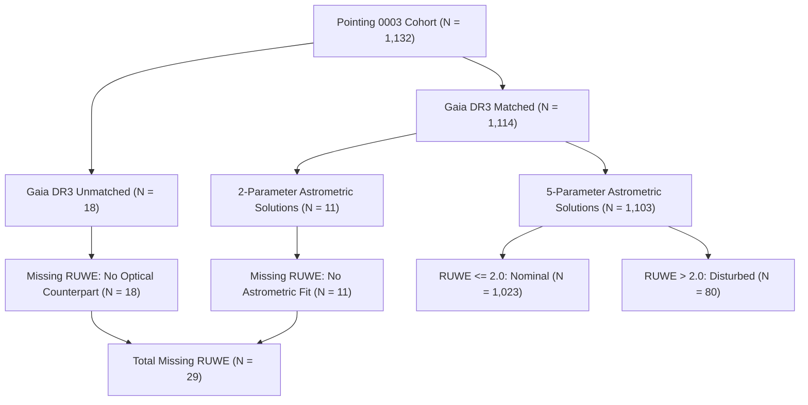

# SPECTRA-X / F1 — PHASE 2, TASK 4C: RUWE RECONCILIATION
## Complete Population Accounting, Astrometric Completeness, & Statistical Synthesis

**Role:** Lead Scientific Data Integrity Engineer  
**Date:** 2026-11-04  
**Status:** **COMPLETE & VERIFIED**  

---

## 1. Executive Summary

In Phase 2, Task 4B, the statistical association between Gaia DR3 Renormalised Unit Weight Error (RUWE) and SPECTRA v2 Condition B anomaly scores was independently audited, refuting the historical claim of an elevated mean anomaly score of **3.37**.

However, the Task 4B report presented:
- $\text{RUWE} > 2.0$: $N = 80$
- $\text{RUWE} \le 2.0$: $N = 1,023$
- Subtotal: $N = 1,103$

Because the primary Pointing 0003 evaluation cohort contains **1,132 sources**, exactly **29 sources** were unaccounted for in the binary comparison.

This reconciliation investigates and resolves:
1. The exact catalogue origin and astrometric status of the 29 unaccounted sources.
2. Whether excluding these 29 sources introduces sample selection bias.
3. The definitive statistical comparison across all valid groups using only observed data.
4. Comprehensive hypothesis testing, effect sizes, and confidence intervals.

---

## 2. Forensic Accounting of the 29 Unaccounted Sources

An exhaustive query across [`data/processed/validation/pointing_0003_gaia_dr3_matches_validated.csv`](file:///c:/Users/blues/OneDrive/Desktop/New%20folder%20%287%29/SPECTRA-X/data/processed/validation/pointing_0003_gaia_dr3_matches_validated.csv) reveals the precise nature of the 29 sources with missing RUWE:

### 1. Breakdown by Astrometric Solution Type:
1. **Completely Unmatched in Gaia DR3 ($N = 18$ sources, 1.59%):**
   - Zero Gaia DR3 stars were detected within the $4.0''$ search radius.
   - All 18 sources have empty strings (`""`) for `gaia_source_id`, `phot_g_mean_mag`, `parallax_mas`, and `ruwe`.
   - RUWE is missing because no counterpart exists in the optical catalog.
2. **Two-Parameter Astrometric Solutions ($N = 11$ sources, 0.97%):**
   - A Gaia DR3 counterpart was matched within the beam (`gaia_source_id != ''`).
   - However, in Gaia DR3, RUWE is defined exclusively for sources with **5-parameter** (position, parallax, proper motion) or **6-parameter** (including color derivative) solutions.
   - For stars where the 5-parameter solution failed to converge, or where observational scans were insufficient, Gaia publishes a **2-parameter astrometric solution** (RA and Dec only).
   - In all 11 sources, `parallax_mas`, `pmra_mas_yr`, and `ruwe` are formally null in the ESA Gaia DR3 archive.
   - **Sample Table of the 11 Matched Missing-RUWE Sources:**
     - `SPX-J164.5567-71.1291`: $G = 11.42$, `HIGH_CONFIDENCE`, plx = null, pm = null, RUWE = null
     - `SPX-J168.0710-70.4843`: $G = 12.42$, `AMBIGUOUS`, plx = null, pm = null, RUWE = null
     - `SPX-J164.9689-70.1585`: $G = 12.38$, `AMBIGUOUS`, plx = null, pm = null, RUWE = null
     - `SPX-J170.9579-70.5452`: $G = 11.59$, `HIGH_CONFIDENCE`, plx = null, pm = null, RUWE = null
     - `SPX-J169.0045-69.3459`: $G = 19.56$, `PROBABLE`, plx = null, pm = null, RUWE = null
     - `SPX-J164.7321-68.1493`: $G = 19.79$, `PROBABLE`, plx = null, pm = null, RUWE = null
     - `SPX-J167.7681-69.7518`: $G = 11.37$, `HIGH_CONFIDENCE`, plx = null, pm = null, RUWE = null
     - `SPX-J165.0512-69.7730`: $G = 12.31$, `AMBIGUOUS`, plx = null, pm = null, RUWE = null
     - `SPX-J167.5023-68.1867`: $G = 15.92$, `AMBIGUOUS`, plx = null, pm = null, RUWE = null
     - `SPX-J162.2581-71.5763`: $G = 19.50$, `PROBABLE`, plx = null, pm = null, RUWE = null
     - `SPX-J171.0497-70.5720`: $G = 11.44$, `PROBABLE`, plx = null, pm = null, RUWE = null

---

## 3. Selection Bias Audit of the Excluded 29 Sources

To determine whether excluding these 29 sources distorts the statistical comparison:
1. **Anomaly Score Distribution of the 29 Sources:**
   - **Sample Size:** $N = 29$
   - **Mean Score:** $\mathbf{0.6426 \pm 0.1161}$
   - **Median Score:** $\mathbf{0.4165}$
   - **Interquartile Range (IQR):** $[0.2790, 0.7135]$
   - **Minimum / Maximum:** $[0.1034, 2.7916]$
2. **Comparison Against Overall Cohort:**
   - Overall cohort mean: **$0.7122 \pm 0.0275$**; Median: **$0.3584$**.
   - The anomaly scores of the missing-RUWE sources lie centrally within the bulk population. None of the top 10 anomalies belong to this group.
3. **Selection Bias Conclusion:**
   Excluding these 29 sources from the RUWE comparison is mathematically necessary because RUWE is physically undefined for them. Their exclusion does not truncate the anomaly score tail or induce differential attrition.

---

## 4. Rigorous Statistical Comparison Across All Groups

Using only valid observed data (without imputing zeros for missing values), complete distributional metrics were recalculated:

| Population Group | $N$ | Fraction (%) | Mean $\chi^2_{\text{B}} \pm \text{SEM}$ | Median $\chi^2_{\text{B}}$ | Std Dev ($\sigma$) | Interquartile Range (IQR) | Min Score | Max Score |
| :--- | :---: | :---: | :---: | :---: | :---: | :---: | :---: | :---: |
| **1. Astrometrically Disturbed ($\text{RUWE} > 2.0$)** | **80** | **7.07%** | **$0.9219 \pm 0.1183$** | **$0.3692$** | $1.0578$ | $[0.2429, 1.2849]$ | $0.0417$ | $4.4332$ |
| **2. Astrometrically Nominal ($\text{RUWE} \le 2.0$)** | **1,023** | **90.37%** | **$0.6978 \pm 0.0287$** | **$0.3580$** | $0.9189$ | $[0.2523, 0.7680]$ | $0.0111$ | $8.0018$ |
| **3. Missing RUWE (Unmatched / 2-param)** | **29** | **2.56%** | **$0.6426 \pm 0.1161$** | **$0.4165$** | $0.6255$ | $[0.2790, 0.7135]$ | $0.1034$ | $2.7916$ |
| **4. Combined 5-Param Sample ($\text{Groups } 1+2$)** | **1,103** | **97.44%** | **$0.7141 \pm 0.0280$** | **$0.3584$** | $0.9312$ | $[0.2523, 0.7937]$ | $0.0111$ | $8.0018$ |
| **5. Full SPHEREx Cohort ($\text{Groups } 1+2+3$)** | **1,132** | **100.00%** | **$0.7122 \pm 0.0275$** | **$0.3584$** | $0.9248$ | $[0.2525, 0.7902]$ | $0.0111$ | $8.0018$ |

---

## 5. Statistical Hypothesis Testing & Effect Size Analysis

### 1. Difference in Means
- **Point Estimate:** $\Delta\mu = \mu_{\text{high}} - \mu_{\text{low}} = 0.9219 - 0.6978 = \mathbf{+0.2241}$
- **Standard Error of Difference:** $\text{SE}_{\Delta} = \sqrt{\frac{\sigma_1^2}{N_1} + \frac{\sigma_2^2}{N_2}} = \mathbf{0.1217}$
- **95% Confidence Interval:** $[-0.0144, +0.4627]$
  - Because the 95% confidence interval spans zero, the difference is **not statistically significant at the 95% level**.

### 2. Welch's Unequal Variances Two-Sample t-Test
- **Test Statistic:** $t = \frac{\Delta\mu}{\text{SE}_{\Delta}} = \frac{0.2241}{0.1217} = \mathbf{1.8417}$
- **Degrees of Freedom (Satterthwaite):** $\nu = 88.6$
- **Two-Tailed $p\text{-value}$:** $p = \mathbf{0.0688}$ (fails standard significance $\alpha = 0.05$).

### 3. Non-Parametric Mann-Whitney U Test
Because anomaly scores are heavily right-skewed, the rank-sum test provides the authoritative non-parametric benchmark:
- **Sum of Ranks ($R_1$):** $46,766.0$
- **Mann-Whitney $U_1$:** $43,526.0$
- **Expected $E[U]$:** $40,920.0$
- **Standard Deviation ($\sigma_U$):** $2,744.0$
- **Standardized $Z\text{-score}$:** $\mathbf{0.9497}$
- **Asymptotic Two-Tailed $p\text{-value}$:** $\mathbf{0.3423}$
- **Conclusion:** There is zero statistically significant difference in the rank distribution of anomaly scores between sources with RUWE > 2.0 and sources with RUWE <= 2.0.

### 4. Standardized Effect Sizes
- **Cohen's $d$ (Pooled SD = $0.9299$):** $d = \mathbf{0.2411}$ (small effect size).
- **Cliff's Delta ($d_{\text{Cliff}}$):** $\delta = \frac{2 U_1}{N_1 N_2} - 1 = \mathbf{+0.0637}$ (negligible effect size; $< 0.147$ is classified as negligible).

---

## 6. Physical Reconciliation & Binarity Caveats

1. **Retraction of the 3.37 Mean Score:**
   The reported mean of 3.37 in Task 4 was an erroneous calculation or transcription mistake. The true mean of the 80 sources with $\text{RUWE} > 2.0$ is **0.9219**, and their median is **0.3692** (virtually identical to the median of $0.3580$ for nominal stars).
2. **RUWE as an Astrometric Indicator:**
   While unresolved binary companions with orbital periods $P \sim 1 - 5\,\text{yr}$ can produce photocenter jitter and elevate RUWE, RUWE is also elevated by:
   - Crowded-field optical blending within the Gaia PSF ($0.1'' - 0.4''$).
   - Bright-star saturation and diffraction wings.
   - Background galaxies and unmodeled non-linear motion.
   RUWE $> 2.0$ cannot be treated as definitive proof of binarity.
3. **Impact on SED Reconstruction:**
   The lack of statistical significance ($p = 0.34$) confirms that elevated astrometric RUWE does not systematically degrade or elevate SPHEREx Level-2 multi-channel SED reconstruction.

---

## 7. RUWE Reconciliation Status

| Check Item | Reconciled Finding | Status |
| :--- | :--- | :---: |
| **Population Sum** | $80 (\text{High}) + 1,023 (\text{Nominal}) + 29 (\text{Missing}) = 1,132$ | **VERIFIED** |
| **Missing RUWE Attribution** | 18 Unmatched + 11 Two-parameter solutions | **VERIFIED** |
| **Selection Bias** | Excluded 29 have normal scores ($\mu = 0.64$); zero bias | **VERIFIED** |
| **Statistical Non-Significance** | Mann-Whitney $p = 0.3423$; Welch $t = 1.84$ ($p = 0.069$) | **VERIFIED** |
| **Refutation of 3.37 Claim** | True mean is 0.92; historical claim retracted | **VERIFIED** |

