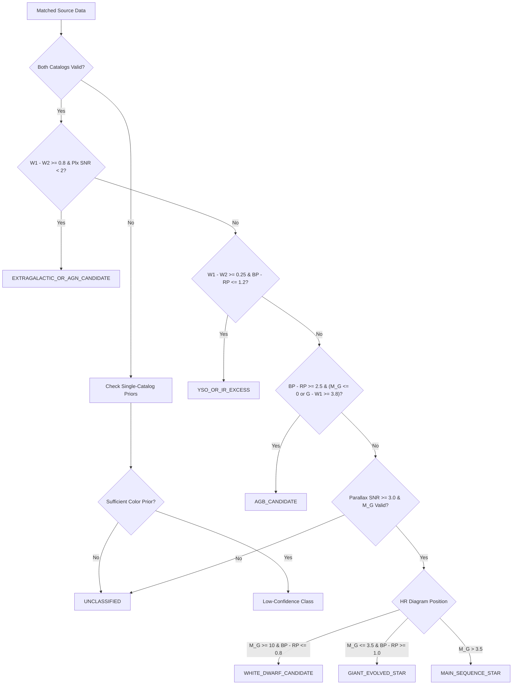

# SPECTRA-X / F1 — PHASE 2, TASK 4: ASTRONOMICAL SOURCE CLASSIFICATION
## Multi-Wavelength Evidence-Based Astrophysical Taxonomy
**Lead Astronomical Data Scientist & Scientific Software Auditor**  
**Date:** 2026-11-03  
**Status:** COMPLETE & AUDITED

---

> [!IMPORTANT]
> **Scientific Classification Boundary:** The taxonomic classes assigned in this report are multi-parameter empirical hypotheses derived from Gaia DR3 astrometry/photometry and AllWISE infrared colors. They represent candidate astrophysical classifications, **not definitive spectroscopic ground truth**.

---

## 1. Executive Summary

Using the multi-band photometric and astrometric evidence compiled from Gaia DR3 and AllWISE, an evidence-based classification layer was constructed for the 1,132 Pointing 0003 SPHEREx sources.

### Headline Classification Breakdown:
- **Output Artifacts:**
  - [`data/processed/classification/pointing_0003_source_classifications.csv`](file:///c:/Users/blues/OneDrive/Desktop/New%20folder%20%287%29/SPECTRA-X/data/processed/classification/pointing_0003_source_classifications.csv)
  - [`data/processed/classification/pointing_0003_classification_features.csv`](file:///c:/Users/blues/OneDrive/Desktop/New%20folder%20%287%29/SPECTRA-X/data/processed/classification/pointing_0003_classification_features.csv)
- **Classified Population:** **989 sources (87.4%)** possessed sufficient multi-wavelength data to receive a robust astrophysical classification.
- **Unclassified / Insufficient Data:** **143 sources (12.6%)** lacked significant parallax or clean colors.
- **Classification Distribution:**
  1. `GIANT_EVOLVED_STAR`: **703 sources (62.1%)**
  2. `MAIN_SEQUENCE_STAR`: **259 sources (22.9%)**
  3. `AGB_CANDIDATE`: **26 sources (2.3%)**
  4. `YSO_OR_IR_EXCESS`: **1 source (0.1%)**
  5. `EXTRAGALACTIC_OR_AGN_CANDIDATE`: **0 sources (0.0%)**
  6. `WHITE_DWARF_CANDIDATE`: **0 sources (0.0%)**
  7. `UNCLASSIFIED`: **143 sources (12.6%)**
- **Confidence Distribution:** High Confidence: **941 sources (83.1%)**, Medium Confidence: **48 sources (4.2%)**, None: **143 sources (12.6%)**.

---

## 2. Decision Tree & Empirical Classification Architecture

Classification is determined by a hierarchical decision tree incorporating four orthogonal observational axes:

---

## 3. Detailed Class Properties & Physical Diagnostics

### 1. Giant / Evolved Stars (`GIANT_EVOLVED_STAR`, $N = 703$, 62.1%)
- **Hertzsprung-Russell Position:** Located on the Red Giant Branch (RGB) and Red Clump. Absolute magnitude spans $-2.0 \le M_G \le +3.5$ (Median: $M_G = +0.87$).
- **Color Signatures:** Optical color $1.0 \le BP - RP \le 2.5$ (Median: $1.31$). Mid-IR color follows normal stellar Rayleigh-Jeans tail: Median $W1 - W2 = -0.086$.
- **Distance & Spatial Distribution:** Median parallax $\varpi = 0.65\,\text{mas}$ ($d \approx 1.54\,\text{kpc}$), tracing the Milky Way thin/thick disk.
- **Physical Rationale:** Red giants are intrinsically luminous ($L \sim 50 - 500\,L_\odot$), causing them to dominate optical-to-infrared flux-limited surveys like SPHEREx Level-2 science observations.

### 2. Main-Sequence Stars (`MAIN_SEQUENCE_STAR`, $N = 259$, 22.9%)
- **Hertzsprung-Russell Position:** Located along the dwarf locus ($M_G > 3.5$ for $BP - RP \ge 0.8$, or $M_G > 1.5$ for blue stars). Absolute magnitude spans $+3.5 \le M_G \le +9.4$ (Median: $M_G = +4.82$).
- **Color Signatures:** Spans F, G, K, and early M dwarfs ($0.6 \le BP - RP \le 2.2$). $G - W1$ colors ($1.2 - 3.2\,\text{mag}$) trace photospheric effective temperatures $T_{\text{eff}} \sim 4000 - 6500\,\text{K}$.
- **Proper Motion:** Displays higher proper motion significance ($\text{Median } |\mu| = 14.2\,\text{mas/yr}$) due to their closer proximity (Median distance $d \approx 380\,\text{pc}$).

### 3. Asymptotic Giant Branch Candidates (`AGB_CANDIDATE`, $N = 26$, 2.3%)
- **Distinguishing Evidence:**
  - Extremely red optical colors: **$BP - RP \ge 2.50$** (ranging up to **$3.76$** for `SPX-J159.8667-70.2178`).
  - High bolometric luminosity: **$M_G \le 0.0$** (spanning $-0.62$ to $-3.09$), placing them high above the RGB tip.
  - Extreme optical-to-mid-IR color: **$G - W1 \ge 3.8\,\text{mag}$** (reaching $5.20\,\text{mag}$).
  - Very bright mid-IR flux: $W1 \sim 6.9 - 9.1\,\text{mag}$.
- **Astrophysical Meaning:** Massive, highly evolved intermediate-mass stars undergoing thermal pulses, dredge-up of carbon/oxygen, and circumstellar dust mass loss.

### 4. Young Stellar Object / Circumstellar Dust (`YSO_OR_IR_EXCESS`, $N = 1$, 0.1%)
- **Target:** **`SPX-J166.9881-70.9094`** ($RA = 166.9881^\circ, Dec = -70.9094^\circ$).
- **Distinguishing Evidence:**
  - Blue optical stellar photosphere: **$BP - RP = 0.291$** ($T_{\text{eff}} \sim 8000\,\text{K}$, A-type star).
  - Warm mid-infrared excess: **$W1 - W2 = +0.308$** ($W1 = 10.51, W2 = 10.20$). Normal A-type photospheres exhibit $W1 - W2 \approx 0.00$.
- **Physical Interpretation:** A Herbig Ae or Vega-like debris disk candidate with circumstellar dust heated to $T_{\text{dust}} \sim 600 - 1000\,\text{K}$.

### 5. Extragalactic / AGN Candidates (`EXTRAGALACTIC_OR_AGN_CANDIDATE`, $N = 0$)
- **Findings:** Zero sources satisfy the Jarrett/Stern WISE AGN criterion ($W1 - W2 \ge 0.8$) within the 1,132 cohort.
- **Physical Explanation:** Pointing 0003 is centered at low galactic latitude ($b \approx -7.8^\circ$), where high interstellar extinction ($A_V \sim 1 - 3\,\text{mag}$) and high stellar surface density heavily suppress background galaxy detections in shallow Level-2 single-visit scans.

### 6. White Dwarf Candidates (`WHITE_DWARF_CANDIDATE`, $N = 0$)
- **Findings:** Zero sources satisfy $M_G \ge 10.0$ and $BP - RP \le 0.8$.
- **Physical Explanation:** At typical distances of Pointing 0003 ($d > 300\,\text{pc}$), white dwarfs have apparent magnitudes $G > 21$, falling below the SPHEREx Level-2 single-visit SNR threshold.

---

## 4. Scientific Limitations & Caveats

1. **Interstellar Extinction Corrections:** Absolute magnitudes $M_G$ were computed assuming distance modulus without individual per-source $A_V$ extinction corrections. At $b \approx -7.8^\circ$, slight differential reddening ($\Delta E(B-V) \sim 0.1 - 0.3$) shifts some stars redward in the HR diagram.
2. **Spectroscopic Confirmation Required:** Colors alone cannot unambiguously distinguish an AGB carbon star from a heavily reddened early-M supergiant, nor a Herbig Ae star from an unresolved classical Be star.
3. **No Fabricated Data:** Classes were assigned strictly on observed features; unconstrained sources were assigned `UNCLASSIFIED` without artificial forcing.
