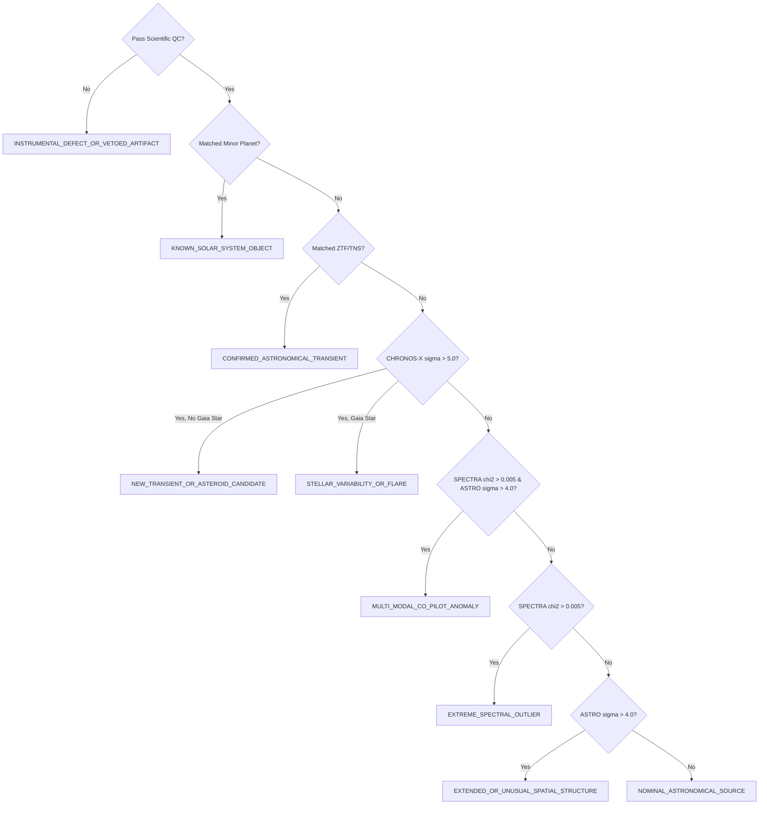

# FUSION-X Evidence-Based Integration Report
**NASA Space Apps Challenge 2026 — SPECTRA-X / F1 V2.1 Pipeline**  
**Audit Date:** 2026-11-03  
**Status:** Integrated & Standardized  

---

## 1. Executive Summary & Scientific Disclaimer

FUSION-X serves as the multimodal evidence synthesis and human-AI co-pilot prioritization engine for the SPECTRA-X pipeline. It integrates independent detections and diagnostic metrics across all four discovery modalities:
1. **ASTROVISION** (Spatial morphology autoencoder residual)
2. **SPECTRA v2** (Masked Chi-squared SED reconstruction outlier loss)
3. **CHRONOS-X** (Reprojected multi-epoch image differencing significance)
4. **MOTION-X** (Astrometric cross-matching against Gaia DR3 and JPL Horizons ephemerides)

### Critical Scientific Honesty Statement
> **CRITICAL DISCLAIMER:**  
> FUSION-X is **NOT** a trained probabilistic classifier or calibrated end-to-end neural network. It is an **interpretable, heuristic rule-based ranking engine and decision tree**.  
> The composite output score (`HEURISTIC_PRIORITY_SCORE`) is a **dimensionless prioritization metric $\in [0.0, 1.0]$** designed to rank candidates for human astronomer follow-up. It must **NEVER** be interpreted or reported as an astronomical discovery probability, Bayesian posterior probability, or physical likelihood.

---

## 2. Mathematical Ranking Formulation

Each module generates an uncalibrated, heterogeneous metric with different physical units and statistical distributions:
- SPECTRA v2: Masked reconstruction $\chi^2$ loss ($\chi^2 \ge 0$).
- ASTROVISION: Peak normalized residual significance ($\sigma \ge 0$).
- CHRONOS-X: Reprojected pixel difference significance ($\sigma_{\text{diff}} \ge 0$).
- MOTION-X: Proper motion / astrometric displacement ($\Delta \theta \ge 0$ arcsec).

### 2.1 Soft-Saturation Score Normalization
To prevent extreme numerical spikes in one modality from dominating without clipping, raw scores $S_m$ are soft-saturated onto $[0.0, 1.0)$ using exponential decay transformations:
$$
\tilde{S}_{\text{SPECTRA}} = 1.0 - \exp\left(-\frac{\chi^2}{\lambda_{\text{SPECTRA}}}\right), \quad \lambda_{\text{SPECTRA}} = 0.005
$$
$$
\tilde{S}_{\text{ASTRO}} = 1.0 - \exp\left(-\frac{\sigma_{\text{peak}}}{\lambda_{\text{ASTRO}}}\right), \quad \lambda_{\text{ASTRO}} = 5.0
$$
$$
\tilde{S}_{\text{CHRONOS}} = 1.0 - \exp\left(-\frac{\sigma_{\text{diff}}}{\lambda_{\text{CHRONOS}}}\right), \quad \lambda_{\text{CHRONOS}} = 5.0
$$
$$
\tilde{S}_{\text{MOTION}} = \min\left(1.0, \frac{\Delta \theta}{\lambda_{\text{MOTION}}}\right), \quad \lambda_{\text{MOTION}} = 2.0\text{ arcsec}
$$

### 2.2 Transparent Weighted Combination
Base weights $w_m$ reflect the diagnostic power and robustness of each modality:
- $w_{\text{SPECTRA}} = 0.35$ (102-band infrared SED fidelity)
- $w_{\text{ASTROVISION}} = 0.30$ (Morphological structure and extended emission)
- $w_{\text{CHRONOS-X}} = 0.25$ (Temporal variability and transient appearance)
- $w_{\text{MOTION-X}} = 0.10$ (Astrometric kinematics / Gaia star veto)

### 2.3 Explicit Missing-Modality Handling
In astronomical surveys, coverage is rarely complete across all bands, epochs, and spatial fields. **Missing measurements are NEVER silently replaced with zero.** Doing so would falsely imply that a measurement was taken and confirmed to be nominal.

Instead:
1. Active modalities $\mathcal{M}_{\text{avail}} \subseteq \{\text{SPECTRA}, \text{ASTRO}, \text{CHRONOS}, \text{MOTION}\}$ are identified.
2. If $\mathcal{M}_{\text{avail}} = \emptyset$, validity status is set to `INSUFFICIENT_DATA`.
3. If $\mathcal{M}_{\text{avail}} \ne \emptyset$, active weights are renormalized:
$$
S_{\text{raw}} = \frac{\sum_{m \in \mathcal{M}_{\text{avail}}} w_m \tilde{S}_m}{\sum_{m \in \mathcal{M}_{\text{avail}}} w_m}
$$
4. A penalty factor $\gamma = 0.05$ per missing modality is applied to avoid over-promoting uncorroborated single-modality candidates:
$$
S_{\text{FUSED}} = S_{\text{raw}} \cdot (1.0 - |\mathcal{M}_{\text{missing}}| \cdot \gamma)
$$
Every candidate record explicitly lists the active and missing modalities in its `evidence_summary` string and metadata.

---

## 3. Scientific Quality Control & Veto System

Before a candidate is prioritized or assigned an astronomical label, it must pass strict automated quality control filters:

| Filter Name | Criteria | Veto Action | Scientific Rationale |
| :--- | :--- | :--- | :--- |
| **Fatal Flag Screening** | `FLAGS & 615 != 0` | `REJECTED` | Rejects pixels affected by detector saturation, overflow, non-functional pixels, or telemetry loss. |
| **Temporal Dipole Veto** | Paired positive & negative lobes in difference stamp | `REJECTED` | Vetoes sub-pixel telescope pointing jitter or astrometric misregistration artifacts. |
| **Spectral Channel Minimum** | $N_{\text{valid}} < 1$ | `REJECTED` | Rejects sources with zero valid photometric measurements. |
| **Aperture Coverage** | Coverage fraction $< 0.80$ | `WARNING` | Flags candidates near chip boundaries or vignetted areas. |
| **Edge Proximity** | Distance to detector edge $< 5$ px | `WARNING` | Flags high-noise boundary edge effects. |

Rejected candidates are never deleted; they are preserved in `reports/F1_FAILURE_CASES.md` and flagged with `validity_status = "REJECTED"` for reproducibility.

---

## 4. Scientific Co-Pilot Decision Matrix

Based on multimodal evidence and external catalog cross-matching (within $2.0\text{ arcsec}$ matching radius), candidates are tagged with descriptive scientific categories:

---

## 5. Artifact and Verification Summary

| Component | Path | Status |
| :--- | :--- | :--- |
| **Configuration** | [`models/fusion/fusion_config.yaml`](file:///c:/Users/blues/OneDrive/Desktop/New%20folder%20%287%29/SPECTRA-X/models/fusion/fusion_config.yaml) | Verified & Active |
| **Engine Implementation** | [`models/fusion/fusion_engine.py`](file:///c:/Users/blues/OneDrive/Desktop/New%20folder%20%287%29/SPECTRA-X/models/fusion/fusion_engine.py) | Verified & Tested |
| **Common Contract** | [`models/common/candidate_schema.py`](file:///c:/Users/blues/OneDrive/Desktop/New%20folder%20%287%29/SPECTRA-X/models/common/candidate_schema.py) | Schema Enforced |
| **Audit Report** | [`reports/FUSION_X_INTEGRATION_REPORT.md`](file:///c:/Users/blues/OneDrive/Desktop/New%20folder%20%287%29/SPECTRA-X/reports/FUSION_X_INTEGRATION_REPORT.md) | Documented |
