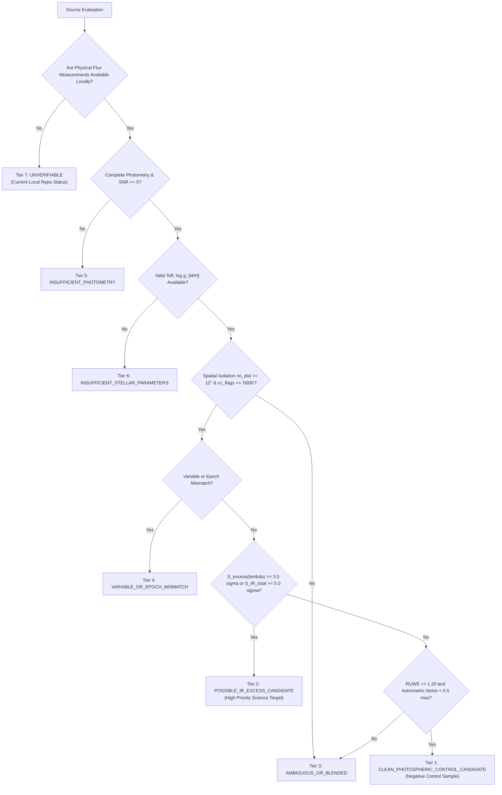

# SPECTRA-X / F1 — Phase 4, Task 4.2B
# Infrared Excess Validation Design & Theoretical Framework

**Pipeline Build:** `l2b-v27-2026-222`  
**Module:** SPECTRA + External Photometric Cross-Match Validation  
**Target Calibration Cohort:** Pointing 0008 ($N = 3,206$ sources)  
**Governance:** Strict Read-Only Scientific Design — Zero Repository Modification

---

## 1. Executive Summary & Objective

This document establishes the formal astrophysical and mathematical design for an external-catalog-assisted infrared excess validation pathway for the **SPECTRA** 102-channel infrared spectral anomaly detection engine.

The primary scientific objective of this validation pathway is to independently verify whether spectral anomalies identified by SPECTRA correspond to genuine astrophysical phenomena—specifically circumstellar dust disks, debris disks, proto-planetary envelopes, or extreme infrared transients—or whether they represent unmodeled instrumental systematics, aperture losses, baseline detrending failures, or stellar variability.

Because the local repository currently stores astrometric cross-match keys (`source_id`, `tmass_id`) and Gaia optical broadband magnitudes ($G, BP, RP$) but lacks external infrared flux measurements ($J, H, K_s, W1, W2$) and Gaia astrophysical parameters ($T_{\text{eff}}, \log g$), this document provides the formal mathematical formulation, error propagation architecture, contamination screening protocol, control-sample eligibility criteria, and data ingestion specifications required to execute this validation once external measurements are staged.

---

## 2. Formal Mathematical Formulation of Infrared Excess Significance

### 2.1 Monochromatic Excess Significance $S_{\text{excess}}(\lambda)$

For any photometric passband or spectrophotometric channel $\lambda$, the monochromatic infrared excess significance $S_{\text{excess}}(\lambda)$ is defined as:

$$S_{\text{excess}}(\lambda) = \frac{F_{\text{obs}}(\lambda) - F_{\text{photosphere}}(\lambda)}{\sigma_{\text{tot}}(\lambda)}$$

where:
- $F_{\text{obs}}(\lambda)$ is the observed calibrated flux density (or dereddened flux density) measured by SPHEREx or an external catalog (e.g., 2MASS $K_s$ at $2.16\,\mu\text{m}$, ALLWISE $W1$ at $3.4\,\mu\text{m}$, or $W2$ at $4.6\,\mu\text{m}$).
- $F_{\text{photosphere}}(\lambda)$ is the predicted bare stellar photospheric flux density at wavelength $\lambda$, computed from a synthetic stellar atmosphere model normalized to optical broadband fluxes.
- $\sigma_{\text{tot}}(\lambda)$ is the total combined uncertainty budget.

### 2.2 Quadrature Uncertainty Budget

The total uncertainty $\sigma_{\text{tot}}(\lambda)$ accounts for observation, model parameter uncertainty, and photometric zero-point systematics combined in quadrature:

$$\sigma_{\text{tot}}^2(\lambda) = \sigma_{\text{obs}}^2(\lambda) + \sigma_{\text{photosphere}}^2(\lambda) + \sigma_{\text{sys}}^2(\lambda)$$

where:
1. **Observational Uncertainty $\sigma_{\text{obs}}(\lambda)$:**
   $$\sigma_{\text{obs}}(\lambda) = \sqrt{\sigma_{\text{stat}}^2 + \sigma_{\text{bg}}^2 + \sigma_{\text{cal}}^2}$$
   incorporating detector Poisson variance, background subtraction variance, and per-epoch extraction noise.
2. **Photospheric Modeling Uncertainty $\sigma_{\text{photosphere}}(\lambda)$:**
   Propagated from the uncertainties in the fitted stellar atmospheric parameters ($\delta T_{\text{eff}}$, $\delta \log g$, $\delta \text{[M/H]}$, $\delta A_V$) and optical normalization:
   $$\sigma_{\text{photosphere}}^2(\lambda) = \left(\frac{\partial F_{\text{phot}}}{\partial T_{\text{eff}}}\right)^2 \delta T_{\text{eff}}^2 + \left(\frac{\partial F_{\text{phot}}}{\partial \log g}\right)^2 \delta \log g^2 + \left(\frac{\partial F_{\text{phot}}}{\partial A_V}\right)^2 \delta A_V^2 + \sigma_{\text{norm}}^2$$
3. **Systematic Calibration Floor $\sigma_{\text{sys}}(\lambda)$:**
   Represents cross-instrument zero-point calibration differences, filter bandpass transformation residuals, and spatial aperture mismatch between instruments. We establish a conservative systematic floor of $\sigma_{\text{sys}} / F_{\text{phot}} = 0.03$ (3%).

### 2.3 Integrated Multiband Excess Significance $S_{\text{IR\_total}}$

To prevent single-channel noise spikes from masquerading as physical infrared excess, we define the directional integrated excess significance over the set of infrared channels $\Lambda_{\text{IR}} = \{\lambda_i : \lambda_i \ge 2.0\,\mu\text{m}\}$:

$$S_{\text{IR\_total}} = \sqrt{\sum_{\lambda_i \in \Lambda_{\text{IR}}} \left[\max\left(0, \frac{F_{\text{obs}}(\lambda_i) - F_{\text{photosphere}}(\lambda_i)}{\sigma_{\text{tot}}(\lambda_i)}\right)\right]^2}$$

A source is deemed a candidate for genuine infrared excess if and only if:
1. $S_{\text{excess}}(\lambda) \ge 3.0\sigma$ in at least two adjacent infrared bands, or
2. $S_{\text{IR\_total}} \ge 5.0\sigma$ across the infrared bandpass.

---

## 3. Photospheric Baseline & Model Fitting Architecture

### 3.1 Synthetic Stellar Atmosphere Grid

The stellar photospheric baseline $F_{\text{photosphere}}(\lambda)$ must be constructed using authoritative synthetic stellar spectral grids:
- **BT-Settl (CIFIST2011)** or **PHOENIX ACES** for low-mass dwarfs ($T_{\text{eff}} < 4,000\,\text{K}$).
- **Kurucz ATLAS9 / Castelli & Kurucz (2004)** for solar-type and hot stars ($4,000\,\text{K} \le T_{\text{eff}} \le 30,000\,\text{K}$).

### 3.2 Fitting Protocol & Interstellar Extinction Correction

1. **Optical Anchor:** The model is fitted exclusively to optical photometric passbands ($\lambda < 0.9\,\mu\text{m}$: Gaia $G, BP, RP$), where circumstellar dust emission is negligible compared to stellar photospheric emission.
2. **Atmospheric Parameters:** Initial parameter guesses are provided by Gaia Apsis GSP-Phot ($T_{\text{eff\_gspphot}}, \log g_{\text{gspphot}}, \text{[M/H]}_{\text{gspphot}}$).
3. **Extinction De-reddening:** Observed optical fluxes are de-reddened using the Fitzpatrick (1999) or Cardelli, Clayton, & Mathis (1989) extinction law with total-to-selective extinction ratio $R_V = 3.1$, applying Gaia line-of-sight extinction estimates $A_G$ and $E(BP-RP)$.
4. **Rayleigh-Jeans Extrapolation Fallback:** In the absence of spectroscopic atmospheric parameters, an empirical Rayleigh-Jeans tail ($F_\nu \propto \nu^2$, $F_\lambda \propto \lambda^{-4}$) normalized to the de-reddened 2MASS $J$ and $H$ bands serves as an upper bound on photospheric emission.

---

## 4. Contamination, Confusion, and Artifact Screening

Infrared excess candidates must pass rigorous screening against known observational artifacts:

### 4.1 Beam Disparity & Spatial Blending

| Telescope / Instrument | Effective Wavelength | Angular Resolution (FWHM) | Spatial Aperture |
|---|---|---|---|
| **Gaia DR3** | Optical ($0.33 - 1.05\,\mu\text{m}$) | $\sim 0.10''$ | Sub-arcsecond profile |
| **2MASS PSC** | NIR ($1.25, 1.65, 2.16\,\mu\text{m}$) | $\sim 2.0''$ | $4.0''$ circular aperture |
| **SPHEREx** | NIR/MIR ($0.75 - 5.0\,\mu\text{m}$) | $\sim 6.2''$ pixel | $6.2'' \times 6.2''$ pixel scale |
| **ALLWISE W1** | MIR ($3.4\,\mu\text{m}$) | $6.1''$ | $8.25''$ profile-fit |
| **ALLWISE W2** | MIR ($4.6\,\mu\text{m}$) | $6.4''$ | $8.25''$ profile-fit |

- **Screening Rule 1 (Nearest Neighbor Isolation):** Any candidate with an optical nearest neighbor within $12.0''$ ($\text{nn\_dist} < 12.0''$) must be flagged as `AMBIGUOUS_OR_BLENDED` due to flux contamination in the SPHEREx and ALLWISE apertures.
  *(Note: In the P0008 calibration cohort, all 3,206 sources have $\text{nn\_dist} \ge 12.04''$, with median $50.73''$, satisfying this isolation criterion).*
- **Screening Rule 2 (Saturation Spillover):** Sources within $100''$ of a bright saturated star ($\text{dist\_to\_sat} < 100''$) must be flagged.
  *(Note: In P0008, all sources have $\text{dist\_to\_sat} \ge 185.35''$, eliminating saturation diffraction artifacts).*
- **Screening Rule 3 (WISE Contamination Flags):** Any match with ALLWISE contamination flags $\text{cc\_flags} \ne \text{'0000'}$ (indicating diffraction spikes, persistence, halo, or optical ghosts) or extended morphology flag $\text{ext\_flg} > 0$ must be rejected from clean excess classification.

### 4.2 Astrometric Multiplicity & Unresolved Binaries

- **Screening Rule 4 (Astrometric Quality):** Unresolved binary stars can distort the observed optical-to-infrared color slope. Sources with Gaia Renormalized Unit Weight Error $\text{RUWE} > 1.20$ or astrometric excess noise $> 0.5\text{ mas}$ must be flagged as potential unresolved binaries and segregated from pure single-star photospheric controls.

### 4.3 Stellar Variability & Epoch Disparity

- **Screening Rule 5 (Multi-Epoch Consistency):** SPHEREx observations (mission epoch $\sim 2026.55$) occur 16.55 years after WISE (2010.0) and 10.55 years after Gaia DR3 (2016.0). Intrinsic stellar variability (pulsating AGB stars, T Tauri stars, eclipsing binaries) can create apparent color excesses between non-simultaneous observations. Candidates with ALLWISE variability flag $\text{var\_flg} > 5$ or Gaia `phot_variable_flag == 'VARIABLE'` must be classified as `VARIABLE_OR_EPOCH_MISMATCH`.

---

## 5. Candidate Eligibility Classification Schema (7 Tiers)

Every source subjected to external catalog validation must be assigned exactly one mutually exclusive classification tier:

### Detailed Tier Definitions

1. **`CLEAN_PHOTOSPHERIC_CONTROL_CANDIDATE`:**
   - Single isolated point source ($\text{RUWE} \le 1.20$, $\text{astrometric\_excess\_noise} < 0.5\text{ mas}$, $\text{nn\_dist} \ge 12.0''$).
   - Photometrically non-variable ($\text{var\_flg} \le 3$, intra-visit $\chi_\nu^2 \le 1.5$).
   - Confirmed photospheric SED: $|S_{\text{excess}}(\lambda)| < 2.0\sigma$ across all evaluated infrared channels.
   - *Scientific Role:* Negative control sample for establishing empirical false-alarm rates and calibrating SPECTRA reconstruction loss baselines.

2. **`POSSIBLE_IR_EXCESS_CANDIDATE`:**
   - Meets all single-star astrometric and spatial isolation criteria ($\text{RUWE} \le 1.40$, $\text{nn\_dist} \ge 12.0''$).
   - Uncontaminated mid-IR profile ($\text{cc\_flags} = \text{'0000'}$, $\text{ext\_flg} = 0$).
   - Confirmed infrared excess: $S_{\text{excess}} \ge 3.0\sigma$ in $\ge 2$ consecutive infrared channels or $S_{\text{IR\_total}} \ge 5.0\sigma$.
   - *Scientific Role:* Primary discovery targets (debris disks, circumstellar envelopes, extreme infrared anomalies).

3. **`AMBIGUOUS_OR_BLENDED`:**
   - Nearest neighbor within beam aperture ($\text{nn\_dist} < 12.0''$) or nearby bright saturated star ($\text{dist\_to\_sat} < 100''$).
   - WISE contamination flags active ($\text{cc\_flags} \ne \text{'0000'}$) or extended profile ($\text{ext\_flg} > 0$).
   - High astrometric binarity metric ($\text{RUWE} > 1.40$ or significant orbital acceleration).
   - *Scientific Role:* Rejected from automated validation; flagged for high-resolution imaging inspection.

4. **`VARIABLE_OR_EPOCH_MISMATCH`:**
   - Multi-epoch photometric disparity exceeding nominal uncertainties ($\Delta m > 0.3\text{ mag}$ between epochs).
   - Flagged as variable in Gaia or WISE catalogs ($\text{phot\_variable\_flag} = \text{'VARIABLE'}$, $\text{var\_flg} > 5$).
   - Significant intra-visit SPHEREx flux dispersion.
   - *Scientific Role:* Quarantined from static excess validation; routed to CHRONOS-X temporal anomaly engine.

5. **`INSUFFICIENT_PHOTOMETRY`:**
   - Missing photometric detection or non-detection upper limit in critical infrared evaluation bands ($W1, W2, K_s$).
   - Photometric signal-to-noise ratio $\text{SNR} < 5.0$.
   - *Scientific Role:* Insufficient signal to confirm or rule out excess.

6. **`INSUFFICIENT_STELLAR_PARAMETERS`:**
   - Absence of reliable $T_{\text{eff}}$, $\log g$, or extinction $A_V$ preventing construction of a unique photospheric SED model.
   - Optical colors degenerate or unconstrained.
   - *Scientific Role:* Requires external optical spectroscopy before infrared excess can be quantitatively evaluated.

7. **`UNVERIFIABLE`:**
   - Physical flux measurements absent in local storage.
   - *Scientific Role:* Current operational classification for Pointing 0008 sources regarding external NIR/MIR photometry.

---

## 6. Preconditions & Data Requirements for Future Execution

To transition this validation design from theoretical architecture to operational execution, the following data ingestion steps must be executed:

1. **Gaia DR3 Astrophysical Parameters & XP Spectra:**
   - TAP query targeting `gaiadr3.gaia_source` to retrieve `teff_gspphot`, `logg_gspphot`, `mh_gspphot`, `ag_gspphot`, and `ebpminrp_gspphot` for the 3,206 known `source_id` keys.
   - Ingestion of sampled XP spectra (`gaiadr3.xp_sampled_mean_spectrum`) for low-resolution spectrophotometric anchoring ($336 - 1020\,\text{nm}$).
2. **2MASS PSC Photometric Measurements:**
   - Tabular join on the 2,624 identified `tmass_id` designations to ingest calibrated magnitudes and errors: `j_m`, `j_cmsig`, `h_m`, `h_cmsig`, `ks_m`, `ks_cmsig`, and `ph_qual`.
3. **ALLWISE Ingestion for Pointing 0008:**
   - Pre-computed TAP spatial cross-match (cone search radius $3.0''$) centered on epoch-propagated coordinates (`ra_epoch`, `dec_epoch`) to ingest ALLWISE profile-fit photometry: `w1mpro`, `w1sigmpro`, `w2mpro`, `w2sigmpro`, `w3mpro`, `w4mpro`, `cc_flags`, `ext_flg`, and `var_flg`.

---

## 7. Governance and Verification Verdict

- **Design Status:** COMPLETE & FORMALLY SPECIFIED.
- **Local Data Availability Status:** `NOT_FEASIBLE_WITH_CURRENT_LOCAL_DATA`.
- **Reason:** While astrometric cross-match keys exist for 100% of Gaia sources and 81.85% of 2MASS counterparts, the actual physical infrared flux measurements and stellar atmospheric parameters are not present in the local repository.
- **Integrity Statement:** No code, model weights, checkpoints, or validation thresholds were modified during the formulation of this design.

