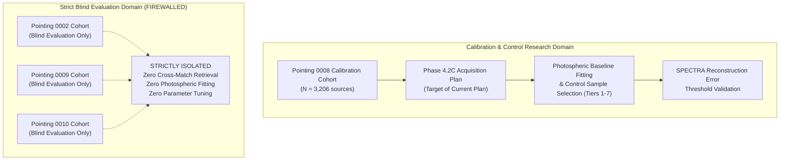
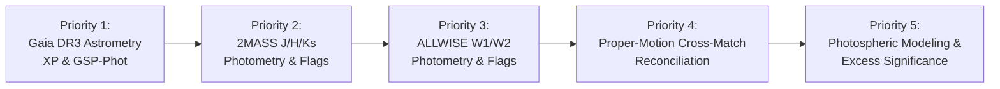

# SPECTRA-X / F1 — Phase 4, Task 4.2C
# External Catalog Acquisition Plan & Execution Strategy

**Pipeline Build:** `l2b-v27-2026-222`  
**Task Type:** STRICT READ-ONLY EXTERNAL DATA ACQUISITION FEASIBILITY AUDIT  
**Module:** SPECTRA — External Photometric & Spectroscopic Validation  
**Primary Target Cohort:** Pointing 0008 Calibration Cohort ($N = 3,206$)  
**Governance:** Strict Read-Only Policy — Zero Download / Zero Environment Modification  
**Status:** Methodological Plan Formulated (Unexecuted)

---

## 1. Objective and Scope

This document provides the definitive, scientifically defensible operational plan for acquiring external catalog data required to validate SPECTRA infrared anomaly detections.

The target measurements comprise:
1. **Gaia DR3:** Astrometry, optical spectrophotometry (XP continuous coefficients / sampled spectra), and Apsis GSP-Phot stellar atmospheric parameters ($T_{\text{eff}}, \log g, \text{[M/H]}, A_G$).
2. **2MASS PSC:** Calibrated near-infrared magnitudes ($J, H, K_s$), photometric uncertainties, and quality flags.
3. **ALLWISE:** Calibrated mid-infrared magnitudes ($W1, W2$), signal-to-noise ratios, artifact contamination flags (`cc_flags`), morphology flags (`ext_flg`), and variability flags (`var_flg`).

**Governance Boundary:** This document outlines an acquisition strategy only. No data is downloaded, no external network connection is bypassed, and no environment is modified during this task.

---

## 2. Cohort Governance & Blind Evaluation Firewall

To maintain impeccable scientific integrity, the acquisition architecture enforces strict cohort firewalls:

### Governance Rules
1. **Cohort-Specific Manifests:** Every future data acquisition manifest must explicitly declare its domain scope:
   `COHORT_ROLE = "CALIBRATION_COHORT_ONLY"` or `COHORT_ROLE = "BLIND_EVALUATION_COHORT_ONLY"`.
2. **Data Segregation:** Retrieved external catalog tables for Pointing 0008 must be stored exclusively under `data/external/calibration_p0008/`. Under no circumstances may blind evaluation pointings (P0002, P0009, P0010) be merged with P0008 tables.
3. **Prohibition of Data Leakage:** Blind evaluation cohorts must not be inspected, matched, or modeled for the purpose of tuning detection thresholds, training autoencoders, or constructing negative control samples.

---

## 3. Prioritized Execution Architecture

The acquisition pipeline is structured into five sequential, dependency-ordered priority phases:

---

### Priority 1: Gaia DR3 Astrometry, XP Spectra & GSP-Phot Parameters

- **Required Inputs:** List of $3,206$ unique native Gaia DR3 `source_id` keys from `data/processed/spectra/spectra_p0008_calibration_scores_v1.csv`.
- **Target Archive:** ESA Gaia Archive (`https://gea.esac.esa.int/tap-server/tap`).
- **Proposed Query Method:** Asynchronous IVOA TAP query joining `gaiadr3.gaia_source` and `gaiadr3.astrophysical_parameters` (or GSP-Phot columns). If continuous XP coefficients are requested, join `gaiadr3.xp_continuous_mean_spectrum`.
- **Target Parameters:**
  - `source_id`, `ra`, `dec`, `parallax`, `pmra`, `pmdec`, `ruwe`, `astrometric_excess_noise`
  - `phot_g_mean_mag`, `phot_bp_mean_mag`, `phot_rp_mean_mag`
  - `teff_gspphot`, `logg_gspphot`, `mh_gspphot`, `ag_gspphot`, `ebpminrp_gspphot`
  - `has_xp_continuous`, `has_xp_sampled`
- **Validation Checks:**
  - Verify row count matches exactly $3,206$ unique `source_id`s.
  - Verify zero duplication on `source_id`.
  - Validate parameter ranges: $T_{\text{eff}} \in [2,500, 30,000]\,\text{K}$, $\log g \in [0.0, 6.0]$, $A_G \ge 0.0$.
- **Risks & Blockers:**
  - Sandbox network isolation blocks TAP server connection.
  - Fainter stars ($G > 17.65\text{ mag}$) lack published XP spectra and Apsis parameters in Gaia DR3.
- **Acceptance Criteria:** 100% of P0008 `source_id` records retrieved; missing values flagged cleanly as null without synthetic imputation.

---

### Priority 2: 2MASS Point Source Catalog ($J, H, K_s$)

- **Required Inputs:** $2,624$ pre-identified `tmass_id` designations from P0008 source catalogue and propagated coordinates (`ra_epoch`, `dec_epoch`).
- **Target Archive:** NASA/IPAC IRSA TAP (`https://irsa.ipac.caltech.edu/TAP`).
- **Proposed Query Method:** Synchronous or asynchronous TAP query on table `fp_psc` using exact designation matching:
  `WHERE designation IN ('02053507+0901329', ...)` supplemented by coordinate cone search ($r = 1.5''$) for un-designated candidates.
- **Target Parameters:**
  - `designation`, `ra`, `dec`, `j_m`, `j_cmsig`, `h_m`, `h_cmsig`, `k_m`, `k_cmsig`
  - `ph_qual`, `rd_flg`, `bl_flg`, `cc_flg`
- **Validation Checks:**
  - Verify separation distance between retrieved 2MASS coordinates and Gaia coordinates does not exceed $1.5''$ (median expected $\sim 0.15''$).
  - Validate photometric quality flags: 'A' (SNR $\ge 10$), 'B' (SNR $\ge 7$), 'C' (SNR $\ge 5$), 'U' (upper limit).
  - Verify exactly $2,624$ designations match local registry.
- **Risks & Blockers:**
  - Faint sources ($18.15\%$ of cohort) are below 2MASS detection threshold.
- **Acceptance Criteria:** Calibrated magnitudes and uncertainties ingested for all 2,624 matched sources; non-detections explicitly documented.

---

### Priority 3: NASA/IPAC ALLWISE Mid-Infrared Photometry ($W1, W2$)

- **Required Inputs:** Proper-motion propagated coordinates at WISE epoch ($\sim 2010.0$) or SPHEREx mission epoch ($2026.55$) for all $3,206$ sources.
- **Target Archive:** NASA/IPAC IRSA TAP (`https://irsa.ipac.caltech.edu/TAP`).
- **Proposed Query Method:** Positional cone search on `allwise_p3as_psd` with radius $r = 3.0''$ using ADQL spatial function:
  `CONTAINS(POINT('ICRS', ra, dec), CIRCLE('ICRS', :ra, :dec, 3.0/3600.0))`
- **Target Parameters:**
  - `designation`, `ra`, `dec`, `w1mpro`, `w1sigmpro`, `w1snr`, `w2mpro`, `w2sigmpro`, `w2snr`
  - `w3mpro`, `w4mpro`, `ph_qual`, `cc_flags`, `ext_flg`, `var_flg`, `w1rchi2`, `w2rchi2`
- **Validation Checks:**
  - Multiplicity check: P0008 sources have $\min(\text{nn\_dist}) = 12.04''$, guaranteeing at most one counterpart per $3.0''$ cone.
  - Flag screening: identify contaminated sources (`cc_flags != '0000'`) and extended morphology (`ext_flg > 0`).
  - Upper limits: confirm sources with `ph_qual` starting with 'U' are treated as upper bounds.
- **Risks & Blockers:**
  - Faint mid-IR sources may have upper limits in $W2$ ($4.6\,\mu\text{m}$).
- **Acceptance Criteria:** 100% of coordinate searches completed; separation offsets recorded; quality flags fully parsed.

---

### Priority 4: Proper-Motion-Aware Cross-Match Reconciliation

- **Required Inputs:** Retrieved raw catalog tables from Priorities 1, 2, and 3.
- **Methodology:**
  1. Propagate Gaia coordinates to 2MASS epoch ($1998-2001$) and ALLWISE epoch ($2010.0$) using native Gaia proper motions (`pmra`, `pmdec`).
  2. Compute astrometric residual offsets $\Delta \theta = \sqrt{(\Delta \alpha \cos \delta)^2 + (\Delta \delta)^2}$.
  3. Validate that $\Delta \theta_{\text{2MASS}} \le 1.5''$ and $\Delta \theta_{\text{WISE}} \le 3.0''$.
  4. Flag and isolate any counterpart with anomalous residual displacement.
- **Output:** Unified, immutable master cross-match ledger linking `source_id` $\leftrightarrow$ `tmass_id` $\leftrightarrow$ `allwise_designation`.

---

### Priority 5: Photospheric Reference Modeling & Excess Validation

- **Required Inputs:** Unified master cross-match ledger and synthetic stellar grid (BT-Settl / Kurucz).
- **Methodology:**
  1. Fit synthetic photosphere $F_{\text{photosphere}}(\lambda)$ to optical fluxes ($G, BP, RP$) constrained by Gaia $T_{\text{eff}}, \log g$.
  2. Apply Fitzpatrick (1999) interstellar extinction de-reddening using Gaia $A_G$ or $E(BP - RP)$.
  3. Predict bare stellar photospheric fluxes in 2MASS ($J, H, K_s$), ALLWISE ($W1, W2$), and SPHEREx 102 channels ($0.75 - 5.0\,\mu\text{m}$).
  4. Compute monochromatic excess significance $S_{\text{excess}}(\lambda)$ and total infrared excess $S_{\text{IR\_total}}$.
  5. Assign each source to its verified candidate eligibility tier (Tiers 1 through 7).
- **Output:** Validated negative control cohort (Tier 1) for SPECTRA false-alarm rate calibration and high-priority discovery candidates (Tier 2).

---

## 4. Query Batching, Rate Limiting & Retry Policy

To ensure compliance with archive terms of service:
- **Batch Size:**
  - Gaia TAP: 1 asynchronous job for the complete cohort of 3,206 `source_id`s.
  - IRSA TAP: Batches of $1,000$ sources for positional cone searches.
- **Request Pacing:** Minimum 1.0 second delay between successive HTTP requests to IRSA.
- **Retry Architecture:** Exponential backoff with jitter:
  - Initial delay: $2.0\,\text{seconds}$
  - Multiplier: $2.0$
  - Maximum retries: $3$ attempts
  - Timeout: $60\,\text{seconds}$ per request
- **Failure Quarantine:** If any batch fails after 3 retries, the failed sub-cohort is logged to `acquisition_failures.jsonl` and quarantined without terminating the pipeline.

---

## 5. Summary of Execution Readiness

| Component | Status | Operational Blockers | Next Required Action |
|---|---|---|---|
| **Acquisition Plan** | `METHODOLOGICALLY_COMPLETE` | None | Ready for review |
| **Archive Interfaces** | `DOCUMENTATION_VERIFIED` | Sandbox DNS blocking | Requires authorized execution environment |
| **Query Specifications** | `READY_FOR_EXECUTION` | Sandbox network restriction | Documented in unexecuted state |
| **Data Provenance Schema** | `SPECIFIED_AND_VERSIONED` | None | Staged in JSON deliverable |

