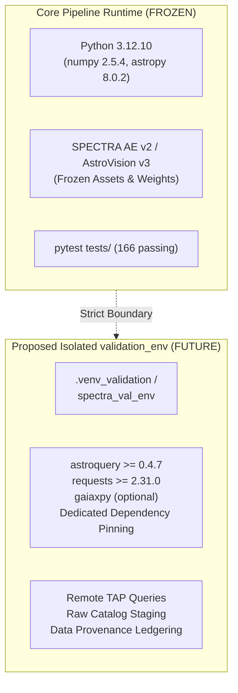

# SPECTRA-X / F1 — Phase 4, Task 4.2C
# Future Validation Environment Requirements & Dependency Audit

**Pipeline Build:** `l2b-v27-2026-222`  
**Task Type:** STRICT READ-ONLY EXTERNAL DATA ACQUISITION FEASIBILITY AUDIT  
**Module:** SPECTRA — External Photometric & Spectroscopic Validation  
**Current Environment Inspected:** Python 3.12.10 (Windows AMD64)  
**Governance:** Zero Installation / Zero Environment Modification / Explicit Authorization Required  

---

## 1. Executive Summary

This document specifies the technical requirements, software dependencies, and architecture for a dedicated, isolated **`validation_env`** designed to execute future external catalog data retrieval and validation workflows without altering the existing core repository or machine learning runtime.

In accordance with strict read-only governance, **zero packages have been installed or modified** during this audit. Creation of any new virtual environment requires explicit, separate authorization from the project owner.

---

## 2. Dependency Evaluation Ledger

The current Python environment was non-invasively inspected. The status of each target package is detailed below:

| Dependency | Purpose | Installed Status | Version (if installed) | Classification | Compatibility & Risk Assessment |
|---|---|---|---|---|---|
| **Python** | Core runtime interpreter | **INSTALLED** | `3.12.10` | **Essential** | Standard base runtime |
| **`numpy`** | Array mathematics & vector operations | **INSTALLED** | `2.5.4` | **Essential** | NumPy 2.x release; requires downstream packages built with NumPy 2.x ABI support |
| **`pandas`** | Tabular catalog processing & join logic | **INSTALLED** | `3.1.1` | **Essential** | Compatible with modern Python 3.12 runtime |
| **`scipy`** | Numerical integration, interpolation & SED fitting | **INSTALLED** | `1.18.1` | **Essential** | Fully compatible |
| **`astropy`** | Coordinate propagation, units, FITS & VOTable I/O | **INSTALLED** | `8.0.2` | **Essential** | Native FITS (`astropy.io.fits`) and VOTable (`astropy.io.votable`) supported out of the box |
| **`astroquery`** | Programmatic TAP queries to Gaia & IRSA | **NOT_INSTALLED** | N/A | **Essential (Future)** | Required for automated TAP submission; requires `requests` and `keyring` |
| **`gaiaxpy`** | Inversion of Hermite coefficients to sampled spectra | **NOT_INSTALLED** | N/A | **Optional** | Needed only if generating sampled XP flux arrays from continuous coefficients |
| **`requests`** | Direct HTTP REST/TAP execution | **NOT_INSTALLED** | N/A | **Essential (Future)** | Standard HTTP transport library |
| **`urllib3`** | Low-level HTTP transport client | **INSTALLED** | `2.8.0` | **Supporting** | Transport layer available in environment |
| **`hashlib` / `json`** | Cryptographic hashing & provenance ledgering | **INSTALLED** | Standard Library | **Essential** | Built-in SHA-256 and JSON serialization |

---

## 3. Detailed Component Analysis

### 3.1 FITS & VOTable Support
- **Status:** **FULLY AVAILABLE** in inspected environment.
- **Verification:** Both `astropy.io.fits` and `astropy.io.votable` import successfully and are fully functional. Ingesting FITS binary tables and IVOA VOTable XML streams returned by TAP queries can be handled natively without installing additional parsers.

### 3.2 Automated TAP Query Execution (`astroquery`)
- **Status:** Currently **NOT INSTALLED**.
- **Role in Validation Environment:** Provides high-level Python interfaces `astroquery.gaia.Gaia` and `astroquery.ipac.irsa.Irsa` for programmatic asynchronous job submission, polling, and automatic result table downloading.
- **Alternative Implementation:** Direct HTTP requests using Python standard library `urllib.request` or `requests` sending ADQL POST payloads to the documented TAP endpoints (`https://gea.esac.esa.int/tap-server/tap/async` and `https://irsa.ipac.caltech.edu/TAP/async`). This eliminates dependency on `astroquery` if minimal overhead is preferred.

### 3.3 Gaia XP Spectral Inversion (`gaiaxpy`)
- **Status:** Currently **NOT INSTALLED**.
- **Role in Validation Environment:** Official ESA tool to convert 55 BP and 55 RP Hermite coefficients into 343-point flux vectors ($336 - 1020\text{ nm}$).
- **Risk Assessment:** `gaiaxpy` has specific dependency pinning requirements (older versions required NumPy < 2.0). Installing `gaiaxpy` into an existing environment running `numpy 2.5.4` could cause dependency conflict.
- **Mitigation:** If sampled XP spectra are desired, retrieve them directly from ESA Gaia Archive's pre-sampled tables or execute `gaiaxpy` strictly inside the isolated `validation_env`.

---

## 4. Proposed Isolated Validation Environment Architecture

To protect frozen model checkpoints (`checkpoints/spectra_masked_ae_v2.pt`), threshold registries, and training pipelines from package version drift or ABI incompatibilities:

### Environment Isolation Principles
1. **Zero Side Effects on Core Runtime:** The validation environment must be created in a distinct directory (e.g. `.venv_validation` or conda environment `spectra_val_env`) that does not overwrite global packages or site-packages used by the primary test suite.
2. **Deterministic Version Pinning:** A frozen `requirements_validation.txt` file must be generated with explicit package hashes prior to installation.
3. **Owner Authorization Prerequisite:** **No virtual environment may be initialized until explicit user authorization is granted.**

---

## 5. Pre-Execution Checklist for Project Owner Authorization

When authorization is granted to prepare the validation environment, the following actions will be executed:
1. Initialize isolated virtual environment: `python -m venv .venv_validation`.
2. Install pinned validation requirements: `requests`, `astroquery`.
3. Validate that `pytest tests/` in the primary workspace remains completely isolated and unchanged.
4. Verify external network routing and DNS resolution outside the sandbox.

