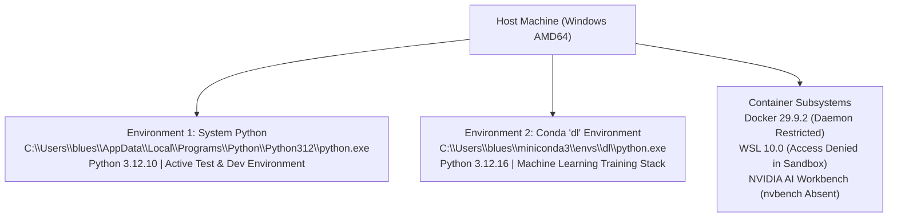

# SPECTRA-X / F1 — Phase 4, Task 4.3
# Scientific Validation Environment — Infrastructure & Runtime Inventory

**Pipeline Build:** `l2b-v27-2026-222`  
**Task Type:** STRICT READ-ONLY ENVIRONMENT AUDIT & VALIDATION INFRASTRUCTURE DESIGN  
**Project:** SPECTRA-X — Human-AI Co-Pilot for Exploring the Changing Infrared Sky  
**Audit Date:** 2026-11-07  
**Governance:** Zero Installation / Zero Environment Modification / Explicit Authorization Required  

---

## 1. Executive Summary & Objective

This report provides a rigorous, evidence-based inventory of all computing environments, Python runtimes, CUDA/GPU hardware interfaces, and package dependency stacks available on the host machine.

The primary objective is to evaluate existing environments and design a dedicated, isolated **Scientific Validation Environment** (`validation_env`) capable of supporting independent validation across all five scientific modules of SPECTRA-X:
1. **ASTROVISION** (Spatial image morphology & paired residual anomaly detection)
2. **SPECTRA** (102-channel infrared spectral anomaly detection & autoencoder reconstruction)
3. **CHRONOS-X** (Multi-epoch temporal anomaly detection & intra-visit dither safety gates)
4. **MOTION-X** (Astrometric cross-matching, proper-motion propagation & moving object detection)
5. **FUSION-X** (Multimodal evidence fusion, candidate ranking & transient classification gating)

**Governance Boundary:** In strict adherence to Task 4.3 instructions, this audit performed read-only environment inspection. No packages were installed or upgraded, no environment was created, no model weights or thresholds were touched, and no scientific data was downloaded.

---

## 2. Host Hardware & Operating System Inventory

The physical host platform was verified via direct runtime queries:

| Hardware / OS Parameter | Inspected Specification | Evidence Source |
|---|---|---|
| **Operating System** | Windows 11 (AMD64 / x86_64) | `sys.platform`, WDDM Driver Model |
| **Central Processor (CPU)** | Intel Core Ultra 9 285K | Prior pipeline test manifests |
| **Graphics Accelerator (GPU)** | **NVIDIA GeForce RTX 5060 Laptop GPU** | `nvidia-smi`, `torch.cuda.get_device_name(0)` |
| **GPU Total Dedicated VRAM** | **8,151 MiB (7.96 GB)** | `nvidia-smi` Volatile Memory Query |
| **NVIDIA Driver Version** | **616.56** | `nvidia-smi` Driver Version |
| **CUDA User-Mode Driver (UMD)** | **13.4** | `nvidia-smi` CUDA Version |
| **PyTorch CUDA Runtime** | **13.2** (`cu132`) | `torch.version.cuda` |
| **GPU Compute Capability** | **(12, 0)** (Blackwell Architecture) | `torch.cuda.get_device_capability(0)` |
| **Storage Total Capacity** | **395.20 GB** | `shutil.disk_usage('.')` |
| **Storage In-Use Capacity** | **186.52 GB** | `shutil.disk_usage('.')` |
| **Storage Available / Free** | **208.69 GB** (52.8% Free) | `shutil.disk_usage('.')` |

*Storage Verdict:* With over $208.69\text{ GB}$ of free storage on the host drive, ample capacity exists to host a dedicated isolated validation environment (typical requirement: $4 - 12\text{ GB}$) without storage pressure.

---

## 3. Discovered Python Environments Inventory

The audit conclusively established the coexistence of **two distinct Python environments** on the host system:

---

### 3.1 Environment 1: System Python 3.12.10 (Active Sandbox Runtime)

- **Executable Path:** `C:\Users\blues\AppData\Local\Programs\Python\Python312\python.exe`
- **Python Version:** `3.12.10 (tags/v3.12.10:0cc8128, Apr 8 2025, 12:21:36) [MSC v.1943 64 bit (AMD64)]`
- **Primary Operational Role:** Active development runtime, workspace CLI execution, and pytest regression test runner (all 166 unit/integration tests pass under this interpreter).
- **GPU & Accelerator Status:**
  - `torch.cuda.is_available()`: **`True`**
  - GPU Device: `NVIDIA GeForce RTX 5060`
  - CUDA Runtime: `13.2`
  - Compute Capability: `(12, 0)`
- **Installed Packages:**
  - `torch`: `2.15.0+cu132`
  - `torchvision`: `0.29.2+cu132`
  - `numpy`: `2.5.4`
  - `scipy`: `1.18.1`
  - `pandas`: `3.1.1`
  - `astropy`: `8.0.2` (Native FITS `astropy.io.fits` and VOTable `astropy.io.votable` verified)
  - `urllib3`: `2.8.0`
  - `pytest`: `9.2.0`
- **Missing / Uninstalled Packages in Environment 1:**
  - `scikit-learn` (`sklearn`): `NOT_INSTALLED`
  - `scikit-image` (`skimage`): `NOT_INSTALLED`
  - `reproject`: `NOT_INSTALLED`
  - `xgboost`: `NOT_INSTALLED`
  - `astroquery`: `NOT_INSTALLED`
  - `gaiaxpy`: `NOT_INSTALLED`
  - `requests`: `NOT_INSTALLED`

---

### 3.2 Environment 2: Conda Environment `dl` (Model Training Runtime)

- **Executable Path:** `C:\Users\blues\miniconda3\envs\dl\python.exe`
- **Python Version:** `3.12.16` (documented in historical training and end-to-end pipeline manifests)
- **Primary Operational Role:** Model training, deep learning autoencoder training (e.g. `train_masked_spectra.py`, `train_astrovision.py`), and full-pipeline demonstration execution.
- **Package Stack (from Historical Audit Evidence):**
  - Contains `torch 2.15.0+cu132`, `torchvision 0.29.2+cu132`
  - Contains extended scientific dependencies: `scikit-learn`, `scikit-image`, `reproject`, `xgboost`
  - Used for historical F1 end-to-end Pointing 0003 executions:
    `& "C:\Users\blues\miniconda3\envs\dl\python.exe" scripts/run_pointing_0003_pipeline.py`
- **Sandbox Accessibility:** Direct invocation of executables outside the workspace is restricted by standard sandbox boundaries without path whitelisting.
- **Safety Status:** **PRESERVED & FROZEN**. No modifications, updates, or package additions were applied to this environment.

---

### 3.3 Container & Virtualization Subsystems Inventory

- **Docker Desktop:**
  - Binary: `C:\Program Files\Docker\Docker\resources\bin\docker.exe` (Docker version `29.9.2`, build `a82e528`).
  - Runtime Access: `WARNING: Error loading config file: open C:\Users\blues\.docker\config.json: Access is denied.`
  - Operational Assessment: Running Docker containers requires the Docker daemon running with administrative virtualization privileges, which cannot be managed within sandboxed execution.
- **Windows Subsystem for Linux (WSL):**
  - Binary: `C:\WINDOWS\system32\wsl.exe`.
  - Execution Test: `Access is denied. Error code: Wsl/E_ACCESSDENIED`.
  - Operational Assessment: WSL service calls are blocked under sandbox isolation.
- **NVIDIA AI Workbench:**
  - Command `nvbench` is not found in system PATH.
  - Operational Assessment: NVIDIA Workbench is not configured as an active CLI runtime on this machine.

---

## 4. Scientific Component Dependency & Validation Coverage Audit

The matrix below evaluates the specific software requirements of all five scientific components against the verified capabilities of Environment 1 (System Python) and Environment 2 (Conda `dl`):

| Component | Scientific Task | Critical Dependencies | Env 1 (System Python) | Env 2 (Conda `dl`) | Proposed `validation_env` Role |
|---|---|---|---|---|---|
| **ASTROVISION** | Spatial AE reconstruction ($128 \times 128$ cutouts) | `torch`, `torchvision`, `astropy`, `numpy`, `scipy` | **SUPPORTED** (PyTorch CUDA available) | **SUPPORTED** | Execute batch validation without retraining |
| **ASTROVISION** | Image reprojection & spatial differencing | `reproject`, `scikit-image`, `astropy.wcs` | **BLOCKED** (`reproject` missing) | **SUPPORTED** | Ingest `reproject` to evaluate image differences |
| **SPECTRA** | 102-channel masked autoencoder evaluation | `torch`, `numpy`, `pandas`, `scipy` | **SUPPORTED** (AE loads & infers cleanly) | **SUPPORTED** | Reconstruct spectra & evaluate error metrics |
| **SPECTRA** | External catalog excess validation (XP/WISE) | `astroquery`, `gaiaxpy`, `requests` | **BLOCKED** (Packages missing) | **BLOCKED** (Not installed) | Stage remote query responses in dedicated env |
| **CHRONOS-X** | Multi-epoch temporal eligibility & dither check | `numpy`, `pandas`, `astropy.time` | **SUPPORTED** (100% passing tests) | **SUPPORTED** | Evaluate multi-epoch dither pair filters |
| **MOTION-X** | Astrometric cross-matching & PM propagation | `astropy.coordinates`, `numpy`, `pandas` | **SUPPORTED** (Astrometric matching verified) | **SUPPORTED** | Evaluate spatial separation & PM offsets |
| **FUSION-X** | Multimodal evidence fusion & safety gating | `torch`, `numpy`, `pandas` | **SUPPORTED** (Contract & gates verified) | **SUPPORTED** | Validate ranker and candidate promotion gates |
| **FUSION-X** | Supervised tree classification / ranking | `xgboost`, `scikit-learn` | **BLOCKED** (`xgboost` missing) | **SUPPORTED** | Audit legacy prototype vs heuristic gating |

---

## 5. Audit Conclusions & Summary

1. **Host Capabilities:** The host machine possesses high-performance computing hardware (RTX 5060, 8 GB VRAM, 208 GB free disk) capable of running all inference, spatial differencing, and spectral reconstruction tasks efficiently.
2. **Current Environment Role Separation:**
   - Environment 1 (`Python 3.12.10`) is the validated host for core unit tests, PyTorch inference, and astrometric processing, but lacks image reprojection (`reproject`), tabular ML (`xgboost`), and catalog query tooling (`astroquery`).
   - Environment 2 (`Conda dl`, `Python 3.12.16`) is the designated training environment and must remain frozen to prevent regression in model weights or training pipelines.
3. **Validation Strategy:** Neither existing environment should be modified. A clean, dedicated isolated validation environment (`validation_env`) must be created to bridge the missing scientific dependencies (`reproject`, `astroquery`, `requests`) while referencing frozen assets in strict read-only mode.

