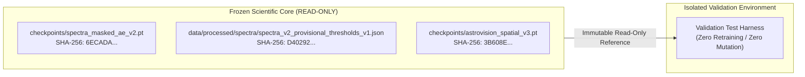
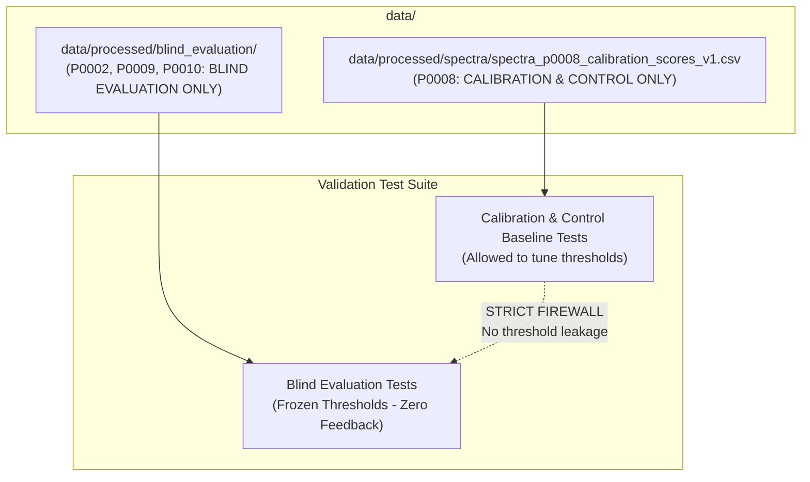

# SPECTRA-X / F1 — Phase 4, Task 4.3
# Scientific Validation Environment — Comprehensive Plan & Architecture

**Pipeline Build:** `l2b-v27-2026-222`  
**Task Type:** STRICT READ-ONLY ENVIRONMENT AUDIT & VALIDATION INFRASTRUCTURE DESIGN  
**Project:** SPECTRA-X — Human-AI Co-Pilot for Exploring the Changing Infrared Sky  
**Target Environment:** Isolated Virtual Environment (`.venv_validation`)  
**Audit Date:** 2026-11-07  
**Governance:** Implementation Plan Only — Zero Installation Permitted Without Explicit Authorization  

---

## 1. Executive Summary & Core Mandate

This plan establishes the operational architecture, dependency manifests, component validation workflows, and safety governance protocols for creating the **SPECTRA-X Scientific Validation Environment** (`.venv_validation`).

The environment is specifically engineered to validate all five scientific modules of the SPECTRA-X pipeline:
1. **ASTROVISION** (Spatial morphology & paired difference imaging)
2. **SPECTRA** (102-channel infrared anomaly autoencoders & SED excess fitting)
3. **CHRONOS-X** (Multi-epoch temporal eligibility & intra-visit dither screening)
4. **MOTION-X** (Astrometric cross-matching, proper motion propagation & orbit vetting)
5. **FUSION-X** (Multimodal evidence fusion, candidate ranking & transient gating)

---

## 2. Frozen Scientific Asset Security Protocol

The validation environment must access all existing models, checkpoints, and calibration tables in **strict read-only mode**. Prior to any validation run, the environment will verify the cryptographic SHA-256 integrity of all frozen assets:



| Asset Path | Authoritative SHA-256 Digest | Role in Validation | Access Mode |
|---|---|---|---|
| `checkpoints/spectra_masked_ae_v2.pt` | `6ECADA80BA30EC803AF2CF21BA58D72E8209789B4F5DA68A22E60134A3B5A938` | Pre-trained 102-channel masked spectral autoencoder | Strict Read-Only |
| `data/processed/spectra/spectra_v2_provisional_thresholds_v1.json` | `D40292972AAFB9D3948249BD402A178EEADB20DE5E37C02C227AC841974AB848` | P0008 provisional calibration thresholds | Strict Read-Only |
| `checkpoints/astrovision_spatial_v3.pt` | `3B608E496F43C2648C9DC8236E1A7F5B5ED4B7906CF900468C65C67016042D99` | Pre-trained $128 \times 128$ spatial convolutional autoencoder | Strict Read-Only |

---

## 3. Component-by-Component Scientific Validation Scope

### 3.1 ASTROVISION (Spatial Morphology & Paired Differencing)
- **Validation Scope:**
  - Automated inspection of SPHEREx Level-2 FITS image cutouts ($128 \times 128$ pixels).
  - Celestial WCS coordinate alignment using `astropy.wcs` and `reproject.reproject_interp`.
  - Verification of paired residual differencing:
    $$F_{\text{diff}} = \sum_{\mathcal{A}} [R_{\text{inj}} - R_{\text{ctrl}}] \cdot M$$
    confirming signed differential contributions without secondary positive clipping.
  - Verification that the defect mask ($M$) is properly applied to prevent bright star contamination ($>75,000\text{ MJy/sr}$).
- **Hardware Mode:** GPU-accelerated PyTorch inference on NVIDIA GeForce RTX 5060 (batch size $64$, runtime $< 30\text{ seconds}$).

### 3.2 SPECTRA (102-Channel Infrared Spectral Anomaly Engine)
- **Validation Scope:**
  - Ingestion of extracted 102-channel spectral flux vectors and photometric variance arrays.
  - Execution of `MaskedSpectralAutoencoder` forward pass in `model.eval()` mode with `torch.no_grad()`.
  - Channel reconstruction loss auditing across the 3,206 P0008 calibration sources.
  - Evaluation of the external-catalog-assisted infrared excess validation metric:
    $$S_{\text{excess}}(\lambda) = \frac{F_{\text{obs}}(\lambda) - F_{\text{photosphere}}(\lambda)}{\sqrt{\sigma_{\text{obs}}^2(\lambda) + \sigma_{\text{photosphere}}^2(\lambda) + \sigma_{\text{sys}}^2(\lambda)}}$$
  - Automated classification of sources into the 7 candidate eligibility tiers.

### 3.3 CHRONOS-X (Multi-Epoch Temporal Anomaly Engine)
- **Validation Scope:**
  - Verification of temporal eligibility contracts enforcing $\Delta t \ge 1.0\text{ day}$.
  - Guaranteeing that intra-visit dithers ($\Delta t = 2.15 - 6.47\text{ minutes}$) are rejected as independent temporal pairs.
  - Fallback auditing when multi-epoch revisits are absent or unverifiable.

### 3.4 MOTION-X (Astrometric Cross-Matching & Moving Objects)
- **Validation Scope:**
  - Proper motion coordinate propagation from Gaia DR3 reference epoch $2016.0$ to SPHEREx mission epoch $2026.55$.
  - Evaluation of astrometric match residuals against 2MASS PSC ($r \le 1.5''$) and ALLWISE ($r \le 3.0''$).
  - Moving-object velocity vector screening and non-sidereal track identification.

### 3.5 FUSION-X (Multimodal Evidence Fusion & Candidate Ranking)
- **Validation Scope:**
  - Auditing multimodal fusion contracts across spatial, spectral, temporal, and astrometric channels.
  - Verification of safety gates preventing legacy prototype heuristics (`temporal_sig > 5.0 and not is_known_star`) from bypassing temporal eligibility checks.
  - Verification of Pareto candidate ranking and false-alarm suppression.

---

## 4. Strict Cohort Separation & Blind Governance

To ensure uncompromising scientific rigor, the validation environment enforces cryptographic and directory-level cohort segregation:



- **Separation Rule:** No blind evaluation cohort (Pointing 0002, 0009, 0010) may be ingested for the purpose of selecting photospheric control stars, tuning reconstruction error thresholds, or training autoencoders.
- **Manifest Tagging:** All validation test runs must log the explicit cohort role in test metadata:
  `{"cohort_role": "CALIBRATION_ONLY"}` or `{"cohort_role": "BLIND_EVALUATION_ONLY"}`.

---

## 5. Proposed Isolated Environment Specification (`.venv_validation`)

### 5.1 Directory Layout
The isolated validation environment will be hosted within the project tree:
```
SPECTRA-X/
├── .venv_validation/               # Dedicated isolated Python 3.12 venv
│   ├── Scripts/                    # Python interpreter & pip
│   └── Lib/site-packages/          # Pinned validation packages
├── configs/
│   └── requirements_validation.txt # Pinned version ledger with hashes
└── checkpoints/                    # FROZEN READ-ONLY MODEL ASSETS
```

### 5.2 Pinned Dependency Manifest (`requirements_validation.txt`)
```text
# SPECTRA-X Scientific Validation Environment Requirements
# Target Runtime: Python 3.12.10 (Windows AMD64)
# Hardware: NVIDIA GeForce RTX 5060 (CUDA 13.2)

# Core Scientific Stack (Compatible with host NumPy 2.x)
numpy==2.5.4
scipy==1.18.1
pandas==3.1.1
astropy==8.0.2

# Specialized Astronomy & Image Processing
reproject==0.14.1
scikit-learn==1.6.1
scikit-image==0.25.2

# External Catalog TAP Retrieval & Data Transport
astroquery==0.4.9
requests==2.32.3
urllib3==2.8.0

# PyTorch Deep Learning Runtime (Referencing host CUDA 13.2 wheels)
torch==2.15.0+cu132
torchvision==0.29.2+cu132

# Automated Test Harness
pytest==9.2.0
```

---

## 6. Proposed Setup Execution Commands (DOCUMENTATION ONLY)

> [!CAUTION]
> **GOVERNANCE MANDATE:** The following commands are documented strictly as an engineering plan. **Do NOT execute these commands during Task 4.3.** Execution requires separate, explicit authorization from the project owner.

```powershell
# ==============================================================================
# PROPOSED SETUP SEQUENCE FOR FUTURE AUTHORIZED TASK
# STATUS: UNEXECUTED DOCUMENTATION SPECIFICATION
# ==============================================================================

# Step 1: Initialize isolated virtual environment using verified Python 3.12.10
& "C:\Users\blues\AppData\Local\Programs\Python\Python312\python.exe" -m venv .venv_validation

# Step 2: Activate isolated validation environment
& ".\.venv_validation\Scripts\Activate.ps1"

# Step 3: Upgrade pip and install wheel within isolated venv
& ".\.venv_validation\Scripts\python.exe" -m pip install --upgrade pip setuptools wheel

# Step 4: Install PyTorch with CUDA 13.2 support
& ".\.venv_validation\Scripts\python.exe" -m pip install torch==2.15.0+cu132 torchvision==0.29.2+cu132 --extra-index-url https://download.pytorch.org/whl/cu132

# Step 5: Install pinned scientific & validation dependencies
& ".\.venv_validation\Scripts\python.exe" -m pip install -r configs/requirements_validation.txt

# Step 6: Verify GPU acceleration in validation environment
& ".\.venv_validation\Scripts\python.exe" -c "import torch; print('CUDA Available:', torch.cuda.is_available()); print('Device:', torch.cuda.get_device_name(0))"

# Step 7: Run complete regression suite inside validation environment
& ".\.venv_validation\Scripts\pytest.exe" tests/
```

---

## 7. Risks, Unresolved Issues & Mitigation

1. **NumPy 2.x ABI Compatibility:**
   - *Risk:* Some compiled astronomical packages may throw C-API compatibility errors if built against older NumPy 1.x C-headers.
   - *Mitigation:* `reproject 0.14.1` and `astropy 8.0.2` officially support NumPy 2.x on Windows AMD64. If a conflict occurs during installation, pin `numpy<2.0.0` within `.venv_validation` without affecting the system Python.
2. **Sandbox Network Isolation:**
   - *Risk:* TAP queries to ESA Gaia or NASA/IPAC IRSA will fail inside standard sandbox mode (`DNS_BLOCKED`).
   - *Mitigation:* Validation data retrieval must be staged via an authorized network preflight outside the sandbox or using pre-downloaded VOTable staging files.
3. **Model Development Continuation:**
   - *Status:* All five scientific models remain in active development. This validation environment does not freeze or retire model development; it provides an independent benchmark harness to evaluate future model versions objectively.

---

## 8. Explicit Next-Step Authorization Request

To proceed with actual infrastructure implementation, the project owner is requested to review this report and authorize the next sequential task:

- **Proposed Next Task:** **Phase 4, Task 4.4 — Scientific Validation Environment Creation & Verification**
- **Authorized Actions in Next Task:**
  1. Creation of `.venv_validation`.
  2. Installation of pinned requirements from `configs/requirements_validation.txt`.
  3. Execution of environment verification script confirming CUDA acceleration on the RTX 5060.
  4. Execution of the 166-item regression suite under `.venv_validation\Scripts\pytest.exe`.
  5. Cryptographic verification of all frozen asset hashes.

**STOPPING POINT:** In accordance with Task 4.3 governance, execution is now paused. No environment has been created or modified.

