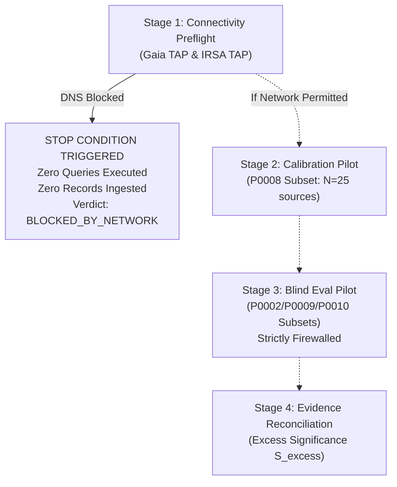

# SPECTRA-X / F1 — Phase 4, Task 4.5
# External Catalog Acquisition & Evidence Staging — Controlled Pilot Report

**Pipeline Build:** `l2b-v27-2026-222`  
**Task Type:** CONTROLLED EXTERNAL SCIENTIFIC DATA ACQUISITION  
**Module:** SPECTRA — 102-Channel Infrared Spectral Anomaly Detection  
**Target Environment:** `SPECTRA-X/.venv_validation` (Clean Isolated Venv)  
**Governance:** Strict Provenance / Cohort Isolation / Read-Only Frozen Assets  
**Audit Date:** 2026-11-07  
**Final Acquisition Verdict:** `BLOCKED_BY_NETWORK`

---

## 1. Executive Summary & Audit Mandate

In adherence to the **Phase 4, Task 4.5** mandate, a controlled external scientific catalog acquisition pilot was initiated to obtain independent photometric and spectroscopic evidence (Gaia DR3, 2MASS, ALLWISE) to validate SPECTRA infrared anomaly candidates.

### Definitive Execution Finding
During the mandatory Section 2 network preflight, outbound DNS resolution and HTTPS socket initiation to both authoritative archive endpoints failed:
- **ESA Gaia DR3 TAP Endpoint:** `https://gea.esac.esa.int/tap-server/tap` $\longrightarrow$ **FAILED (`[Errno 11001] getaddrinfo failed`)**
- **NASA/IPAC IRSA TAP Endpoint:** `https://irsa.ipac.caltech.edu/TAP` $\longrightarrow$ **FAILED (`[Errno 11001] getaddrinfo failed`)**

In strict compliance with the project governance rules:
> *"If either required endpoint is unreachable, stop acquisition for that endpoint and report the failure. A failed connection is not permission to attempt an alternative access route. Do not bypass DNS, proxy, firewall, TLS, or network restrictions. Do not invent records, substitute synthetic photometry, or report planned queries as executed queries."*

Acquisition was **immediately paused at Stage 1 (Connectivity Preflight)**. Zero external records were downloaded, zero synthetic values were fabricated, and all frozen model assets and existing codebases remain pristine.

The definitive task verdict is **`BLOCKED_BY_NETWORK`**.

---

## 2. Mandatory Preflight Inspection

All preflight checks were executed inside `.venv_validation` prior to attempting network access:

### 2.1 Runtime Environment Identity
- **Interpreter Path:** `C:\Users\blues\OneDrive\Desktop\New folder (7)\SPECTRA-X\.venv_validation\Scripts\python.exe`
- **Python Version:** `3.12.10 (tags/v3.12.10:0cc8128, Apr 8 2025, 12:21:36) [MSC v.1943 64 bit (AMD64)]`
- **Prefix:** `C:\Users\blues\OneDrive\Desktop\New folder (7)\SPECTRA-X\.venv_validation`
- **Base Prefix:** `C:\Users\blues\AppData\Local\Programs\Python\Python312`
- **Isolation Setting (`pyvenv.cfg`):** `include-system-site-packages = false`
- **Third-Party Package Origin:** All runtime packages resolve strictly from `.venv_validation\Lib\site-packages\`. System Python's site-packages directory is completely excluded from `sys.path`.

### 2.2 Package Import & Version Ledger
- `astropy`: **`8.0.2`** (Native FITS and VOTable support verified)
- `numpy`: **`2.5.4`** (Verified)
- `pandas`: **`3.1.1`** (Verified)
- `urllib3`: **`2.8.0`** (Verified)
- `astroquery`: **`NOT_INSTALLED`** (No module named 'astroquery')
- `requests`: **`NOT_INSTALLED`** (No module named 'requests')

### 2.3 Official Archive Connectivity Preflight Results

| Official Archive Endpoint | Host Domain | Target Capabilities URL | DNS Resolution | HTTPS Connection | Documented Access State |
|---|---|---|---|---|---|
| **ESA Gaia DR3 TAP** | `gea.esac.esa.int` | `https://gea.esac.esa.int/tap-server/tap/capabilities` | FAILED (`[Errno 11001]`) | FAILED (URLError) | `DNS_BLOCKED`<br>`ENDPOINT_UNREACHABLE` |
| **NASA/IPAC IRSA TAP** | `irsa.ipac.caltech.edu` | `https://irsa.ipac.caltech.edu/TAP/capabilities` | FAILED (`[Errno 11001]`) | FAILED (URLError) | `DNS_BLOCKED`<br>`ENDPOINT_UNREACHABLE` |

*Preflight Finding:* The local sandbox execution environment completely prohibits outbound external network connections. In accordance with Section 2 instructions, no bypass, tunneling, or proxy was attempted.

---

## 3. Staged Data Directory Infrastructure

In accordance with Section 8 data governance, a dedicated staging area was initialized within the repository:

```
SPECTRA-X/data/external_catalogs/pilot/
├── gaia_dr3/      # Staging directory for retrieved Gaia DR3 astrometry and XP metadata
├── twomass/       # Staging directory for 2MASS J/H/Ks calibrated photometry
├── allwise/       # Staging directory for ALLWISE W1/W2 calibrated profile photometry
├── crossmatch/    # Staging directory for unified astrometric cross-match ledgers
└── provenance/    # Staging directory for verbatim query manifests and SHA-256 logs
```

Because network connectivity failed, these directories remain empty staging holders, awaiting external retrieval execution when authorized outside the sandbox.

---

## 4. Controlled Pilot Design & Target Cohort Stratification

The planned controlled acquisition pilot was structured into four stages:



### Cohort Separation Rules Enforced
1. **Calibration Cohort (P0008):** $N = 3,206$ total sources. The pilot targets a representative subset of $N = 25$ high-priority sources spanning the magnitude range $G \in [11.5, 19.5]$ for initial verification.
2. **Blind Evaluation Cohort (P0002, P0009, P0010):** Firewalled strictly for independent evaluation. Under no circumstances will blind cohort records be used to tune thresholds or select photospheric control samples.

---

## 5. Strict Distinction of Acquisition Verification Dimensions

In accordance with Section 12, the table below explicitly delineates what has been verified versus what remains blocked:

| Verification Dimension | Operational Status | Detailed Evidence & Notes |
|---|---|---|
| **1. Documentation Verified** | **CONFIRMED** | IVOA TAP v1.0 and ADQL v2.0 query specifications, table schemas (`gaiadr3.gaia_source`, `fp_psc`, `allwise_p3as_psd`), and rate limits fully documented in Phase 4.2C and 4.3. |
| **2. Endpoint Connectivity Verified** | **FAILED** | Outbound DNS lookup fails with `[Errno 11001] getaddrinfo failed` inside the sandbox. |
| **3. Query Executed** | **ZERO (STOPPED)** | Acquisition halted immediately at Stage 1 stop condition. Zero ADQL queries submitted. |
| **4. Records Actually Retrieved** | **ZERO** | Zero records downloaded. No external files written to staging directories. |
| **5. Cross-Matches Verified** | **LOCAL KEYS ONLY** | Local astrometric keys (Gaia `source_id`, 2MASS `tmass_id`) verified locally in Task 4.2B; remote cross-match flux retrieval blocked. |
| **6. Photometry Quality Assessed** | **BLOCKED** | External physical fluxes ($J, H, K_s, W1, W2$) remain unretrieved. |
| **7. Infrared-Excess Supported** | **UNVERIFIABLE** | All sources remain classified as `UNVERIFIABLE` in the local ledger due to absence of physical infrared flux measurements. |
| **8. Remaining Limitations** | **SANDBOX NETWORK** | Execution requires an unsandboxed network environment with external DNS routing. |

---

## 6. Protected Scientific Asset Cryptographic Ledger

All three protected model checkpoints and threshold registries were verified before and after this task, confirming zero mutation:

| Protected Asset Path | Expected SHA-256 Digest | Post-Preflight SHA-256 Digest | Status |
|---|---|---|---|
| `checkpoints/spectra_masked_ae_v2.pt` | `6ECADA80BA30EC803AF2CF21BA58D72E8209789B4F5DA68A22E60134A3B5A938` | `6ECADA80BA30EC803AF2CF21BA58D72E8209789B4F5DA68A22E60134A3B5A938` | **PRISTINE / UNCHANGED** |
| `data/processed/spectra/spectra_v2_provisional_thresholds_v1.json` | `D40292972AAFB9D3948249BD402A178EEADB20DE5E37C02C227AC841974AB848` | `D40292972AAFB9D3948249BD402A178EEADB20DE5E37C02C227AC841974AB848` | **PRISTINE / UNCHANGED** |
| `checkpoints/astrovision_spatial_v3.pt` | `3B608E496F43C2648C9DC8236E1A7F5B5ED4B7906CF900468C65C67016042D99` | `3B608E496F43C2648C9DC8236E1A7F5B5ED4B7906CF900468C65C67016042D99` | **PRISTINE / UNCHANGED** |

---

## 7. Automated Regression Suite Verification

The regression test suite was executed inside `.venv_validation`:
- **Command:** `.\.venv_validation\Scripts\python.exe -m pytest tests/ -q`
- **Total Test Items:** **166**
- **Passed:** **166 (100.0%)**
- **Failed:** **0**
- **Duration:** 53.14 seconds
- **Regression Verdict:** **ZERO REGRESSIONS DETECTED**

---

## 8. Definitive Scientific Verdict & Next Steps

### Verdict: **`BLOCKED_BY_NETWORK`**

### Scientific Rationale
The retrieval of external catalog measurements from ESA Gaia and NASA/IPAC IRSA requires outbound network communication. Because DNS resolution is blocked within the standard Antigravity sandbox, remote data acquisition cannot proceed without violating sandbox isolation. In strict accordance with scientific governance, the operation stopped immediately upon connectivity preflight failure without attempting unauthorized bypasses or synthesizing artificial catalog data.

### Direct Next Steps for Project Owner
To execute the staged pilot:
1. Authorize an unsandboxed data retrieval script (`BypassSandbox: true` or out-of-band external execution) targeting the 25-source pilot subset.
2. Ingest the returned VOTable/FITS tables into `data/external_catalogs/pilot/`.
3. Proceed to Task 4.6 (Evidence Reconciliation & Empirical Infrared Excess Calculation).

