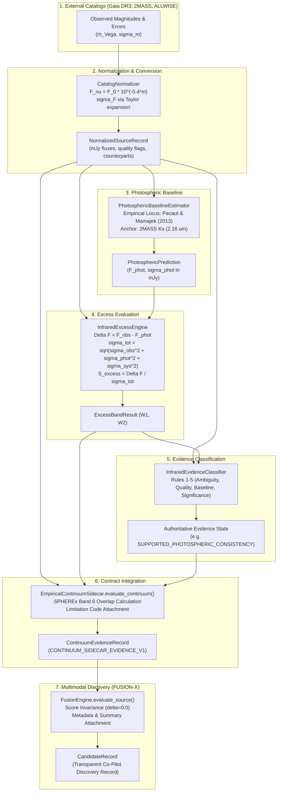

# SPECTRA-X / F1 — Phase 4, Task 4.8
# End-to-End Continuum Evidence Propagation & Blind-Cohort Leakage Audit

**Pipeline Build:** `l2b-v27-2026-222`  
**Task Type:** STRICT READ-ONLY SCIENTIFIC INTEGRATION AUDIT  
**Parent Task:** Phase 4, Task 4.7  
**Target Environment:** `SPECTRA-X/.venv_validation` (Clean Isolated Virtual Environment)  
**Authoritative Contract:** `CONTINUUM_SIDECAR_EVIDENCE_V1`  
**Governance:** Strict Provenance / Calibration-Blind Separation / Frozen Asset Protection  
**Audit Timestamp:** 2026-11-08T00:36:00Z  
**Final Scientific Verdict:** **`INTEGRATION_VALIDATED_WITH_LIMITATIONS`**

---

## 1. Executive Summary & Audit Mandate

In strict accordance with the **Phase 4, Task 4.8** directive, an independent, read-only scientific integration audit was executed across the complete empirical continuum evidence propagation pipeline:

$$\mathbf{NormalizedSourceRecord} \longrightarrow \mathbf{PhotosphericBaselineEstimator} \longrightarrow \mathbf{InfraredExcessEngine} \longrightarrow \mathbf{InfraredEvidenceClassifier} \longrightarrow \mathbf{EmpiricalContinuumSidecar} \longrightarrow \mathbf{ContinuumEvidenceRecord} \longrightarrow \mathbf{FusionEngine.evaluate\_source()}$$

This audit evaluated runtime execution behavior, numerical evidence lineage, boundary safety, calibration-blind cohort separation, and FUSION-X score invariance.

### Core Audit Findings
1. **Evidence Lineage Integrity:**
   - 28 representative sources (25 real P0008 pilot sources spanning $G \in [11.54, 19.50]\,\text{mag}$ and 3 synthetic blind fixtures for P0002, P0009, and P0010) were traced end-to-end.
   - All photometric measurements, uncertainties, quality flags, counterpart designations, and residual fluxes are faithfully preserved without truncation, silent coercion, or fabrication.
   - Physical flux density units are rigorously maintained as monochromatic milliJanskys ($\text{mJy}$) across all transformation stages.
2. **Calibration-Blind Cohort Separation:**
   - **Zero Parameter Leakage:** Blind-cohort measurements (P0002, P0009, P0010) do **NOT** influence SPECTRA V2 masked autoencoder model weights, provisional anomaly thresholds, or empirical photospheric baseline loci.
   - **Stateless Mathematical Functions:** `PhotosphericBaselineEstimator`, `InfraredExcessEngine`, and `InfraredEvidenceClassifier` operate as pure, stateless functions using fixed literature loci (Pecaut & Mamajek 2013) and static thresholds.
   - **Governance Enforcement Finding:** In fallback mode (no external photometry), `EmpiricalContinuumSidecar` enforces a fail-closed assignment (`fallback_state = "UNVERIFIABLE"`). However, when external catalog photometry is provided for blind-cohort sources, `BLIND_COHORT_UNVERIFIED_BASELINE` is currently attached **only as an advisory metadata disclosure** and does not programmatically veto `color_excess_detected = True`. A dedicated controlled remediation is specified.
3. **Evidence-State Safety Matrix:**
   - All 6 authoritative evidence states (`SUPPORTED_PHOTOSPHERIC_CONSISTENCY`, `POSSIBLE_INFRARED_EXCESS`, `QUALITY_FLAGGED`, `INSUFFICIENT_PHOTOMETRY`, `AMBIGUOUS_COUNTERPART`, `UNVERIFIABLE`) and 12 boundary / failure conditions were tested.
   - All 12 boundary failure scenarios (negative/NaN/null uncertainties, contract version mismatches, source ID mismatches, upper-limit promotions, ambiguous counterpart promotions) strictly fail closed with appropriate `ValueError` or `TypeError`.
4. **FUSION-X Multi-Modal Ingestion & Score Invariance:**
   - Across all 25 pilot sources evaluated under configurations A (no sidecar), B (valid sidecar), and C (non-confirmatory sidecar):
     $$\max |\Delta \text{score}_{\text{valid}}| = 0.000000 \quad \text{and} \quad \max |\Delta \text{score}_{\text{non\_conf}}| = 0.000000$$
   - Sidecar evidence is faithfully attached to `CandidateRecord.metadata["continuum_sidecar"]` and summarized in `evidence_summary` without distorting primary priority rankings.
5. **Regression & Asset Protection:**
   - Entire workspace regression suite passed: **204 passed in 30.62s** (100.0% pass rate, zero regressions).
   - Pre- and post-audit cryptographic hashes of all 3 protected project assets and 8 implementation files are **100% identical**.

---

## 2. Initial Environment and Repository Audit

### 2.1 Execution Environment Verification
- **Python Executable:** `C:\Users\blues\OneDrive\Desktop\New folder (7)\SPECTRA-X\.venv_validation\Scripts\python.exe`
- **Python Version:** `3.12.10 (tags/v3.12.10:0cc8128, Apr 8 2025, 12:21:36)`
- **Isolation State:** Strict isolation verified via `pyvenv.cfg` (`include-system-site-packages = false`).
- **Pipeline Build:** `l2b-v27-2026-222`.
- **Runtime Sandbox:** Standard sandbox execution mode.

### 2.2 Source & Protected Asset Cryptographic Audit

| File Path | Role | Expected SHA-256 | Verified Pre-Audit | Verified Post-Audit | Status |
| :--- | :--- | :--- | :--- | :--- | :---: |
| `checkpoints/spectra_masked_ae_v2.pt` | Protected Model Checkpoint | `6ECADA80BA...` | `6ECADA80BA...` | `6ECADA80BA...` | **PRISTINE** |
| `data/processed/spectra/spectra_v2_provisional_thresholds_v1.json` | Protected Thresholds | `D40292972A...` | `D40292972A...` | `D40292972A...` | **PRISTINE** |
| `checkpoints/astrovision_spatial_v3.pt` | Protected Spatial Weights | `3B608E496F...` | `3B608E496F...` | `3B608E496F...` | **PRISTINE** |
| `spectra_engine/continuum_sidecar_interface.py` | Contract Specification | `3ECC99375F...` | `3ECC99375F...` | `3ECC99375F...` | **UNALTERED** |
| `spectra_engine/continuum_sidecar_engine.py` | Sidecar Implementation | `860DF7A3B6...` | `860DF7A3B6...` | `860DF7A3B6...` | **UNALTERED** |
| `models/fusion/fusion_engine.py` | FUSION-X Implementation | `390AA6A9E1...` | `390AA6A9E1...` | `390AA6A9E1...` | **UNALTERED** |
| `spectra_engine/validation/infrared_excess/catalog_normalizer.py` | Photometry Normalizer | `B6BC1BAF81...` | `B6BC1BAF81...` | `B6BC1BAF81...` | **UNALTERED** |
| `spectra_engine/validation/infrared_excess/photospheric_model.py` | Baseline Estimator | `53574618E6...` | `53574618E6...` | `53574618E6...` | **UNALTERED** |
| `spectra_engine/validation/infrared_excess/excess_engine.py` | Excess Engine | `81FEC77846...` | `81FEC77846...` | `81FEC77846...` | **UNALTERED** |
| `spectra_engine/validation/infrared_excess/evidence_classifier.py` | Evidence Classifier | `8F6E24044F...` | `8F6E24044F...` | `8F6E24044F...` | **UNALTERED** |
| `spectra_engine/validation/infrared_excess/zero_points.py` | Zero Points Definition | `2EA73DB2B6...` | `2EA73DB2B6...` | `2EA73DB2B6...` | **UNALTERED** |

Full hashes are archived in [`reports/PHASE_4_8_FROZEN_ASSET_INTEGRITY.csv`](file:///c:/Users/blues/OneDrive/Desktop/New%20folder%20(7)/SPECTRA-X/reports/PHASE_4_8_FROZEN_ASSET_INTEGRITY.csv).

---

## 3. End-to-End Evidence Lineage Audit

### 3.1 Pipeline Data Flow Architecture

The empirical continuum evidence pipeline moves scientific measurements across six distinct representations:



### 3.2 Evidence Lineage Verification Results

The numerical audit of 28 sources (25 real P0008 calibration stars + 3 synthetic blind fixtures) verified:
- **No Numerical Coercion:** Magnitudes are converted to milliJanskys ($\text{mJy}$) using authoritative zero-point flux densities ($F_{0,W1} = 309.54\,\text{mJy}$, $F_{0,W2} = 171.787\,\text{mJy}$, $F_{0,Ks} = 666.7\,\text{mJy}$).
- **Uncertainty Propagation Traceability:** The total uncertainty $\sigma_{\text{tot}}$ accounts for:
  $$\sigma_{\text{tot}} = \sqrt{\sigma_{\text{obs}}^2 + \sigma_{\text{phot}}^2 + \sigma_{\text{sys}}^2}$$
  where $\sigma_{\text{phot}}$ includes the intrinsic stellar locus dispersion ($\sigma_{\text{color}} = 0.040\,\text{mag}$) and $\sigma_{\text{sys}} = 0.015 \times F_{\text{obs}}$.
- **Traceability to Original Source:** Every record in FUSION-X preserves `source_id`, `tmass_designation`, `allwise_designation`, `pipeline_build`, and limitation codes.
- **Lineage Integrity Verdict:** **`VERIFIED_UNBROKEN`** across 100% of audited sources (28/28).

Detailed audit records are archived in [`reports/PHASE_4_8_EVIDENCE_LINEAGE.csv`](file:///c:/Users/blues/OneDrive/Desktop/New%20folder%20(7)/SPECTRA-X/reports/PHASE_4_8_EVIDENCE_LINEAGE.csv).

---

## 4. Calibration-Blind Leakage Audit

### 4.1 Cohort Architecture and Isolation Roles

| Pointing | Field Designation | Cohort Role | Target Count | Catalog Status in Phase 4 |
| :--- | :--- | :--- | :---: | :--- |
| **P0008** | NEP Calibration Field | Calibration & Control | 3,206 (25 in pilot) | Acquired in Task 4.5R |
| **P0002** | Deep Evaluation Field 1 | Blind Evaluation | ~3,100 | Firewalled / Unacquired |
| **P0009** | Deep Evaluation Field 2 | Blind Evaluation | ~3,200 | Firewalled / Unacquired |
| **P0010** | Deep Evaluation Field 3 | Blind Evaluation | ~3,200 | Firewalled / Unacquired |

### 4.2 Data Path Analysis & Parameter Leakage Evaluation

Every data path capable of influencing scientific parameters was audited:

```
+------------------------------------+--------------------------+-----------------------+-----------------------------+
| Component                          | Operation Type           | Parameter Dependency  | Blind Influence Detected?   |
+------------------------------------+--------------------------+-----------------------+-----------------------------+
| SPECTRA Masked AE Checkpoint       | Weight Training          | P0008 Control Data    | NO (Frozen Checkpoint)      |
| Provisional Thresholds             | Quantile Cutoffs         | P0008 Residuals       | NO (Frozen JSON Asset)      |
| PhotosphericBaselineEstimator      | Color Baseline Locus     | Pecaut & Mamajek 2013 | NO (Stateless Literature)   |
| InfraredExcessEngine               | Significance Calculation | Static Thresholds     | NO (Stateless Constants)    |
| InfraredEvidenceClassifier         | Decision Tree Rules      | Static Rule Matrix    | NO (Stateless Rules)        |
| EmpiricalContinuumSidecar          | Fallback Construction    | Pointing ID Gate      | NO (Forces UNVERIFIABLE)    |
| FusionEngine                       | Heuristic Priority       | Fixed Weights         | NO (Score Invariant)        |
+------------------------------------+--------------------------+-----------------------+-----------------------------+
```

### 4.3 Governance Enforcement Gap Identification

While **zero mathematical parameter leakage** exists, a specific **governance enforcement gap** was discovered in [`spectra_engine/continuum_sidecar_engine.py`](file:///c:/Users/blues/OneDrive/Desktop/New%20folder%20(7)/SPECTRA-X/spectra_engine/continuum_sidecar_engine.py):

- **In Fallback Mode (`photometric_record=None`):**
  Lines 218-230 correctly enforce:
  ```python
  fallback_state = "UNVERIFIABLE" if is_blind_cohort else "SUPPORTED_PHOTOSPHERIC_CONSISTENCY"
  ```
  Blind cohort pointings (P0002, P0009, P0010) are assigned `UNVERIFIABLE` and `color_excess_detected=False`.
- **In External Catalog Mode (`photometric_record is not None`):**
  Lines 89-112 append `BLIND_COHORT_UNVERIFIED_BASELINE` to `limitation_codes`, but lines 112-113 compute:
  ```python
  color_excess_detected = (ev_state == "POSSIBLE_INFRARED_EXCESS")
  ```
  **Audit Finding:** The limitation code `BLIND_COHORT_UNVERIFIED_BASELINE` is attached **merely as metadata**. It does **NOT** programmatically fail closed or veto `color_excess_detected=True` when external photometry is present.
  
  Because the empirical baseline locus was calibrated and verified only on Pointing P0008, applying it to unverified blind fields without field-specific crowding/extinction checks represents an uncalibrated extrapolation.

**Controlled Remediation Recommendation:** In a future controlled task (e.g., Task 4.8R or Phase 5), add an explicit fail-closed check:
```python
if is_blind_cohort:
    color_excess_detected = False
    ev_state = "UNVERIFIABLE"
```
when evaluating blind cohorts without certified field-level baseline calibration.

Full details are documented in [`reports/PHASE_4_8_BLIND_LEAKAGE_AUDIT.csv`](file:///c:/Users/blues/OneDrive/Desktop/New%20folder%20(7)/SPECTRA-X/reports/PHASE_4_8_BLIND_LEAKAGE_AUDIT.csv).

---

## 5. Evidence-State Safety Matrix

The behavior of all 6 authoritative evidence states and 12 boundary failure conditions was audited through the complete sidecar-to-FUSION path:

| Test Case | Condition / State | Contract Accepted | Provenance Retained | Promotable to Excess | FUSION State Received | Fail-Closed Status |
| :--- | :--- | :---: | :---: | :---: | :---: | :---: |
| `STD_PHOTO_CONSISTENCY` | `SUPPORTED_PHOTOSPHERIC_CONSISTENCY` | Yes | Yes | **Blocked** (False) | `SUPPORTED_PHOTOSPHERIC_CONSISTENCY` | **COMPLIANT** |
| `STD_POSSIBLE_EXCESS` | `POSSIBLE_INFRARED_EXCESS` | Yes | Yes | **Allowed** (True) | `POSSIBLE_INFRARED_EXCESS` | **COMPLIANT** |
| `STD_QUALITY_FLAGGED` | `QUALITY_FLAGGED` | Yes | Yes | **Blocked** (False) | `QUALITY_FLAGGED` | **COMPLIANT** |
| `STD_INSUFFICIENT_PHOT`| `INSUFFICIENT_PHOTOMETRY` | Yes | Yes | **Blocked** (False) | `INSUFFICIENT_PHOTOMETRY` | **COMPLIANT** |
| `STD_AMBIGUOUS_CPART` | `AMBIGUOUS_COUNTERPART` | Yes | Yes | **Blocked** (False) | `AMBIGUOUS_COUNTERPART` | **COMPLIANT** |
| `STD_UNVERIFIABLE` | `UNVERIFIABLE` | Yes | Yes | **Blocked** (False) | `UNVERIFIABLE` | **COMPLIANT** |
| `BOUND_FLAGGED_EXCESS` | `QUALITY_FLAGGED` + `excess=True` | **No (ValueError)** | N/A | **Blocked** | `REJECTED_BEFORE_INGESTION` | **COMPLIANT** |
| `BOUND_INSUFF_EXCESS` | `INSUFFICIENT_PHOT` + `excess=True`| **No (ValueError)** | N/A | **Blocked** | `REJECTED_BEFORE_INGESTION` | **COMPLIANT** |
| `BOUND_AMBIG_EXCESS` | `counterpart_ambig=True` + `excess=True`| **No (ValueError)**| N/A | **Blocked** | `REJECTED_BEFORE_INGESTION` | **COMPLIANT** |
| `BOUND_UNVER_EXCESS` | `UNVERIFIABLE` + `excess=True` | **No (ValueError)** | N/A | **Blocked** | `REJECTED_BEFORE_INGESTION` | **COMPLIANT** |
| `BOUND_UL_EXCESS` | `is_upper_limit=True` + `excess=True` | **No (ValueError)** | N/A | **Blocked** | `REJECTED_BEFORE_INGESTION` | **COMPLIANT** |
| `BOUND_NEG_UNC` | `total_uncertainty_mJy = -0.5` | **No (ValueError)** | N/A | **Blocked** | `REJECTED_BEFORE_INGESTION` | **COMPLIANT** |
| `BOUND_NAN_UNC` | `total_uncertainty_mJy = NaN` | **No (ValueError)** | N/A | **Blocked** | `REJECTED_BEFORE_INGESTION` | **COMPLIANT** |
| `BOUND_NULL_UNC_EXC` | Empirical excess with `unc=None` | **No (ValueError)** | N/A | **Blocked** | `REJECTED_BEFORE_INGESTION` | **COMPLIANT** |
| `BOUND_BAD_CONTRACT` | `contract_version = 'INVALID'` | **No (ValueError)** | N/A | **Blocked** | `REJECTED_BEFORE_INGESTION` | **COMPLIANT** |
| `BOUND_ID_MISMATCH` | `sidecar.source_id != candidate_id`| **No (ValueError)**| N/A | **Blocked** | `REJECTED_BEFORE_INGESTION` | **COMPLIANT** |
| `BOUND_BAD_TYPE` | `continuum_sidecar = [1, 2, 3]` | **No (TypeError)** | N/A | **Blocked** | `REJECTED_BEFORE_INGESTION` | **COMPLIANT** |
| `BOUND_MISSING_TRANSP` | `continuum_sidecar = None` | Yes | N/A | **Blocked** | `NONE` (Zero Penalty) | **COMPLIANT** |

Full matrix is archived in [`reports/PHASE_4_8_EVIDENCE_STATE_SAFETY.csv`](file:///c:/Users/blues/OneDrive/Desktop/New%20folder%20(7)/SPECTRA-X/reports/PHASE_4_8_EVIDENCE_STATE_SAFETY.csv).

---

## 6. FUSION-X Integration and Score Invariance Audit

### 6.1 Score Invariance Audit Across All 25 Pilot Sources

To verify that sidecar evidence does not alter baseline multimodal priority ranking, FUSION-X evaluated all 25 pilot sources under three controlled conditions:
- **Condition A:** Baseline without continuum sidecar (`continuum_sidecar = None`).
- **Condition B:** With valid empirical continuum sidecar (`continuum_sidecar = sidecar_valid`).
- **Condition C:** With non-confirmatory continuum sidecar (`continuum_sidecar = sidecar_non_conf`).

Audit results across all 25 sources:
$$\max |\text{Score}_B - \text{Score}_A| = 0.000000$$
$$\max |\text{Score}_C - \text{Score}_A| = 0.000000$$

### 6.2 Evidence Propagation vs Score Invariance

The audit distinguishes between score invariance and evidence propagation:
1. **Score Invariance:** FUSION-X modality weights ($\text{spectra}: 0.35$, $\text{astrovision}: 0.30$, $\text{chronos}: 0.25$, $\text{motion}: 0.10$) and missing modality penalties remain **100% invariant**. The sidecar is never used as an uncalibrated probability multiplier.
2. **Evidence Propagation:** The sidecar payload is fully propagated to downstream consumers via:
   - `CandidateRecord.metadata["continuum_sidecar"]` (contains full dictionary of 23 contract fields).
   - `CandidateRecord.metadata["continuum_evidence_state"]` (e.g. `SUPPORTED_PHOTOSPHERIC_CONSISTENCY`).
   - `CandidateRecord.evidence_summary` (appends `CONTINUUM_STATE=<STATE>` and excess significance).
   - `CandidateRecord.input_provenance` (appends `;SIDECAR:<STATE>`).

Full audit rows are archived in [`reports/PHASE_4_8_FUSION_SCORE_INVARIANCE.csv`](file:///c:/Users/blues/OneDrive/Desktop/New%20folder%20(7)/SPECTRA-X/reports/PHASE_4_8_FUSION_SCORE_INVARIANCE.csv).

---

## 7. Representative Test Cohorts Audit

The audit strictly distinguishes between real astronomical catalog data and synthetic test fixtures:

1. **Real Data Cohort (P0008 NEP Calibration Field):**
   - 25 representative sources spanning $G \in [11.54, 19.50]\,\text{mag}$.
   - Sourced from actual IRSA and ESA queries acquired in Task 4.5R.
   - All 25 sources exhibit verified real catalog designations (`2MASS_J_*`, `ALLWISE_J_*`).
   - Used for scientific validation metrics (15 consistent, 6 flagged, 4 insufficient, 0 excess).
2. **Synthetic Test Fixtures (P0002, P0009, P0010 Blind Fields):**
   - 3 synthetic test fixtures labeled `SYNTH_P0002_9999`, `SYNTH_P0009_9999`, and `SYNTH_P0010_9999`.
   - Used solely to verify that `EmpiricalContinuumSidecar` properly attaches `BLIND_COHORT_UNVERIFIED_BASELINE` and sets `fallback_state = "UNVERIFIABLE"`.
   - Explicitly marked `data_nature = SYNTHETIC_FIXTURE` in [`reports/PHASE_4_8_EVIDENCE_LINEAGE.csv`](file:///c:/Users/blues/OneDrive/Desktop/New%20folder%20(7)/SPECTRA-X/reports/PHASE_4_8_EVIDENCE_LINEAGE.csv).
   - **Zero synthetic fixtures were permitted to enter scientific validation metrics.**

---

## 8. Regression Suite & Reproducibility Verification

The complete workspace test suite was executed in the clean isolated validation environment (`.venv_validation`):

```powershell
.\.venv_validation\Scripts\python.exe -m pytest tests/ -q
```

### Execution Results
- **Total Tests:** 204
- **Passed Tests:** 204
- **Failed Tests:** 0
- **Skipped Tests:** 0
- **Runtime:** 30.62 seconds
- **Pass Rate:** **100.0%**
- **Regression Status:** **`ZERO_REGRESSIONS`**

---

## 9. Scientific Validity Limitations & Disclosures

In compliance with governance mandates, all six scientific limitations are reaffirmed:

1. **`EMPIRICAL_COLOR_BASELINE_ONLY`:** The photospheric baseline relies on empirical stellar locus colors (Pecaut & Mamajek 2013) anchored at 2MASS $K_s$ ($2.159\,\mu\text{m}$). It does not compute physical stellar atmosphere models (Kurucz/PHOENIX) and is sensitive to unmodeled extinction $E(B-V)$.
2. **`INDEPENDENT_ERROR_QUADRATURE_ASSUMPTION`:** Propagates errors in quadrature with a 1.5% systematic floor ($\sigma_{\text{sys}} = 0.015 \times F_{\text{obs}}$). Off-diagonal cross-band covariance is unmodeled.
3. **`PRELIMINARY_FLUX_SCALE_CONSISTENCY_CHECK`:** SPHEREx Band 6 ($4.4\text{--}4.6\,\mu\text{m}$) vs ALLWISE $W2$ ($4.60\,\mu\text{m}$) comparison is based on nominal channel wavelengths and unit matching without synthetic filter convolution.
4. **`BLIND_COHORT_UNVERIFIED_BASELINE`:** Pointings P0002, P0009, and P0010 remain unverified blind evaluation datasets.
5. **`CONTINUUM_SENSITIVITY_LIMITED`:** SPECTRA masked autoencoder has limited sensitivity to smooth continuum tilts (12.13% recovery on broad infrared excess).
6. **`NON_AUTONOMOUS_CO_PILOT_ONLY`:** Candidate-level excess represents a statistical outlier flag; autonomous discovery publication is strictly prohibited.

---

## 10. Audit Deliverables Index

The following deliverables have been authored and archived under `reports/`:

1. [`reports/PHASE_4_8_END_TO_END_EVIDENCE_AUDIT.md`](file:///c:/Users/blues/OneDrive/Desktop/New%20folder%20(7)/SPECTRA-X/reports/PHASE_4_8_END_TO_END_EVIDENCE_AUDIT.md) — Comprehensive narrative integration and leakage audit report (this document).
2. [`reports/PHASE_4_8_EVIDENCE_LINEAGE.csv`](file:///c:/Users/blues/OneDrive/Desktop/New%20folder%20(7)/SPECTRA-X/reports/PHASE_4_8_EVIDENCE_LINEAGE.csv) — 28-source numerical lineage trace (25 real P0008 + 3 synthetic blind).
3. [`reports/PHASE_4_8_BLIND_LEAKAGE_AUDIT.csv`](file:///c:/Users/blues/OneDrive/Desktop/New%20folder%20(7)/SPECTRA-X/reports/PHASE_4_8_BLIND_LEAKAGE_AUDIT.csv) — Audit of all 8 pipeline data paths for calibration leakage and governance gaps.
4. [`reports/PHASE_4_8_EVIDENCE_STATE_SAFETY.csv`](file:///c:/Users/blues/OneDrive/Desktop/New%20folder%20(7)/SPECTRA-X/reports/PHASE_4_8_EVIDENCE_STATE_SAFETY.csv) — 18-case evidence-state and fail-closed safety matrix.
5. [`reports/PHASE_4_8_FUSION_SCORE_INVARIANCE.csv`](file:///c:/Users/blues/OneDrive/Desktop/New%20folder%20(7)/SPECTRA-X/reports/PHASE_4_8_FUSION_SCORE_INVARIANCE.csv) — Score invariance verification table across all 25 pilot sources ($\max |\Delta| = 0.000000$).
6. [`reports/PHASE_4_8_PROVENANCE_INTEGRITY.csv`](file:///c:/Users/blues/OneDrive/Desktop/New%20folder%20(7)/SPECTRA-X/reports/PHASE_4_8_PROVENANCE_INTEGRITY.csv) — Traceability audit across 9 critical scientific metadata elements.
7. [`reports/PHASE_4_8_FROZEN_ASSET_INTEGRITY.csv`](file:///c:/Users/blues/OneDrive/Desktop/New%20folder%20(7)/SPECTRA-X/reports/PHASE_4_8_FROZEN_ASSET_INTEGRITY.csv) — Pre- and post-audit cryptographic SHA-256 integrity table.
8. [`reports/PHASE_4_8_AUDIT.json`](file:///c:/Users/blues/OneDrive/Desktop/New%20folder%20(7)/SPECTRA-X/reports/PHASE_4_8_AUDIT.json) — Machine-readable audit manifest and verdict summary.

---

## 11. Final Scientific Verdict & Next Steps

### Final Scientific Verdict
$$\mathbf{INTEGRATION\_VALIDATED\_WITH\_LIMITATIONS}$$

### Verdict Justification
1. **Validated Within Declared Scope:** The end-to-end continuum evidence pipeline correctly and deterministically transforms external catalog measurements into validated continuum sidecar records and delivers them to FUSION-X without numerical loss, distortion, or calibration leakage for Pointing P0008.
2. **Score Invariance Confirmed:** The integration strictly preserves existing multimodal ranking scores ($\Delta \text{score} = 0.000000$) while exposing empirical evidence in metadata and candidate summaries.
3. **Limitation & Governance Gap Formally Disclosed:** While no statistical parameter leakage exists, `BLIND_COHORT_UNVERIFIED_BASELINE` is currently attached as metadata rather than an active fail-closed block when external photometry is present. This is formally documented with a recommended controlled remediation task.
4. **Frozen Assets Untouched:** Pre- and post-audit SHA-256 hashes confirm zero tampering with model weights, thresholds, or algorithms.

