# SPECTRA-X: Updated Scientific Model Readiness Matrix (F1 V2.1 Forensic Audit)

## 1. Readiness Level Definitions

1. **NOT STARTED**: No architecture, code, or data pipeline exists.
2. **DATA AVAILABLE**: Raw and calibration data exist on disk but unintegrated.
3. **PIPELINE IMPLEMENTED**: End-to-end Python code exists and runs without syntax/runtime errors.
4. **BASELINE TRAINED**: Neural network weights converged on baseline or proxy data; checkpoint verified.
5. **VALIDATION PENDING**: Framework operational; empirical testing against real-world ground truth required.
6. **INDEPENDENTLY EVALUATED / DEVELOPMENT READY**: Tested on independent, spatially un-leaked observations or synthetic injection sets with reproducible metrics.
7. **PRODUCTION READY / SCIENTIFICALLY VALIDATED**: Verified against peer-reviewed external ground-truth standards with contemporaneous spectroscopic/astrometric recovery.

## 2. Updated Official Readiness Matrix

| Model Name | Primary Modality | First-Pass Claim | Audited Status | Level | Scientific Evidence & Justification |
| :--- | :--- | :---: | :---: | :---: | :--- |
| **ASTROVISION** | Spatial Image Morphology | READY | **DEVELOPMENT_READY** | **Level 6** | PyTorch spatial AE (`checkpoints/astrovision_latest.pt`, 854K params) trained on real Level-2 SPHEREx cutouts. Evaluated on independent Pointing 0003. Advance to Level 7 requires verified extended galaxy ground-truth catalogs. |
| **SPECTRA** | 102-Band SED Anomaly | READY | **DEVELOPMENT_READY** | **Level 6** | **UPGRADED FROM LEVEL 4**: Retrained with masked-channel chi2 loss on 2,416 real sources (Pointing 0001) and validated on 1,249 sources (Pointing 0004). Evaluated on untouched Pointing 0003 (1,392 sources) with AUROC 0.9398 on controlled synthetic injection benchmark. Checkpoint: `checkpoints/spectra_masked_ae_v2.pt`. Production readiness pending D3–D6 observations. |
| **CHRONOS-X** | Multi-Epoch Differencing | READY | **VALIDATION_PENDING** | **Level 5** | WCS reprojection and variance differencing fully operational on 44 dither pairs. 152.2σ artifact proven to be dead-pixel interpolation defect and remediated. Multi-month repeat visits currently pending in local storage. |
| **MOTION-X** | Astrometric Movement | READY | **VALIDATION_PENDING** | **Level 5** | Gaia DR3 astrometric matching operational (0.08 arcsec precision). Horizons ephemeris query syntax fix identified; zero known small bodies fell in ingested pointings. |
| **FUSION-X** | Multimodal Co-Pilot | READY | **DEVELOPMENT_READY** | **Level 5** | Multimodal ranking pipeline and co-pilot tagging operational across deterministic benchmarks. Operates on calibrated heuristic priority scores; supervised probabilistic classification pending labeled discovery data. |

## 3. Comparative Summary: Readiness Progression

```mermaid
gantt
    title SPECTRA-X Scientific Readiness Levels (1 to 7)
    dateFormat X
    axisFormat %s
    section ASTROVISION
    Level 6 - Development Ready (Trained on Real Cutouts) :active, 0, 6
    section SPECTRA
    Level 6 - Development Ready (Masked Retrained on Real SEDs) :crit, active, 0, 6
    section CHRONOS-X
    Level 5 - Validation Pending (Awaiting Multi-Month Epochs) :active, 0, 5
    section MOTION-X
    Level 5 - Validation Pending (Awaiting In-FOV Small Bodies) :active, 0, 5
    section FUSION-X
    Level 5 - Development Ready (Heuristic Co-Pilot Functional) :active, 0, 5
```

> [!IMPORTANT]
> **Zero models are classified as `PRODUCTION_READY`**. Scientific honesty is the cornerstone of NASA F1 World-Finalist credibility. The upgrade of **SPECTRA to Level 6 (DEVELOPMENT_READY)** is empirically justified by masked retraining on real Level-2 SPHEREx photometry and rigorous independent evaluation.
