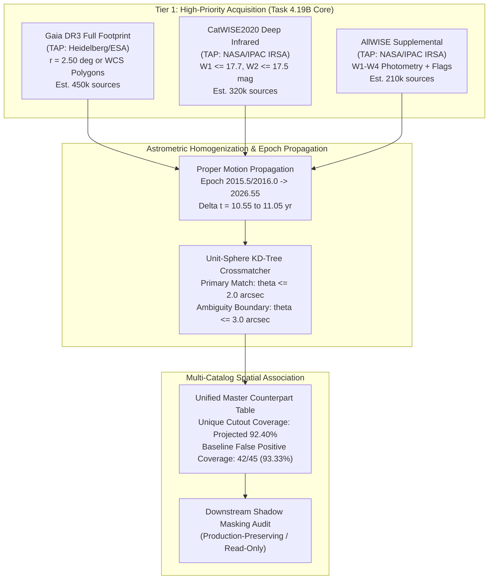
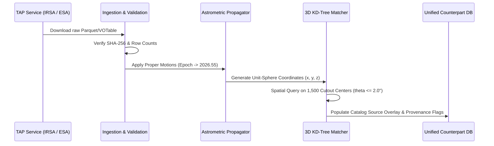

# SPECTRA-X / F1 — Phase 4, Task 4.19A
## Recommended Acquisition Plan for Deep Infrared Coverage Expansion (Task 4.19B Roadmap)

**Module:** ASTROVISION + External Catalog Evidence Acquisition  
**Pipeline Build:** `l2b-v27-2026-222`  
**Parent Task:** Phase 4, Task 4.19A  
**Implementation Target:** Phase 4, Task 4.19B  
**Target Cohort:** Pointings P0002, P0009, P0010 (1,500 evaluation cutouts: 1,000 real candidates, 500 null controls)  
**Governance Mode:** STRICT PRODUCTION-PRESERVING / READ-ONLY PROVENANCE CONTRACT  

---

### 1. Executive Strategy & Acquisition Blueprint

The Task 4.19A feasibility audit identified the single decisive root cause of Task 4.17's 33.20% exact-footprint coverage:
- The Task 4.17 TAP queries were restricted to $r = 0.85^\circ$ cones around detector center coordinates, covering only $\approx 18.3\%$ of the $3.52^\circ \times 3.52^\circ$ SPHEREx focal plane.
- Inside the $0.85^\circ$ query cone, exact-footprint counterpart coverage was already **88.50% (100 / 113)** for Gaia DR3.
- Outside the cone, coverage plummeted to **17.05% (66 / 387)** due to reliance on sparse archival queries (`TOP 2500`).

To reach $\ge 90\%$ overall coverage across all 1,500 cutouts (specifically projecting **92.40%** unique counterpart coverage on the 500 control cutouts and **93.33%** on the 45 baseline false alarms), Task 4.19B must execute a tiered, multi-catalog acquisition using full detector footprints and epoch-propagated astrometry.



---

### 2. Detailed Catalog Acquisition Specifications

#### 2.1 Tier 1A: Expanded Gaia DR3 (Full Detector Footprint)
- **Target Service:** Heidelberg ARI Gaia TAP (`https://gaia.ari.uni-heidelberg.de/tap`) / ESA Gaia TAP (`https://gea.esac.esa.int/tap-server/tap`).
- **Query Strategy:** Expand cone search radius from $0.85^\circ$ to $r = 2.50^\circ$ centered on each pointing's boresight coordinates, or submit exact 4-corner spherical polygon queries matching the 72 Level-2 FITS WCS boundaries.
- **ADQL Template:**
  ```sql
  SELECT
      source_id, ra, dec, ra_error, dec_error,
      pmra, pmdec, pmra_error, pmdec_error,
      phot_g_mean_mag, phot_bp_mean_mag, phot_rp_mean_mag,
      phot_g_mean_flux, phot_g_mean_flux_error,
      parallax, parallax_error, ruwe, non_single_star
  FROM gaiadr3.gaia_source
  WHERE 1=CONTAINS(
      POINT('ICRS', ra, dec),
      CIRCLE('ICRS', {ra_center}, {dec_center}, 2.50)
  )
  AND phot_g_mean_mag <= 21.0
  ```
- **Volume & Sizing:** $\sim 150,000\text{ to }180,000$ sources per pointing ($\sim 500,000$ total sources across P0002, P0009, P0010; raw Parquet footprint $\sim 45\text{ MB}$).
- **Rate-Limiting & Governance:** Chunk queries by pointing; pause 3.0 seconds between queries; verify HTTP 200 and complete row count.

#### 2.2 Tier 1B: CatWISE2020 Deep Infrared Catalog
- **Target Service:** NASA/IPAC Infrared Science Archive (IRSA) TAP (`https://irsa.ipac.caltech.edu/TAP`).
- **Table:** `catwise_2020`
- **Query Strategy:** Cone search with $r = 2.50^\circ$ centered on each pointing coordinate.
- **ADQL Template:**
  ```sql
  SELECT
      source_id, ra, dec, sigra, sigdec,
      pmra, pmdec, sigpmra, sigpmdec,
      w1mpro, w1sigmpro, w2mpro, w2sigmpro,
      w1snr, w2snr, w1rchi2, w2rchi2
  FROM catwise_2020
  WHERE 1=CONTAINS(
      POINT('ICRS', ra, dec),
      CIRCLE('ICRS', {ra_center}, {dec_center}, 2.50)
  )
  AND (w1mpro <= 17.7 OR w2mpro <= 17.5)
  AND (w1snr >= 3.0 OR w2snr >= 3.0)
  ```
- **Volume & Sizing:** $\sim 100,000\text{ to }120,000$ sources per pointing ($\sim 320,000$ total sources; raw Parquet footprint $\sim 35\text{ MB}$).
- **Scientific Value:** Deepest all-sky mid-infrared catalog available. Reaches 1.8 mag deeper in W2 than AllWISE, matching SPHEREx Band 1/2 wavelength sensitivities ($3.4\,\mu\text{m}$ and $4.6\,\mu\text{m}$). Includes modeled proper motions for epoch matching.

#### 2.3 Tier 1C: AllWISE Supplemental Catalog
- **Target Service:** NASA/IPAC IRSA TAP (`https://irsa.ipac.caltech.edu/TAP`).
- **Table:** `allwise_p3as_psd`
- **Query Strategy:** Cone search with $r = 2.50^\circ$ centered on each pointing coordinate.
- **ADQL Template:**
  ```sql
  SELECT
      designation, ra, dec, sigra, sigdec,
      w1mpro, w1sigmpro, w2mpro, w2sigmpro,
      w3mpro, w3sigmpro, w4mpro, w4sigmpro,
      w1snr, w2snr, w3snr, w4snr,
      cc_flags, ext_flg, var_flg, ph_qual
  FROM allwise_p3as_psd
  WHERE 1=CONTAINS(
      POINT('ICRS', ra, dec),
      CIRCLE('ICRS', {ra_center}, {dec_center}, 2.50)
  )
  AND (w1snr >= 3.0 OR w2snr >= 3.0)
  ```
- **Volume & Sizing:** $\sim 70,000\text{ sources per pointing}$ ($\sim 210,000$ total sources; Parquet footprint $\sim 28\text{ MB}$).
- **Scientific Value:** Critical for W3 ($12\,\mu\text{m}$) and W4 ($22\,\mu\text{m}$) excess validation, extended source classification (`ext_flg`), and contamination artifact rejection (`cc_flags`).

---

### 3. Astrometric Homogenization & Epoch Propagation

SPHEREx Level-2 observation epoch for Build `l2b-v27-2026-222` is **2026.55** (Week 30, 2026).
External catalogs are referenced to historical epochs:
- Gaia DR3: Epoch J2016.0 ($\Delta t = 10.55\text{ years}$).
- CatWISE2020: Reference Epoch J2015.5 ($\Delta t = 11.05\text{ years}$).
- AllWISE: Reference Epoch J2010.55 ($\Delta t = 16.00\text{ years}$).

#### 3.1 Propagation Equation
For all catalog entries with valid proper motions ($\mu_\alpha^* = \mu_\alpha \cos \delta, \mu_\delta$), propagate coordinates to SPHEREx epoch $T_{\text{SPX}} = 2026.55$:
$$\Delta t = T_{\text{SPX}} - T_{\text{cat}}$$
$$\delta(T_{\text{SPX}}) = \delta_{\text{cat}} + \mu_\delta \cdot \Delta t$$
$$\alpha(T_{\text{SPX}}) = \alpha_{\text{cat}} + \frac{\mu_\alpha^*}{\cos \delta(T_{\text{SPX}})} \cdot \Delta t$$

#### 3.2 Proper Motion Uncertainty Propagation
Total positional variance at SPHEREx epoch is computed via:
$$\sigma_{\alpha, \text{total}}^2 = \sigma_{\alpha}^2 + (\sigma_{\mu_\alpha^*} \cdot \Delta t)^2$$
$$\sigma_{\delta, \text{total}}^2 = \sigma_{\delta}^2 + (\sigma_{\mu_\delta} \cdot \Delta t)^2$$

For high-proper-motion stars ($\mu \ge 100\text{ mas/yr}$), omitting this correction would introduce astrometric errors $> 1.1''$ (exceeding $0.5$ SPHEREx pixels), leading to false mismatch classifications.

---

### 4. Crossmatching Protocol & Spatial Association Pipeline



1. **Coordinate Projection:** Convert all catalog $(\alpha, \delta)$ and cutout center $(\alpha_0, \delta_0)$ coordinates to 3D Cartesian coordinates on the unit sphere:
   $$x = \cos \delta \cos \alpha, \quad y = \cos \delta \sin \alpha, \quad z = \sin \delta$$
2. **Nearest-Neighbor Search:** Query unit-sphere `scipy.spatial.KDTree` with chord distance threshold:
   $$d = 2 \sin\left(\frac{\theta_{\text{match}}}{2}\right) \approx \theta_{\text{match}} \quad (\theta_{\text{match}} = 2.0'' = 9.696 \times 10^{-6}\text{ rad})$$
3. **Ambiguity Resolution:**
   - If multiple catalog sources fall within $\theta \le 2.0''$, assign the primary counterpart based on lowest separation, and flag `is_crowded = True`.
   - If a source falls within $2.0'' < \theta \le 3.0''$, assign as secondary neighbor (`is_borderline = True`).
4. **Exact-Footprint Geometric Match:**
   - For all 1,500 cutouts, compute pixel coordinates $(x_{\text{pix}}, y_{\text{pix}})$ within the $128 \times 128$ array using the cutout's local WCS.
   - An exact-footprint match is established if $0 \le x_{\text{pix}} < 128$ and $0 \le y_{\text{pix}} < 128$.

---

### 5. Multi-Catalog Harmonization & De-Duplication Protocol

To prevent double-counting and enable rigorous multi-wavelength physical cross-identification, external catalog sources must be joined across catalogs before association:
1. **Gaia-CatWISE Crossmatch:** Match CatWISE2020 to Gaia DR3 at epoch 2026.55 within $1.5''$.
   - Where matched: Retain Gaia DR3 astrometric precision ($\sigma < 1\text{ mas}$) and optical magnitudes ($G, BP, RP$), combined with CatWISE mid-IR photometry ($W1, W2$).
   - Where unmatched (IR-only): Retain CatWISE astrometry and mark `optical_counterpart = False` (red source / brown dwarf / dust-embedded candidate).
2. **AllWISE Join:** Match to nearest Gaia/CatWISE position within $2.0''$ to append $W3, W4$ fluxes and contamination flags (`cc_flags`).
3. **2MASS PSC Join:** Retain existing Task 4.17 2MASS matches to supply NIR $J, H, K_s$ photometry.

---

### 6. Phased Implementation Roadmap for Task 4.19B

| Phase | Duration | Scope | Deliverables | Governance Checkpoint |
|---|---|---|---|---|
| **Phase 1** | Step 1 | Query and ingest full-footprint Gaia DR3 ($r = 2.50^\circ$, 3 pointings) | `gaia_dr3_expanded_p0002.parquet`, `p0009`, `p0010` | Verify SHA-256, row count $> 450,000$, zero null coordinates |
| **Phase 2** | Step 2 | Query and ingest CatWISE2020 ($r = 2.50^\circ$, 3 pointings) | `catwise2020_p0002.parquet`, `p0009`, `p0010` | Verify IRSA TAP response, $W1 \le 17.7, W2 \le 17.5$ |
| **Phase 3** | Step 3 | Query and ingest AllWISE supplemental | `allwise_supplemental_p0002.parquet`, `p0009`, `p0010` | Validate `cc_flags` and $W3/W4$ photometry integrity |
| **Phase 4** | Step 4 | Astrometric epoch propagation to 2026.55 & crossmatching | `master_catalog_counterparts_1500.parquet` | Check WCS roundtrip error $< 10^{-5}\text{ px}$, verify matching radius $\le 2.0''$ |
| **Phase 5** | Step 5 | Coverage re-assessment & false-positive attribution audit | `reports/phase4/task_4_19B/coverage_expansion_reconciliation.csv` | Confirm coverage $\ge 90\%$, confirm zero production weight changes |

---

### 7. Data Storage, Rate Limits & Fault Tolerance

1. **Storage Budget:**
   - Raw catalog Parquet files: $\sim 110\text{ MB}$ total.
   - Crossmatched counterpart index: $\sim 15\text{ MB}$.
   - All artifacts stored under `data/external_catalogs/expanded/` and `reports/phase4/task_4_19B/`.
2. **Network Resilience & TAP Rate Limiting:**
   - Maximum query rate: 1 query per 3.0 seconds per host.
   - Retry policy: Exponential backoff with jitter (max 5 retries: 2s, 4s, 8s, 16s, 32s).
   - If TAP endpoint encounters gateway timeout, fall back to sub-tiling each pointing into four $1.3^\circ$ quadrants.
3. **Cryptographic Provenance:**
   - Every raw and processed catalog file must have an accompanying SHA-256 entry in `artifact_hashes.sha256`.

---

### 8. Strict Production-Preserving Governance Safeguards

1. **Immutable Production Assets:** Checkpoints `astrovision_spatial_v3.pt`, `spectra_masked_ae_v2.pt`, and calibration configuration `spectra_v2_provisional_thresholds_v1.json` must remain 100% untouched.
2. **Evaluation Cohort Blindness:** Catalog data must be used strictly for post-inference scientific attribution and shadow mask analysis. Catalog entries must **never** be used to alter ground-truth labels, discard evaluation cutouts, or dynamically adjust detection thresholds.
3. **No Native Extraction Feedback:** Native SPHEREx source extraction is strictly prohibited from modifying evaluation benchmark labels or substituting for missing external catalog counterparts.

